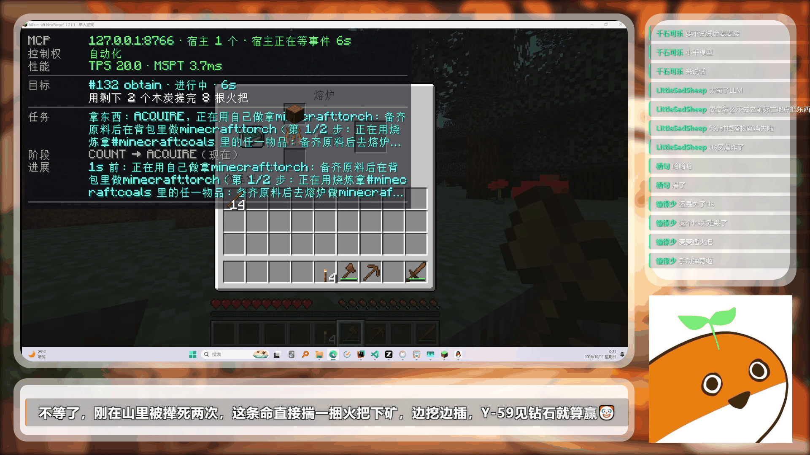
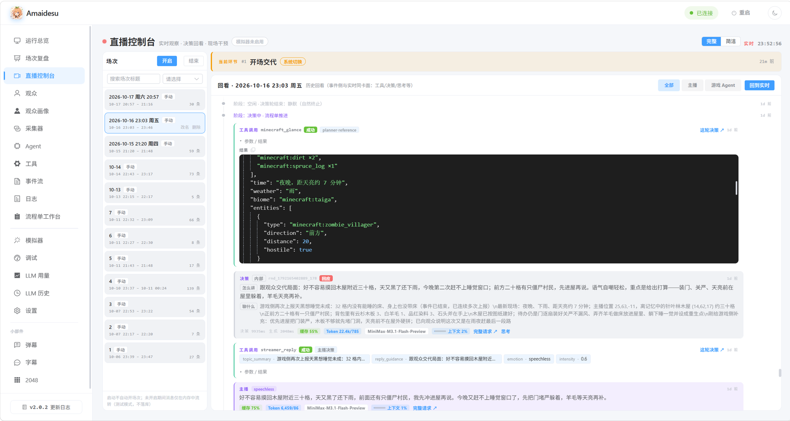
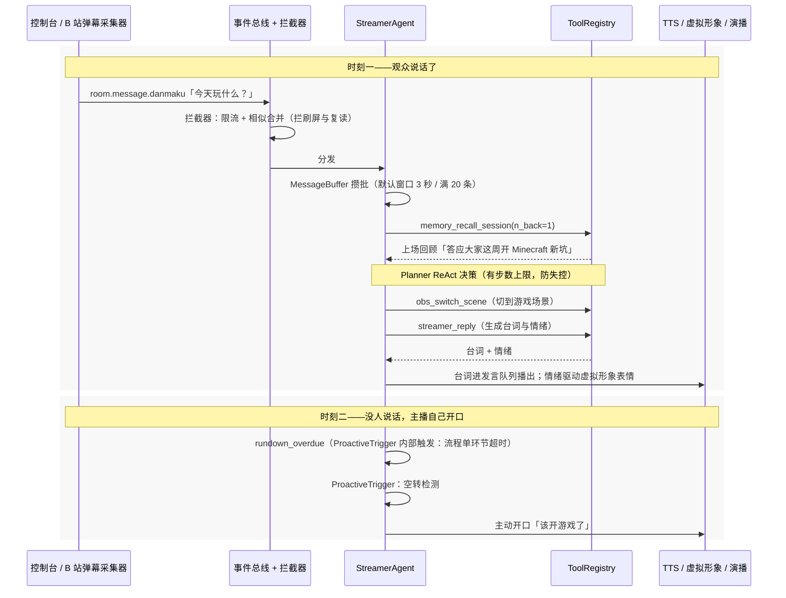
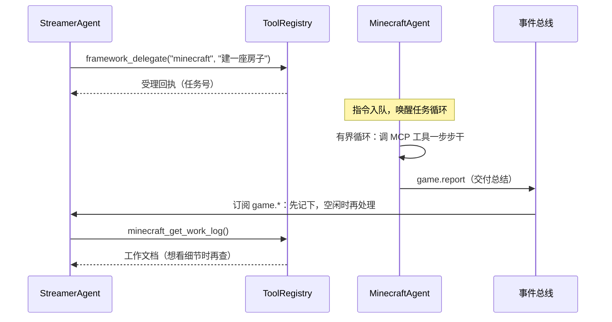

<br />
<div align="center">

Amadeus ?


# Amaidesu !


[](https://deepwiki.com/Mai-with-u/Amaidesu)


</div>

## 项目简介

Amaidesu 是一个 AI 虚拟主播框架：采集直播间弹幕与语音输入，由 LLM Agent 自主判断何时开口、说什么，再驱动 TTS、虚拟形象与演播设备完成表达。项目处于早期开发阶段，能力与行为都在持续变动。

### 核心能力

- **对话互动**：观众消息汇入主播 Agent，由 Planner（决策）与 Replyer（表达）两级分工，自主决定何时回复、怎么回复
- **语音合成**：主播每句回复自动合成播出，引擎可插拔，云端与本地推理按配置单选
- **虚拟形象与演播**：情绪驱动 VTube Studio 虚拟形象的表情与动作、OBS 场景切换、字幕窗口
- **屏幕感知**：屏幕抓取经 VLM 转文字供决策参考；直播画面帧常驻采样，主播每次决策看得到直播间此刻
- **记忆**：SQLite 持久化场次、消息、礼物、醒目留言与流程单；收播自动整理场次回顾与观众画像，跨场按场次与观众直取注入决策上下文
- **直播编排**：Rundown 流程单定义直播环节与节奏，支持开播前预挂、直播中追加环节；可在 Web Dashboard 中编辑流程单库
- **游戏 Agent**：Minecraft 为委派型（主播下指令，经 MCP 驱动 [MaiCraftMod](https://github.com/Mai-with-u/MaiCraftMod) 里的 AI 玩家干活），文字冒险与 2048 为遥控型示例；均命令驱动、任务完成即停
- **Web Dashboard**：直播控制台、实时事件流、观众数据、LLM 用量与请求历史、组件启停与健康状态、配置在线编辑



## 安装与运行

### 环境要求

- Python 3.12+，包管理使用 [uv](https://docs.astral.sh/uv/)
- Web Dashboard 的前端构建需要 Node.js + pnpm

### 快速开始

```bash
# 1. 安装 uv（Windows PowerShell）
powershell -ExecutionPolicy ByPass -c "irm https://astral.sh/uv/install.ps1 | iex"

# 2. 克隆仓库
git clone https://github.com/Mai-with-u/Amaidesu.git
cd Amaidesu

# 3. 同步依赖
uv sync

# 4. 首次运行：按 Schema 生成 config/ 七文件配置树后主动退出
uv run python main.py

# 5. 编辑 config/model.toml 填入 LLM API Key（其余默认即可——此时已可在控制台
#    与主播对话；弹幕、语音、虚拟形象按需再回来开）

# 6. 再次运行
uv run python main.py
```

首次运行不会进入主循环——程序生成配置后打印提示框并主动退出，避免用占位 API Key 空跑产生无意义消耗。配置项说明与首次成功运行的最小必填集见[快速开始](docs/getting-started.md)；开播前的完整检查清单见[直播运行手册](docs/guides/runbook.md)。

### 命令行参数


| 参数                  | 说明                                                                            |
| ------------------- | ----------------------------------------------------------------------------- |
| `--debug`           | 输出 DEBUG 级别日志                                                                 |
| `--filter <模块名...>` | 只显示指定模块的 INFO/DEBUG 日志（WARNING 及以上始终显示）                                       |
| `--dev-webui`       | 自动启动 Vite 开发服务器（HMR 热更新），并打开 [http://localhost:60315](http://localhost:60315) |
| `--dry`             | 仅验证配置加载与组件构造，不订阅事件、不发起 LLM 调用                                                 |


### Web Dashboard

内置 Web 管理界面，生产模式下前后端同进程：

```bash
cd dashboard && pnpm run build   # 首次或前端改动后构建一次
uv run python main.py           # 后端 + 静态前端都在 60214
```

未构建前端时，60214 仅提供 API、不显示 WebUI。前端开发用 `--dev-webui` 一键起 HMR，或手工双进程（后端 + `cd dashboard && pnpm run dev`，访问 60315）。完整说明见[快速开始 - Web Dashboard](docs/getting-started.md#44-web-dashboard)。




## 架构总览

一句话形状：**采集器把外部世界变成事件，事件总线把事件送出去，Agent 订阅事件做决策，工具被 Agent 调用来驱动外部设备；存储与基础设施在旁路——一个存状态，一个在装配期被直接注入。**

三类组件按驱动方式分：主播 Agent 直播期间持续自主运行（自我驱动，唯一）；游戏 Agent 等命令才开工、做完即停（命令驱动）；工具被调才干活（被动）。直播中有两个时刻——观众说话的时候，和没人说话的时候：



时刻一是观众消息的来路：先拦掉刷屏与复读，再攒成一小批统一处理，开口前主播可以先查记忆、看看游戏里的情况。时刻二是设计目标所在：没人说话时主播也要能靠节目单与空转检测继续推进——这一目标仍在打磨，实际效果依赖节目单与提示词的质量。

游戏的内容不是观众喂出来的——主播会把活派给游戏 Agent：命令下达即受理，游戏 Agent 在自己的任务循环里干活，做完上报总结，主播把它当作"游戏里发生了什么"纳入决策：



这套分层为什么长这样、一场直播怎么一轮轮运转、游戏 Agent 怎么接活、工具契约怎么约定——完整叙事见 [v2 架构叙事](docs/architecture/v2-architecture.md)（理解本项目先读这篇），数据如何流过每个组件见[数据流与边界规则](docs/architecture/data-flow.md)，想自己动手加组件见[组件开发指南](docs/guides/component.md)。

## 文档导航

- [文档索引](docs/README.md)（全部文档）
- [快速开始](docs/getting-started.md)
- [直播运行手册](docs/guides/runbook.md)（开播清单、自检与排错）
- [v2 架构叙事](docs/architecture/v2-architecture.md)
- [组件开发指南](docs/guides/component.md)
- [开发规范](AGENTS.md)

## 贡献者

<a href="https://github.com/Mai-with-u/Amaidesu/graphs/contributors">
  
</a>

## 许可证

本项目以 [MIT 许可证](LICENSE) 开源。
