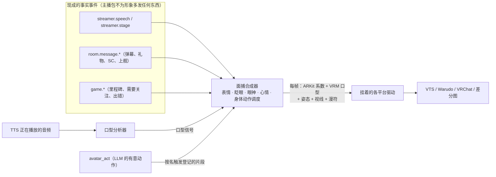
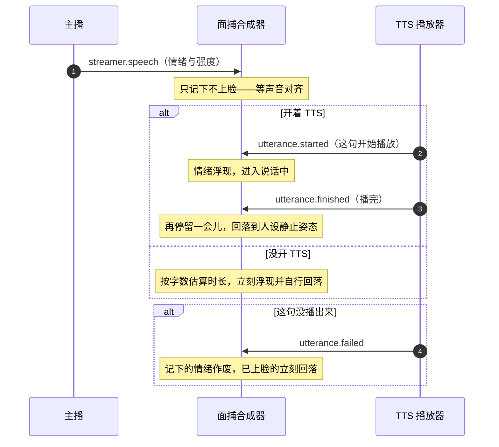

# 虚拟形象（Avatar）

虚拟形象模块让 AI 主播拥有一个可见的身体。AI 主播决定说什么、带什么情绪，本模块负责把它变成虚拟形象上的实际表现：变表情、动嘴、眨眼、看来看去、做动作。

支持四个平台：VTube Studio（简称 VTS）、Warudo、VRChat、表情差分图，用哪个由配置决定，可以同时开几个。代码在 `src/modules/avatar/`，配置文件是 `config/avatar.toml`。

> **怎么读**：想了解形象系统怎么工作，按顺序读本文前半（模块组成 → 驱动方式 → 各条驱动路）；要接入或排错某个平台，直接跳到[四个平台对比](#四个平台对比)与各平台机制小节，步骤与常见问题在[虚拟形象接入指南](../guides/avatar.md)；调参看[形象调校页](#形象调校页)与[配置与装配](#配置与装配)。

## 模块组成

- **面捕合成器**（`tracking/`）：替代摄像头的面部捕捉数据来源——AI 主播背后没有真人做面捕，它按配置帧率（`[tracking]` 的 `tick_hz`）逐帧算出"此刻脸和身体该是什么样"，交给挂在它上面的各平台驱动。
    - **每帧内容**：面部捕捉的通行规范——ARKit 的 52 个表情系数、VRM 的 5 个元音口型，加上头部与身体的姿态、视线，再加一小组风格化标记（脸红、眼泪这类漫符），和真人用 iPhone 面捕时得到的是同一套东西。
    - **谁在生成**：眨眼、眼神、头部微动、表情的起落、心情都在这里按规则生成；手臂与整体身体语言由它的身体动作调度层管，见[身体动作](#身体动作)。
    - **数据来源**：订阅发言、播放、思考、弹幕、游戏这些现成的事实事件，主播包不为形象多发任何东西。
- **平台适配器**（`platform/` 下的 `vts/`、`warudo/`、`vrchat/`、`expression_sheet/`）：各自管本平台的连接、工具面与动作登记，适配器之间互不依赖。
- **驱动**（各平台的 `tracking_driver`）：适配器把一个驱动挂到面捕合成器上；驱动只做一件事——把一帧规范通道写成本平台输入。模型相关的对应关系（哪个输入接模型的哪个部位）留在平台里调，和真人面捕时一样。
- **口型分析器**（`lipsync/`）：把 TTS 正在播放的音频实时分析成"嘴张开多大、在发什么元音"的信号，交给面捕合成器。分析结果不含任何平台专用参数名。
- **接口约定**（`protocol.py`）：每个平台适配器都实现同一组方法——设置表情、列出预设动作、触发预设动作，给控制台的调试台按平台直接试用。方法齐全即满足约定，不需要继承任何基类。



## 形象的驱动方式

| 方式 | 什么时候发生 | 效果 |
|------|------------|------|
| LLM 调工具 | AI 主播在决策中主动调用 | 做有意的动作（点头、摇头、看弹幕、模型做好的动画）、保持表情等 |
| 说话自动变表情 | 主播每发布一句发言 | 按发言携带的情绪和强度，这句话开始播放时浮现，播完后回落 |
| 口型同步 | TTS 播放语音期间 | 嘴巴跟着声音开合 |
| 自动小动作 | 面捕合成器每帧 | 没人互动时也有眨眼、眼神、头部的轻微动作，形象不僵硬 |
| 非说话时间的神态 | 主播在想、来了弹幕礼物、游戏里出事 | 思考时视线移开、先读弹幕；瞥一眼弹幕区；眼睛一亮、受惊、皱眉一缩 |
| 身体动作 | 情绪持续一会儿、想得久了、说话的短语开头、礼物与游戏事件 | 换站姿、偶尔摇一下身体或仰头笑、挥手庆祝 |

这几种方式由面捕合成器合成进同一帧（各管各的部位，不会互相覆盖），再发给所有挂着的平台。出错只记日志，不影响正常的说话和决策；面捕合成器推进一帧出错时换一台新的，从静止姿态重来。

### LLM 调用的工具

平时的表情、眨眼、眼神、说话时的点头都由形象自己完成，`reply` 的情绪就决定这句话的表情；主播只在想做一个有意的动作时调工具，工具名不带平台前缀：

| 工具 | 作用 |
|------|------|
| `avatar_list_actions` | 列出能做的动作：有意的动作、保持表情、手势，以及各平台登记的动作片段 |
| `avatar_act(action, emotion?, intensity?, seconds?)` | 做一个动作；`action="保持表情"` 时给出 emotion 与 seconds，演"假装生气一会儿"这类梗；名字写错时把目录随失败结果一起返回，LLM 据此自我纠正 |

平台适配器不向 LLM 暴露任何工具，平台上做好的动作作为片段登记到面捕合成器，由 `avatar_act` 按名字转回触发。主播多半把动作和 `reply` 放在同一步发出，而那句话要先合成几秒语音才开口；所以主播在想的时候发来的动作先记下，等这一轮的那句话开始播放时再做（像人边说边点头），这一轮不说话、那句迟迟没播出来，就先做、不无限等。

### 说话自动变表情

主播的每次发言都携带情绪标注（固定情绪清单里的一种，清单见 `expression.py`）和强度。这条路不依赖 TTS——没开语音，表情照样变。

每个情绪展开成一份配方，同时作用在脸、眼神、头部上，带浮现、保持、回落的时间曲线。开着 TTS 时，发言事件只把情绪记下，等这句话真正开始播放才浮现，播完再停留一会儿回落到人设静止姿态；没开 TTS 时按字数估算说多久。调度规则防止切换太频繁：同族相近只延长；换别的表情要等当前表情停留够最短时长；惊、怕这类强情绪可以打断。



表情还会慢慢累积成心情（愉快度与兴奋度两个慢变维度，没有新刺激时按半衰期缓慢回落）。心情作用在所有表情之下：连着几句开心的话后，句间的静止脸也带着笑；兴奋时眼睛略睁大、多动；打累了眼皮略沉、动作变慢。调参在 `[tracking]` 的 `mood_*`。

一次反应里情绪转了时（先吓一跳、再发现虚惊一场），即时反应会把它拆成两三句、每句带自己的情绪，排在同一段落里逐句播放。面捕合成器本来就是每句等开始播放才上脸，相近的情绪由调度规则合并、不会来回切。没开语音时几句合成一句发出，情绪取第一句。

### 口型同步

TTS 播放器把正在播放的音频实时递给共享口型分析器，面捕合成器接收口型信号：说话时下巴开合与元音口型只听口型分析器，元音顺带出撮唇、咧嘴；嘴角仍归表情。各平台怎么用：

- VTS：写下巴、张嘴与元音输入（`VoiceA`~`VoiceO`）；
- Warudo：下巴与嘴唇系数随面捕数据发出（启用时应关闭 Warudo 自带的音频口型，避免两边打架）；
- VRChat：内置口型参数只读、OSC 写不了，VRChat 按麦克风声音自己算口型，把 TTS 声音接到虚拟声卡当作 VRChat 的麦克风即可；做了面捕参数的形象另外收到下巴与嘴唇参数。

### 自动小动作

面捕合成器的眨眼（频率随状态变化：说话时多、读弹幕时少，闭合快、睁开慢）、眼神微动（偶尔瞥向别处再看回来）、头部漫步（随机节奏，刻意不用正弦波），以及说话时的韵律：音节起点轻点头、短语开头偶尔挑眉、说完有时点一下头。VRChat 写不了头部转动，只有眨眼和眼神。

### 非说话时间的神态

AI 主播大量时间不在说话：Planner 在想下一句、在看弹幕、在玩游戏。面捕合成器订阅现成的事实事件，让这些时间也有符合情境的神态：

| 事件 | 形象的反应 |
|------|-----------|
| `streamer.stage` 进入 planning（开始想） | 刚进入时有弹幕，就先看着弹幕区读一会儿（眼神一行行移动、眨眼变少），再把视线移向侧上方、眉心微紧、动作放慢；想得久了偶尔看回镜头一下。一开口或回到 idle 就结束 |
| 弹幕到达 | 瞥一眼弹幕区再看回来（正在想、正在说时不瞥；两次之间随机拉开间隔，防左顾右盼） |
| 礼物 / SC / 上舰 | 瞥一眼弹幕区，眼睛一亮、嘴角上扬（上舰最明显） |
| `game.milestone` / `attention_required` / `error` | 眼睛一亮 / "诶？"一下抬眉睁眼 / 皱眉一缩低头——比主播开口说这件事早好几秒，像人"先一惊、再开口" |

这些反应是叠在表情之上的短促动作，不进表情调度：不会打断正在说的那句话的表情。每类反应都有单独的开关。

### 身体动作

面捕数据只管脸、头和躯干的前后左右，手臂和整体的身体语言要靠成套的动作：Warudo 自带的人形动画、VTS 上画师做的动作文件、VRChat 的动作菜单。面捕合成器定了一小套平台无关的动作名，只决定"什么时候做哪个"，平台驱动各自翻译，做不到的跳过：

| 类别 | 什么时候做 | 节制 |
|------|-----------|------|
| 站姿（双手放在身前、单手叉腰、挠后脑勺、思考……） | 跟着持续的情绪：主表情保持一会儿才换；Planner 想得久了摆思考站姿，一开口就放下 | 换上后至少停一段时间；情绪回到平静过一会儿才回普通站姿 |
| 叠加动作（左右摇一下身体、开心时仰头笑） | 说话的短语开头（按口型信号判断） | 各自有最短间隔，两个叠加动作之间也隔开，不会变成打拍子 |
| 手势（挥手、双手挥、指一下、举拳庆祝） | 礼物挥手，SC、上舰双手挥，游戏里程碑举拳；主播也能经 `avatar_act` 点名 | 同一个手势有最短间隔，主播点名的不受限 |

情绪对应哪个站姿在 `[tracking].body_stances` 里改，时间参数在 `[tracking]` 的 `body_*`（也可以在形象调校页上调）。面捕合成器停下时各平台回到普通站姿。各平台怎么做：Warudo 播自带动画库里的动画（`[platform.warudo.body_animations]` 可换）；VRChat 只做手势，对到动作菜单里的动作（`body_emotes`）；VTS 按 `body_hotkeys` 登记的热键触发，默认不登记。

眼神看向哪里取决于直播画面布局，三个目标都在 `[tracking]` 里设：镜头方向（`camera_gaze_x/y`，镜头或观众视线不在形象正前方时调）、弹幕区方向（`chat_gaze_x/y`）、思考时望向的落点（`thinking_gaze_x/y`，`thinking_gaze_mirror` 关掉后只看这一侧，比如另一侧是游戏画面）。视线偏到边上时头跟着转多少由 `head_follow_deg` 决定。这些最好在[形象调校页](#形象调校页)上对着画面拖。

## 四个平台对比

| | VTS | Warudo | VRChat | 表情差分图 |
|---|-----|--------|--------|-----------|
| 连接方式 | WebSocket（localhost:8001） | 面捕数据 UDP（127.0.0.1:49983）+ 蓝图通道 WebSocket（localhost:19190） | UDP OSC（127.0.0.1:9000） | 无（控制台小部件页取图） |
| 每帧写什么 | VTS 捕捉输入，照 VBridger 规范换算 | iFacialMocap 面捕数据（ARKit 系数 + 头部转角与位置 + 眼球转角） | 官方眼动输入 + VRCFaceTracking 面捕参数 | 不逐帧：显示此刻主表情对应的那张图 |
| 模型映射在哪调 | VTS 的模型设置 | Warudo 的面捕设置 | 形象上的面捕参数 | 每个情绪一张图 |
| 预设动作 | VTS 热键 | 蓝图动作（抛鱼 + 配置登记的动作） | 写形象动作参数（默认 SDK 模板的 `VRCEmote`，参数名和动作表可配置） | 无 |
| 身体动作 | 登记了热键的才做 | 站姿、叠加动作、手势都做（Warudo 自带动画） | 只做手势（动作菜单） | 无 |
| 风格化标记 | 表情文件或自建输入 | 经蓝图写模型形状 | 写形象参数 | 无 |
| 断线处理 | 自动重连 + 健康检查 | 蓝图通道自动重连；面捕数据无连接 | 无需（UDP 无连接概念） | 无 |
| 头部转动 | 支持 | 支持 | VRChat 不开放写入 | 无 |
| 字幕显示面 | 无 | 无 | 头顶聊天框（可关） | 无 |

平台不自建字幕源：字幕由独立的字幕模块统一选源。平台自带的显示面（目前只有 VRChat 头顶聊天框）登记为字幕服务的又一个后端，跟随同一个字幕源；聊天框单条最多 144 字（VRChat 平台硬限制），两条之间有最小发送间隔（`chatbox_min_interval_ms`），间隔内只发最新一条。

## 平台无关边界

主播 Agent 的代码里搜不到任何平台名——这是有验收标准的硬约束：`grep src/agents/streamer/` 必须零命中 `vts` / `warudo` / `vrchat`。主播只发布"我说了一句话，情绪是 X"这样的事件；怎么把它变成脸上的表现是面捕合成器的事，怎么写成具体平台的输入是驱动的事。

新增一个平台的验收清单：

1. 写一个驱动（`name` / `ready()` / `apply(frame)`），把一帧规范通道写成本平台输入，挂到面捕合成器上；平台上做好的动作经 `register_clips` 登记
2. 实现接口约定的全部方法，通过接口约定测试
3. 风格化标记按"标记名 → 平台资源"登记，没有就如实说明不支持
4. 在 `tools/bootstrap.py` 与 `config/registry.py` 两处登记

## 各平台机制要点

接入步骤、模型准备与常见问题在[虚拟形象接入指南](../guides/avatar.md)；这里只留各平台与系统交互的机制要点。

**VTS**：经 WebSocket 插件 API 连接，首次连接在 VTS 里弹窗授权、token 存 `data/vts_token.txt`。VTS 每渲染一帧才处理一次排队的请求，所以逐帧注入发出即返回、不等回复；后台按固定周期检查连接健康与模型变化。断开前驱动先发一帧静止姿态收尾——VTS 会一直保持最后收到的值，不收尾形象会停在半闭眼。

**Warudo**：Warudo 自带 iPhone 面捕 App iFacialMocap 的接收器，驱动把每一帧按该协议经 UDP 发给它——Warudo 把面捕合成器当成一部正在抓脸的 iPhone，用自己的面捕流程（标定、平滑、形状映射）落到模型上。协议里没有身体字段：身体的前倾后缩写成头部位置，Warudo 按头部位移与转角自己带动身体，所以身体转角不发。另有一条 WebSocket 蓝图通道，只管面捕数据装不下的东西：身体动作（站姿、叠加动作、手势，播 Warudo 自带 AGIA 动画库）、动作片段（抛鱼与登记的蓝图动作）与风格化标记。

**VRChat**：OSC 接口能写的只有官方眼动输入、形象作者自定义参数（`/avatar/parameters/<名字>`）和与形象无关的聊天框、移动输入；口型、手势、头部等内置部分只读——所以口型靠把 TTS 声音接进虚拟声卡让 VRChat 自己算，手势走形象的动作参数表。眼动直发官方输入（左右按"画面右边是形象自己的左边"取反）；做面捕参数的形象按 VRCFaceTracking 的 `FT/v2` 简化参数名换算 ARKit 系数，只发变化了的值。

**表情差分图**：静态立绘形象，每个情绪一张差分图（文件名即情绪名），由小部件页 `/widget/expression_sheet` 显示、嵌进直播软件当浏览器源。显示哪张图跟着面捕合成器此刻的主表情走：语音开始播放才换、播完停一会儿再回落，`avatar_act` 的"保持表情"直接生效。差分图只有一张张整图，表情强弱、眨眼、口型画不出来，所以不挂逐帧驱动，也不向 LLM 暴露工具。

## 形象调校页

控制台侧边栏的"形象调校"用来看着形象调面捕合成器，面捕合成器装配了就能用：

- **实时通道**：显示面捕合成器此刻发给平台的各通道值；打开"手动摆姿"后每个通道变成滑条，直接指定值试效果，关掉或离开页面后几秒内交还给自动行为；
- **眼神目标**：在方框里拖镜头、弹幕区、思考三个点，形象边拖边看过去；
- **表情配方**：选一个情绪，按通道改它满强度时的偏移，可以边调边预览。键用 ARKit 系数名（去掉 Left / Right 是双侧简写，如 `mouthSmile`）、姿态通道名和风格化标记（`marker_tears` 等）。改过的情绪写成 `[tracking.recipes.<情绪>]`，整份替换默认配方（浮现快慢不变），没写的情绪用默认配方；
- **人设与行为**：静止时的嘴角、眨眼频率、心情、表情停留等调参，以及挂着的平台驱动的校准项；
- **动作**：点头、摇头、VTS 热键等，和主播调 `avatar_act` 走同一个目录。

页面上的改动只在运行中生效，点"保存到配置"才写回 `avatar.toml`；没保存就重启会回到文件里的值，页面顶部会提示。

## 配置与装配

`config/avatar.toml` 结构（本文件内的段，在项目其他文档中带文件名记作 `[avatar.platform]`、`[avatar.lipsync]`）：

```toml
[platform]
enabled = ["vts"]        # 启用哪些平台，合法值：vts / warudo / vrchat / expression_sheet

[platform.vts]           # 各平台自己的参数：地址端口、VTS 的模型校准项等
# ...

[lipsync]                # 口型分析器调参（与具体平台无关）
# ...

[tracking]               # 面捕合成器调参（帧率、眨眼、眼神目标、头部微动、表情起落、心情；与具体平台无关）
# ...

[tracking.recipes.happy] # 按人设改某个情绪的表情配方（通常在形象调校页里调好再保存）
# ...
```

- 每个配置键的权威定义在各组件代码的 ConfigSchema 里（Pydantic）；改配置结构须走配置系统的版本与迁移流程
- 启动时按 `enabled` 名单装配：名单外的平台完全不加载，工具也不注册

## 相关文档

架构决策：

- [ADR-052：面捕合成器](../decisions/052-avatar-tracking-synthesizer.md)
- [ADR-023：平台无关边界](../decisions/023-avatar-platform-agnostic-boundary.md)
- [ADR-024：口型帧级通道](../decisions/024-lipsync-frame-channel.md)
- [ADR-025：字幕单一来源](../decisions/025-subtitle-single-source.md)
- [ADR-026：虚拟形象工具约定](../decisions/026-avatar-tool-surface-contract.md)
- [ADR-028：虚拟形象配置文件](../decisions/028-avatar-domain-config-graduation.md)
- [ADR-053：形象动作工具](../decisions/053-avatar-act-tool.md)
- [ADR-054：面捕规范词表](../decisions/054-avatar-standard-face-vocabulary.md)
- [ADR-056：风格化标记](../decisions/056-avatar-style-markers.md)
- [ADR-057：各平台移植](../decisions/057-avatar-platform-drivers.md)
- [ADR-060：身体动作层](../decisions/060-avatar-body-layer.md)

其他文档：

- [虚拟形象接入指南](../guides/avatar.md) — 各平台接入步骤、模型准备与常见问题
- [事件系统](event-system.md) — 主播发言、TTS 播放事件的语义
- [数据流与边界规则](../conventions/data-flow.md) — 情绪如何到达虚拟形象、口型音频从哪里来
- [v2 架构叙事](v2-architecture.md) — 工具类组件的判据
- 事件名常量、配置 Schema、目录结构以代码为唯一事实源（`src/modules/events/names.py`、`src/modules/config/avatar_schemas.py`、`src/modules/avatar/`）
