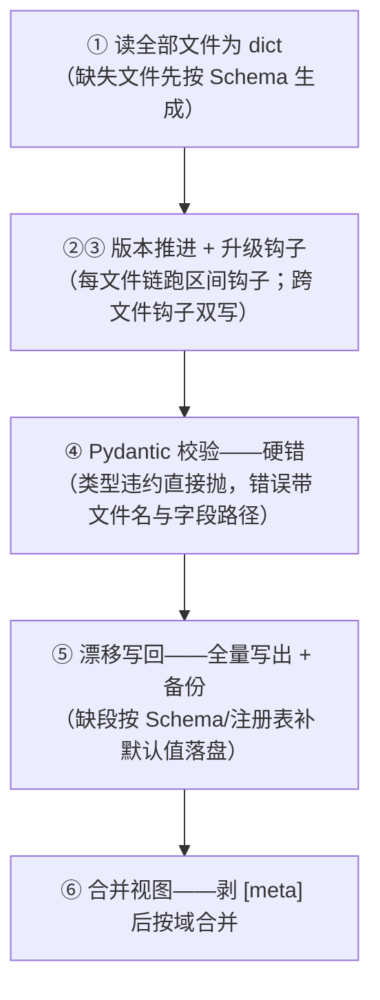

# 配置系统

配置系统是"Schema 即真相"的单管线：配置项的形状由 Pydantic Schema 定义，配置文件的生成、校验、迁移、写回都从同一份 Schema 推导。`config/` 目录下的七个 TOML 文件是**用户唯一契约面**——启动迁移完成后，文件里就是可配置全集的物化快照，用户看文件（或 WebUI 读文件）即知全集；不认识的键会被硬错拦下，不存在静默剥离。

权威入口在 `src/modules/config/`。本文讲七文件怎么组织、加载管线怎么跑、版本迁移怎么推进、WebUI 怎么读写。

想干什么读哪节：

- 想知道有哪些配置文件、各管什么——[七文件布局](#七文件布局)
- 想知道启动时文件怎么被加载校验——[加载管线](#加载管线)
- 想改配置结构（加字段、改键名）——[版本流与升级钩子](#版本流与升级钩子)
- 想知道为什么手写了没人认的键会启动失败——[未知即硬错](#未知即硬错)
- 想知道采集器 / Agent / 工具提供者的动态段怎么校验——[组件注册表](#组件注册表)
- 想在代码里读配置——[两份视图](#两份视图)
- 想知道改了文件之后哪些生效哪些要重启——[热重载与热生效](#热重载与热生效)
- 想接 WebUI 的配置读写——[WebUI 契约](#webui-契约)

## 七文件布局

`config/` 下七个 TOML 文件按领域拆分：

| 文件 | 管什么 |
|---|---|
| `agents.toml` | 业务 Agent（主播人设、上下文、后台维护等） |
| `collectors.toml` | 采集器（启用名单 + 各采集器段） |
| `tools.toml` | 工具提供者启用与配置 |
| `avatar.toml` | 虚拟形象（平台启用名单 + 平台成员段 + 口型共享件） |
| `model.toml` | 模型三层配置（连接 / 模型注册 / 用途档） |
| `storage.toml` | 存储 |
| `infra.toml` | 基础设施（TTS、字幕、事件、拦截器、控制台、日志、模拟器） |

布局清单（scope 名、文件名、顺序）的单一事实源是 `layout.py` 的 `CONFIG_SCOPES`——加载管线、配置服务、WebUI 分组都按这份清单工作。**清单顺序即权威顺序**：它同时是加载管线处理各文件的次序，跨文件迁移钩子依赖这个次序保证"先搬家、后做数据变换"。

各文件自带一个 `[meta]` 段，承载该文件自己的结构版本（见下文版本流）。版本字段只读——由升级流程自动推进，用户与 WebUI 都不改它。

## 加载管线

启动加载走单管线（`multi_file_loader.py`），按固定阶段执行：

要点：

- **校验失败必须硬错**，不存在降级路径；加载失败由上层翻译为启动失败。硬错消息带文件名与字段点分路径，是用户修正配置的入口。
- **漂移写回**：文件与 Schema 的偏差在写回时修复——缺失段按 Schema 默认值补齐落盘（首次生成、单缺重建都走这条），冗余项报警告。写回前整目录备份（按批次建备份目录，同秒批次加序号防覆盖）。
- **自写压标**：管线写盘前登记自写标记，文件监视器消费时据此跳过——配置系统自己写盘产生的事件不触发重载（防重入放大）。
- **动态键子段**的校验与补全不在中央 Schema，走组件注册表分发（见 [组件注册表](#组件注册表)）。

## 版本流与升级钩子

每个配置文件的 `[meta].version` 是**该文件自己的**结构版本，版本流彻底独立：一个文件的版本只随作用于它的升级钩子推进，无钩子则保持原值，文件之间互不联动——不存在"单版本号管全部文件"。

- **钩子两类**：单文件钩子（原地改 dict、返回变更路径、幂等）与跨文件钩子（声明目标文件，运行时同时拿到两个文件的 dict 双写，目标文件版本同步推进）。跨文件搬家只此一条机制，无独立通道。
- **调度规则**：读当前版本 → 跑该文件所有"旧版本 < 目标版本"的钩子（按目标版本升序）→ 版本戳推进到最后一个已执行钩子的目标。文件版本超前于全部钩子时自然零变更；没有适用钩子的文件版本保持原值。
- **钩子的目标版本**是该文件自身版本流内的坐标：新钩子取该文件链上界的下一位，与主程序发布版本号无关——配置版本流与发布版本同自 2.0.0 起步、此后各自独立递进，两套序列无关。新生成文件的初始版本只是落盘种子，不参与既有文件的推进调度。
- **钩子的写法分两档**：大多数钩子是"导航到嵌套段 → 删键 / 删段 / 按旧默认改写 / 键改名 → 返回变更路径"的同构体，用声明式词汇按数据表形态构造；真正定制的（跨文件搬迁、值换算）保留为函数。登记处的钩子名字即测试与检索的锚点。

**结构变更的操作分级**由此而来：

- **纯新增字段零成本**：不写钩子不升版本——漂移写回自动补默认值。
- **数据变换**（字段重命名、段拆分、类型转换、退役）：升该文件的版本 + 注册升级钩子 + 配迁移测试；涉及默认值变更时，钩子内区分"用户显式设置的值"与"旧默认落盘的值"，不得覆盖用户显式配置。
- **升版本 ≠ 迁移生效**：钩子注册了不等于迁移真的会发生——提交前实际验证迁移写回落盘，只改 Schema 不升版本 / 不验证迁移是此机制的最高频事故形态。

**忘配钩子的后果是启动硬错**：键改名 / 退役场景必须由钩子先行搬走旧结构；走过钩子后仍抵达校验的未知条目，只可能是钩子欠账或手写笔误，两种都被 [未知即硬错](#未知即硬错) 拦下。

## 未知即硬错

文件里任何 Schema / 注册表不认识的条目——段、启用名、字段键——一律加载期校验失败拦下：错误信息点名条目、给出合法名单与出路提示。不做静默剥离，不做警告跳过。

这条规则的立足点：配置文件是用户唯一契约面，静默忽略一个键等于用户以为生效了实际没生效。硬错把"写错的键"从运行期隐患变成启动期一眼可见的修正任务。

## 组件注册表

动态键配置段（键名运行期确定、每键一份 Schema）的校验与默认值补全不走中央 Schema，走**注册表**分发：

| 注册表 | 对应段 | 说明 |
|---|---|---|
| 采集器表 | `collectors.toml` 各采集器段 | 该文件的段全集判定只认这张表 |
| Agent 表 | `agents.toml` 的 Agent 子段 | 承担启动断言与 Schema 服务；段本身由 typed 字段直连承载 |
| 工具提供者表 | `tools.toml` 的二层身份键段 | 成员身份 = 装配目录的（分类段，提供者键） |

机制要点：

- 注册表模块是**纯容器**，不 import 任何组件包；表的填充单一源在装配层目录（`component_catalog`），依赖方向从目录指向配置侧，配置不反向依赖组件实现。
- **启动断言**：空表（填充入口没跑）或采集器与 Agent 名单交集非空（名单混入错误宿主）都启动失败。采集器文件是唯一靠名单干活的文件，混入 Agent 名会让物化把 Agent 段写进采集器文件。
- 采集器 Schema 必须可默认构造——物化按注册表补缺段依赖此前提；"未配置"用空串 / 零占位表达，不能靠约束表达式表达必填。
- **静态命名段**不走注册表：直接在聚合 Schema 里按类型引用包内 Schema（如视觉提供者的 config 段）。

## 两份视图

配置服务（`ConfigService`）持有两份视图，读取按需选：

- **拍平合并视图**：七文件按固定顺序合并为顶层键视图，点分路径访问（`get_section`）。多数消费方用这份。
- **按文件视图**：拍平会丢掉"哪个键属于哪个文件"，需要文件级命名空间时用它（`get_file_section`）——采集器文件的根键就是启用名单加各采集器同名表，拍平后取不到"这一个文件的这一段"。

**重载是两份缓存的唯一共同前进点**：热重载时两份一起刷新。只前进合并视图的话，按文件视图的消费方会读到开服旧值（曾实际造成开播守卫把刚关掉的开关当成还开着）。

## 热重载与热生效

`FileWatcher`（watchfiles 封装）监听七文件，变更经自写抑制过滤后触发重载：

- **重载失败保留旧配置继续运行**（不打断直播），失败只记日志。
- **重载只前进内存视图**。组件都是构造期快照，要吃到新配置须重启进程——重载后照实提示"待重启"，不假装生效。
- **热生效的唯一形态是组件重建**：组件域文件（agents / collectors）在 WebUI 保存路径注入组件重建上下文，按新配置"停 → 重新实例化 → 启动"，保存即生效。装配类配置（连接、端口、停用名单等）一律重启生效。生效分类的单一事实源是重载策略表（`SCOPE_RELOAD_POLICY`），配置写路径的热生效分类从同一张表推导，不另立清单。

接缝决策（为何热重载只到"内存视图 + 组件重建"为止、infra 归入重启段）见 [ADR-049](../decisions/049-hot-reload-seam-retirement.md)。

## WebUI 契约

WebUI 侧（`webui.py`）把七文件根 Schema 适配为前端可消费形态，读写各有契约：

**读**：

- Schema 树从 Pydantic 自动生成（`schema_generator.py`），字段类型、约束、默认值、嵌套结构全部来自 Schema 本身，前端不手写表单定义。
- 寻址约定：域前缀 + 文件内点分路径（如 `infra.dashboard.port`），与合并视图的扁平寻址一致。
- **敏感值遮蔽**：密钥类字段不下发明文，只发占位文案；回写占位同值会被拒绝——前端无法靠回写把占位符存进配置。

**写**（统一写管线）：

- **事务前置**：键级变更先并入内存文档校验，**全部文件校验通过后再逐文件落盘**——任一校验失败磁盘零写入。
- 校验通过的变更走与加载管线同一套写回（Schema 校验 → 全量序列化写回 + 备份 + 自写压标）。
- 写盘完成按生效分类触发重载或提示重启（见 [热重载与热生效](#热重载与热生效)）。

## 相关决策

- [ADR-014：配置文件按领域拆分](../decisions/014-config-six-file-refactor.md)
- [ADR-022：列表配置一等公民](../decisions/022-list-config-as-first-class.md)
- [ADR-027：动态配置段统一注册表机制](../decisions/027-dynamic-config-section-registry.md)
- [ADR-028：avatar 配置迁出 tools 域——第七配置文件](../decisions/028-avatar-domain-config-graduation.md)
- [ADR-048：组件身份单一源——装配层目录表](../decisions/048-component-identity-catalog.md)
- [ADR-049：热重载回调接缝退役——infra 归入重启段](../decisions/049-hot-reload-seam-retirement.md)
