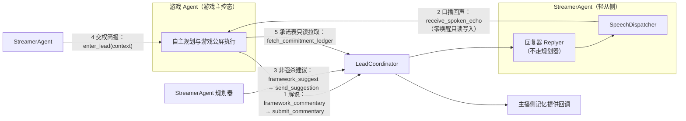

# 动态主从

> 主播 Agent（`StreamerAgent`）与自主领航型游戏 Agent 之间的主控权动态移交机制。系统在运行期只有两个主控态——**主播主控**与**游戏自主主控**，同一时刻至多一个主控方；切换由框架单例 `LeadCoordinator` 串行执行，双方协作只走五束单向契约，任何一束都不构成回流闭环。
>
> **怎么读**：想搞清两态各管什么，看[两态分工](#两态分工)；想改什么时候交权、什么时候收权，看[主控权怎么切换](#主控权怎么切换)；想改交接时给游戏侧看什么，看[交权简报与收尾摘要](#交权简报与收尾摘要)；想改跨 Agent 的某条通路，看[五束单向契约](#五束单向契约)；想改游戏主控期主播还能动哪些工具，看[游戏主控态的工具面切换](#游戏主控态的工具面切换)；想改出声抢占与急停，看[四档发声优先级与两级语音打断](#四档发声优先级与两级语音打断)；想回退这套机制，看[配置与回退](#配置与回退)。取舍背景见文末[相关决策](#相关决策)。

## 两态分工

运行时主控态只有两态，`LeadCoordinator` 维护的不变量是：任一时刻要么 `mode = "streamer"` 且无主控游戏，要么 `mode = "game"` 且主控者为某个已注册游戏 Agent（`src/modules/agents/lead.py`，`LeadCoordinator` 类 docstring）。

| | 主播主控态 | 游戏自主主控态 |
|---|---|---|
| 谁驱动 | 主播 Agent（唯一自我驱动主体） | 自主领航型游戏 Agent（自身持续决策循环） |
| 覆盖场景 | 待机调试、开场问候、纯杂谈环节、遥控型/委派型游戏、下播收尾，以及游戏断连或不健康时的降级态 | 流程单游玩环节且游戏就绪时的游玩推进 |
| 主播做什么 | 全权主导话题、弹幕互动与口播；按委派模式调度游戏 | 退居轻从侧：独享直播间输入并口播回复观众、润色游戏发来的实况解说、低频冷场兜底 |
| 游戏做什么 | 待命，或作为委派执行者按单干活 | 主导游戏内目标规划、执行与游戏公屏交流；环节到点自主推进流程单 |
| 直播间输入 | 一直归主播（任何主控态下直播间采集流都只接主播 Agent） | 主播承接，游戏侧不读直播间弹幕 |
| 游戏输入 | 经委派与递话通道进主播决策 | 公屏与身体事件直接驱动游戏 Agent，不进主播规划器 |

两态都不改变的骨架事实（对齐[架构红线](../../AGENTS.md)）：

- 直播场次生命周期、流程单编排、观众身份与跨场记忆、下播整理，以及唯一出声出口（TTS 播音、字幕、虚拟形象口型）永久归主播 Agent，游戏 Agent 不接管也不旁路。
- 框架层与主播侧不写死任何游戏名：候选发现、契约桥接、工具可见名单全部按 `BaseAgent` 协议成员与运行态判定。

### 自主领航型游戏交互形态

游戏 Agent 通过一个类属性加一个方法向框架声明自身支持自主领航（`src/modules/agents/base.py`）：

- `supports_autonomous_lead: ClassVar[bool]`——声明位，默认 `False`；未覆写协议成员的既有 Agent 因此天然不支持，行为完全不变。
- `can_take_lead()`——运行态就绪判定，由 `LeadCoordinator` 在每次切换前现查。`MinecraftAgent` 的实现（`src/agents/minecraft/agent.py`）要求三个条件同时成立：本场已开播、MCP 已连接且游戏工具可用、LLM 可用且未因连续失败进入冷却。

另有配套协议成员：`enter_lead(context)`（接管主控）、`yield_lead(reason)`（交回主控并回报摘要）、`receive_suggestion(...)`（收非强杀建议）、`receive_spoken_echo(...)`（收口播回声）、`receive_rundown_update(...)` / `receive_rundown_nudge(...)` / `receive_silence_nudge(...)`（收流程单与静默提醒）、`query_short_term_memory(...)`（本场短期记忆查询）。

## 主控权怎么切换

### 切换的执行者：LeadCoordinator

`LeadCoordinator`（`src/modules/agents/lead.py`）是组合根单例，持有 `AgentManager` 与 `EventBus`，对具体游戏名零感知。三条不变量（代码类 docstring 原文归纳）：

1. 任一时刻至多一个主控者。
2. 全部切换动作在 `asyncio.Lock` 内串行执行，同状态重复请求幂等、不重发事件。
3. 跨 Agent 协作只走回调注册与基类协议，协调器不反向 import 任何具体 Agent 包。

切换入口有四个，全部锁内串行、锁外广播事件：

| 入口 | 何时用 | 行为 |
|---|---|---|
| `request_game_lead(context, target, reason)` | 主播侧自动评估后申请交权 | 校验开关与人工覆盖 → 解析目标（显式指定 > 人工锁定 > 唯一就绪候选；多个就绪候选且未指定时拒绝盲选，维持主播主控）→ 若已有他游戏主控先收权 → 调目标 `enter_lead` |
| `reclaim_streamer_lead(reason)` | 流程单切回杂谈、下播、主播停用等 | 调当前主控游戏 `yield_lead` 收回，返回其收尾摘要；已在主播态幂等返回空串 |
| `notify_agent_unavailable(agent_name, reason)` | 游戏断连/故障/心跳静默不再就绪 | 仅当该游戏确为主控方时收权；只做运行态安全收权，不改动人工覆盖标记 |
| `set_override(target, reason)` | Dashboard 人工切换 | `auto` 解除覆盖不强制打断；`streamer` 锁主播并在需要时立即收权；具体游戏名校验就绪后构建简报交权并锁定覆盖，目标拒绝时回滚覆盖标记并抛错 |

换主控游戏时（A 主控 → 交 B）：先让 A `yield_lead` 有序收尾，内存态退回主播，再让 B `enter_lead`；B 拒绝接管时发一条回退方向的 `agent.lead.changed`（reason 形如 `fallback_after_refuse:<目标>`），保证观测事件与内存态一致。

### 交权的门禁（主播侧评估）

自动交权不是事件一响就切，主播 Agent 有一道统一的幂等评估 `_sync_lead_mode`（`src/agents/streamer/streamer_agent.py`），按顺序核：

1. `lead_mode` 配置同步到协调器开关（`streamer_only` 时协调器禁用，交权直接被拒）。
2. 任一前提不满足即收回主播主控：未开播、正在收播道别、配置为 `streamer_only`、人工覆盖锁定 `streamer`、或自动模式下流程单处于杂谈环节。人工覆盖锁定具体游戏时允许跨越杂谈环节，但下播、道别、机制禁用仍必收权。
3. 当前主控游戏已不再就绪（含就绪名单为空）→ 走不可用降级收权。
4. 全部条件满足且存在就绪候选才交权；自动模式下有多个就绪候选时不盲选，维持主播主控（要交给谁由人工覆盖指定）。

评估的触发源（谁会调 `_sync_lead_mode`）：

| 触发源 | 位置 |
|---|---|
| 开播初始化完成 / 下播 | `live.started` / `live.ended` 处理路径 |
| 流程单切段、续期、热切换、编辑保存 | 流程单协调器回调（reason=`rundown_changed`） |
| 候选游戏就绪广播（游戏侧开播置位或重连恢复后经 `notify_agent_ready`） | `_on_lead_agent_ready`；开播初始化进行中时跳过，由初始化末尾统一评估 |
| 周期巡检 | `_maybe_periodic_lead_sync`，带重试防抖（间隔常量 `_LEAD_SYNC_RETRY_INTERVAL_MS`，`streamer_agent.py` 顶部），并兜底检出主控游戏静默失就绪 |
| 人工入口 | Dashboard 写接口与 `sync_lead_mode()` 公开方法 |

### 切换时序

```mermaid
sequenceDiagram
    participant SR as 触发源（开播/流程单/就绪广播/巡检/人工）
    participant ST as StreamerAgent<br/>（门禁评估 + 简报构建）
    participant LC as LeadCoordinator<br/>（互斥锁内串行）
    participant GA as 游戏Agent<br/>（enter_lead / yield_lead）
    participant OB as 只读观察者与监听器

    SR->>ST: 触发评估 _sync_lead_mode
    ST->>ST: 核门禁（开播/道别/lead_mode/覆盖/环节）
    ST->>ST: 构建 LeadHandoverContext（交权简报）
    ST->>LC: request_game_lead(context, target)
    LC->>LC: 锁内：校验开关与覆盖、解析就绪候选
    alt 此前有他游戏主控
        LC->>GA: yield_lead(旧主控) → 收尾摘要
    end
    LC->>GA: enter_lead(简报)
    GA-->>LC: True（置位主控态，唤醒自主循环）
    LC->>LC: 落位 mode="game" / active_lead_agent
    LC--OB: 锁外广播 agent.lead.changed（含 handover_brief）
    LC--OB: 通知已注册切换监听器
    ST->>ST: _on_lead_changed：刷新工具可见名单、记进入时刻
    Note over GA: 游戏侧按 [主控交接简报] 开局自主推进
```

收权方向对称：触发源 → 门禁判定应收回 → `reclaim_streamer_lead` / `notify_agent_unavailable` → 游戏 `yield_lead` 回报收尾摘要 → 广播 `agent.lead.changed`（`mode="streamer"`，摘要在 `handover_summary`，`handover_brief` 为空）→ 主播监听器记摘要、必要时唤醒圆场。

### 切换事件与监听者

`agent.lead.changed`（`CoreEvents.AGENT_LEAD_CHANGED`，payload `AgentLeadChangedPayload`，定义在 `src/modules/events/payloads/agents.py`）是主控态切换的唯一观测事件，携带：切换前后主控名、`mode`、`reason`、当前人工覆盖、交权方向的 `handover_brief`（`LeadHandoverBrief`）或收权方向的 `handover_summary` 文本。场次归属由事件总线的场次盖章拦截器注入，控制台复盘与只读观察者都消费它。

主播侧监听器 `_on_lead_changed`（`streamer_agent.py`）做的事：

- 进游戏主控：记录进入时刻（冷场兜底的计时锚点）、清静默提醒冷却、清掉切环节瞬间挂起的旧主动信号（防止未来被动降级时误触发旧开场白）。
- 回主播主控：取消轻量进房欢迎通道、清进入锚点；收尾摘要记入游戏近况时间线并喂给即时反应的近期背景（主播下一轮自然接话）；若属开播期的异常被动降级（reason 不在有意收权名单且非 `manual` 前缀），置位游戏信号并唤醒主播圆场。

另有兜底 `_record_handover_summary_fallback`：协调器替身未回调监听器时，把收权摘要同文幂等去重地记进游戏近况。

## 交权简报与收尾摘要

**交权简报**（`LeadHandoverContext`，`src/modules/agents/lead.py`）是交权瞬间主播侧一次性生成的只读现场记忆摘要，随 `enter_lead` 传给游戏侧。构建在主播侧 `_build_lead_handover_context`（`streamer_agent.py`）：

| 字段 | 来源 |
|---|---|
| 环节 id / 标题 / 目标 / 预期时长 | 流程单协调器当前环节 |
| 存档名 | 只读刷新存档表后取目标游戏当前存档 |
| 记忆摘要文本 | 复用主播的记忆摘要（未了结承诺、上一场档案、运营备注）+ 该游戏当前存档的常驻社交事实渲染段 |
| 运营备忘 | 主播侧待处理的运营备注列表 |
| 最近台词 | 发声日志最近 3 句（给游戏侧做开场铺垫参考） |

构建器经 `bind_handover_builder` 绑定到协调器；人工覆盖切换与自动评估两条路都走它。构建失败或无构建器时回落到仅含 `reason` 的默认简报，不阻断切换。

游戏侧消费：`MinecraftAgent.enter_lead` 把简报格式化成 `[主控交接简报]` user 消息（`src/agents/minecraft/lead_mode.py` 的 `format_lead_handover_brief`）推入唤醒队列的固定层，作为自主开局的第一份材料。流程单在游戏主控期切段时，主播侧经 `publish_rundown_update` 把新环节同步过去，游戏侧原地刷新固定层简报并追加一条 `[流程单切换]` 通知，长场次不沿用开场旧环节描述。

**收尾摘要**：收权时 `yield_lead` 在取消在跑目标之前提取当前进度与未完事项（`MinecraftAgent.yield_lead` → `_summarize_current_progress`），随返回值交给协调器，再经 `agent.lead.changed` 的 `handover_summary` 与监听器回调两条路送到主播侧入账。

## 五束单向契约

所有跨 Agent 协作都是单向的，每束在接收端异常隔离，失败只降级不回传阻塞：



### 束 1：游戏主控 → 主播解说（`framework_commentary`）

- **谁发起**：当前主控的游戏 Agent，经框架工具 `framework_commentary(summary, mood, urgency, about_player, correction)` 提交 1–2 句客观现场要点（不替主播写台词）。
- **通道**：工具执行体在 `AgentControlProvider._invoke_commentary`（`src/modules/agents/control.py`）→ `LeadCoordinator.submit_commentary` → 主播侧绑定的处理器 `_handle_game_commentary`（`streamer_agent.py`）。
- **门禁**：只有此刻的主控者能提交；非主控调用返回 `not_in_lead` 回执（工具侧转为业务失败，附 human-readable 说明），不抛异常。工具仅对自主领航候选游戏 Agent 可见、绝不对主播暴露（`_commentary_spec` 的 `visible_to`），且仅当名册中存在候选时才注册。
- **主播侧处理**：串行锁保护；要点先记入游戏近况；普通档按最小出声间隔防抖，间隔内的要点进缓冲合并到下次一起说，`urgency="high"` 或纠偏（`correction=True`）穿透防抖立即播报；随后直接构造轻量决策计划调回复器润色（**完全不走规划器**，这是防环的核心：游戏侧出声请求不会反向拉起主播的重决策循环），过预算与敏感词把关后进统一发言管线，优先级按 urgency 取 P1 / P0。
- **失败表现**：回复器异常、空输出、被词表过滤等每条路径都返回结构化回执（`accepted` / `spoken` / `reason`）；处理器抛异常被协调器隔离成 `handler_error` 回执。每条退出路径（成功与每种失败）都发观测事件 `agent.lead.commentary`，直播控制台解说卡消费。

### 束 2：主播发声 → 游戏回声（`receive_spoken_echo`，零唤醒）

- **谁发起**：主播的发声出口。`SpeechDispatcher` 挂了一个发声监听，每真正播出一句面向观众的话就经 `LeadCoordinator.publish_spoken_echo` 转发。
- **通道**：同步方法直转，只在当前处于游戏主控态时投递给主控游戏 Agent。
- **防环**：游戏侧 `receive_spoken_echo`（`src/agents/minecraft/agent.py`）是纯同步写入——文本进一个有界滚动缓冲 `SpokenEchoBuffer`（`src/agents/minecraft/lead_mode.py`：去重、超长截断、留最近几句），**绝不置位唤醒事件**；缓冲内容在游戏侧下一次正常推理步被拼成 `[直播间刚说过]` 只读提示顺带参考，用于解说避重复与纠偏比对。转发侧异常只记日志，绝不反噬发声主链。

### 束 3：主播 → 游戏非强杀建议（`framework_suggest`）

- **谁发起**：主播规划器（观众点菜、提醒）或运营者（Dashboard 建议通道 `POST /api/v1/agents/lead/suggest`）。
- **通道**：工具执行体 `_invoke_suggest` → `LeadCoordinator.send_suggestion` → 主控游戏 `receive_suggestion`。
- **语义**：不创建委派账本、不调结单、不取消游戏在跑目标——只是把建议（可附来源观众原话，经宿主附件透传）送达游戏侧，由它自主决定立即执行、排进待办或搁置。游戏侧包装成 `[直播间建议]` 通知入队唤醒，且仅在主控态或有活跃任务时受理（`MinecraftAgent.receive_suggestion`）。
- **门禁与失败**：当前非游戏主控态 → `not_in_game_lead`（提示改用常规委派）；指定目标非主控方 → `target_not_leading`；游戏侧拒收 → `refused`。每条路径发观测事件 `agent.lead.suggestion`，控制台建议卡消费。

### 束 4：交权记忆摘要（`bind_handover_builder`）

见[交权简报与收尾摘要](#交权简报与收尾摘要)。方向是主播 → 游戏、一次性、只读；防环点在于简报只读不写——主播构建时不改游戏状态，游戏消费后也不经此通道回话。

### 束 5：权威承诺表只读拉取（`fetch_commitment_ledger`）

- **谁发起**：主控游戏侧组装尾部动态任务状态时按需调用。
- **通道**：`LeadCoordinator.fetch_commitment_ledger(game, save_id, player_uuids, limit)` → 主播启动期经 `set_commitment_ledger_provider` 注册的回调（主播侧 `_build_game_commitment_ledger`，读承诺表存储）。
- **返回**：按当前存档与在场玩家归一化成 `open`（未兑现承诺，含目标与进度）与 `closed_this_session`（本场已兑现）两组紧凑条目；两者皆空或回调异常一律返回空字典，不让空结构白占游戏推理上下文。
- **防环**：只读拉取、异常降级为空、不携带任何会触发主播决策的回调。

三束之外的补充旁路（同一注册机制，不属五束）：跨场被动记忆线索 `fetch_passive_cues`（游戏公屏合批或到达地标时拉取，游戏侧呈现为 `[脑中闪过]` 只读线索）、本场短期记忆聚合 `query_active_short_term_memory`（主播的回忆工具按它聚合主控与各候选游戏的本场记忆，私聊条目按隐私规则过滤）、流程单超时提醒 `publish_rundown_nudge`（按环节节流推送）与静默暖场提醒 `publish_silence_nudge`。

## 游戏主控态的工具面切换

主控切换后，主播与游戏的 LLM 工具表按当前主控态现算（框架工具提供者 `AgentControlProvider` 声明 `syncs_with_agent_roster = True`，名册与主控态变化时由 `ToolRegistry.refresh_provider_tools` 重算）：

| 工具 | 主播主控态 | 游戏主控态 |
|---|---|---|
| `framework_delegate` / `framework_task_settle` | 正常可用 | 指向主控游戏时执行期业务拒绝（`game_in_lead`，提示改用建议通道）；运营直派同样被拒 |
| `framework_commentary` | 不可见 | 仅当前主控游戏可见可调 |
| `framework_suggest` | 不可见 | 仅主播可见可调 |
| `rundown_control` | 主播可见 | 可见名单并入当前主控游戏（环节推进归当场主控）；游戏侧提示词只授权 `next` / `renew`，跳段与流程单内容编辑不在游戏侧授权内 |
| `streamer_memory_correct` | 主播可见 | 可见名单并入当前主控游戏（场内记忆更正跟随当场主控） |

框架工具的使用说明（`guide_for`）随主控态自动换文：主控游戏收到"用 framework_commentary 提交要点"的守则；主播收到"不要委派/强杀主控游戏、用 framework_suggest 转达"的守则（若还有非主控的委派型游戏，附常规委派守则）。主播规划器在游戏主控期还会跳过游戏相关参考段与游戏主动唤醒——普通游戏事件只入账、不进规划器（例外：高光里程碑仍交即时反应当场惊呼）。

## 四档发声优先级与两级语音打断

全部面向直播间的口播（主播回复、冷场暖场、游戏解说的润色成品）统一汇入唯一发言管线：`UtteranceQueue` + `SpeechDispatcher`（`src/agents/streamer/`）。四档优先级常量在 `utterance_queue.py`：

| 档 | 常量 | 装什么 |
|---|---|---|
| P0 | `SPEECH_PRIORITY_NORMAL` | 常规解说、冷场暖场独白 |
| P1 | `SPEECH_PRIORITY_HIGHLIGHT` | 高光即时反应、`urgency="high"` 解说、游戏公屏即时反应 |
| P2 | `SPEECH_PRIORITY_AUDIENCE` | 观众弹幕、礼物、醒目留言（SC）、上舰回复 |
| P3 | `SPEECH_PRIORITY_EMERGENCY` | 极急事件（非自选意外阵亡、紧急急停） |

决策轮到优先级的映射在 `decision_executor.py`（观众互动 P2、游戏触发 P1、其余 P0）；即时反应通路里阵亡/急停类映射到 P3 且允许硬打断（`mouth.py`）。

两级打断（实现与语义在 `utterance_queue.py` / `speech_dispatcher.py`）：

- **一级软打断（清待播）**：任何 `priority > P0` 的发言入队前，`interrupt_lower_priority` 移除队列中尚未开始播放且优先级更低的条目——P2 清待播 P0/P1，P1 清待播 P0。正在播段落的余句沿用 `tts.utterance.dropped(reason="segment_interrupted")` 并保留尾句回调；跨来源低优独立句发 `reason="priority_preempted"`。
- **二级硬打断（停正在播的 P0）**：仅当调用方显式开启 `allow_hard_interrupt=True` 且优先级到 P3 时，`hard_interrupt_playing` 先清低优待播，再仅当正在播放条目优先级不高于 P0 时取消该句播放子任务并立即停播声卡音频，发 `tts.utterance.dropped(reason="hard_interrupted")`（不计渲染超时、不终止队列循环）。正在播放的 P1 高光与 P2 观众回复绝不被硬打断。

冷场兜底分工：游戏主控期静默达到阈值时，主播侧先向游戏侧发 `[直播间静默提醒]`（`publish_silence_nudge`，按阈值自身时长冷却）；主播侧自身的冷场暖场兜底由配置开关控制（见[配置与回退](#配置与回退)），关闭时静默暖场由游戏侧承接。流程单环节超期则由主播侧按节流间隔推送 `[流程单超时提醒]`（`publish_rundown_nudge`，同一环节冷却窗口内的推送节流在 `LeadCoordinator`，间隔配置在流程单主动信号配置段）。

## 配置与回退

配置键在 `agents.toml` 的 `[agents.streamer]` 段（Schema：`src/agents/streamer/config.py`，默认值以 Schema 为准）：

| 键 | 作用 |
|---|---|
| `lead_mode` | `"dynamic"`（游玩期动态移交）或 `"streamer_only"`（始终主播主控） |
| `game_lead_idle_fallback_ms` | 游戏主控期主播侧冷场兜底时长；0 = 关闭主播侧兜底，静默暖场由游戏侧承接 |
| `game_lead_silence_nudge_ms` | 全场连续无声达到该时长时向主控游戏发静默暖场提醒；0 = 关闭 |
| `game_lead_commentary_min_interval_ms` | 普通实况解说的最小出声间隔防抖；`urgency="high"` 与纠偏穿透 |

回退路径：把 `lead_mode` 切成 `streamer_only` 即关闭动态移交——每次评估都会把开关同步进协调器（`set_enabled(False)`），协调器拒绝一切交权请求；已处于游戏主控的会立即收回（reason=`lead_mode_streamer_only`）。解说与建议通道因无主控方自然不可达（提交返回 `not_in_lead`、建议返回 `not_in_game_lead`）。委派四件、流程单与既有委派链路不受影响，行为与引入该机制前一致。

## 运营控制面（Dashboard）

| 端点 | 作用 |
|---|---|
| `GET /api/v1/agents/lead` | 当前主控模式、主控 Agent、覆盖策略、机制开关、候选与就绪名单、切换原因（`LeadCoordinator.snapshot()` 的只读快照） |
| `POST /api/v1/agents/lead` | 人工切换覆盖：`auto` / `streamer` / 具体候选游戏名（走 `set_override`，含就绪校验与拒绝回滚） |
| `POST /api/v1/agents/lead/suggest` | 运营者向当前主控游戏转达非强杀建议（同一 `send_suggestion` 通道） |

## 相关决策

- [ADR-081：游玩期动态主从移交与两级语音打断](../decisions/081-dynamic-lead-handover.md) —— 本机制的取舍记录：为什么把游玩期游戏内决策权从主播侧移出去、否掉了哪些替代方案（游戏兼管直播间、游戏直连 TTS、继续叠闸门修补、游戏侧自醒暖场）。
- [ADR-005](../decisions/005-v2-agent-tool-architecture.md) —— 主体驱动三分（主播自我驱动 / 游戏 Agent 命令驱动 / 工具被动驱动），自主领航型是其扩展。
- [ADR-043](../decisions/043-game-agent-interaction-shapes.md) —— 游戏交互三形态（遥控型 / 委派型 / 自主领航型）。
- [ADR-080](../decisions/080-speech-thinking-cadence-decouple.md) —— 发声排队与思考节拍解耦，四档优先级与两级打断建立在其队列之上。
- [ADR-018](../decisions/018-game-agnostic-boundary.md) —— 游戏无关边界：本机制全部按协议与运行态判定，无游戏名特判。
