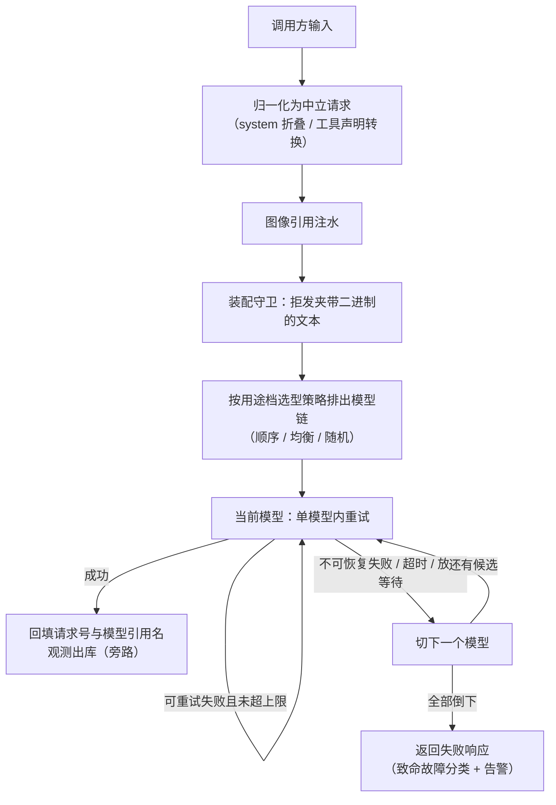

# LLM 接入层

LLM 接入层是所有大模型调用的统一通道：主播的规划器与回复器、游戏 Agent、下播整理、全模态语音引擎、记忆语义检索——系统里每一次模型请求都经它发出。它把「挑哪个模型、失败了怎么办、花了多少钱」这些与具体业务无关的事从各组件收走，组件只声明自己用哪个用途档。

本文讲配置怎么分层、一次调用怎么走、失败怎么处理、用量怎么记账。入口是 `LLMManager`（`src/modules/llm/engine.py`），与事件总线同级的核心基础设施服务。

想干什么读哪节：

- 想配模型、给某个用途换模型——[三层配置与用途档](#三层配置与用途档)
- 想知道一次调用内部怎么走——[一次调用的流转](#一次调用的流转)
- 想知道失败时重试、切换、告警的行为——[失败处理](#失败处理)
- 想知道思考链与思考强度怎么传——[思考链](#思考链)
- 想知道截图怎么进对话——[图像进出历史](#图像进出历史)
- 想接入新厂商或本地模型——[客户端适配](#客户端适配)
- 想知道用量、费用、上下文水位这些数据从哪来——[观测出库](#观测出库)
- 想知道记忆语义检索的向量化——[嵌入客户端](#嵌入客户端)

## 三层配置与用途档

模型配置在 `model.toml`，分三层（键全集以 `src/modules/config/model_schemas.py` 为准，文档不抄录）：

| 层 | 是什么 |
|---|---|
| `[[llm_providers]]` | 连接：一个服务端一条连接（地址、密钥、鉴权方式、重试参数）。多个模型复用同一连接 |
| `[[llm_models]]` | 模型注册：注册名、实际 API 模型标识、所属 provider、能力开关（视觉、思考回传）、定价与上下文窗口 |
| `[llm_profiles.<用途>]` | 用途档：这个用途按顺序用哪几个模型、选型策略、温度、思考强度、放弃等待时长 |

**用途档**（profile）是"这个用途用哪些模型"的配置单元——规划器用高质量档、回复器用台词档、总结类任务用便宜档，各自的模型清单互不相干。用途档是封闭集合：合法名单由配置 Schema 的显式字段定义，未知用途在配置加载与装配期一律硬错；消费方声明自己绑定的用途档时也走同一校验，声明错误启动即暴露。

每层引用关系在装配期校验：模型引用不存在的 provider、用途档引用不存在的模型，都是启动硬错，不静默兜底。

## 一次调用的流转

调用方从三个入口进（`generate` 文本 / `generate_vision` 视觉 / `generate_audio` 音频输出），都返回同一个中立响应对象。入口签名刻意宽容：输入接受裸字符串、中立消息列表或 OpenAI 风格字典列表，由引擎统一归一化，消费方不必为迁就契约改自己的输入形状。

各步要点：

- **归一化**：字典里的 system 消息折叠进请求的独立 system 参数（各厂商对 system 的承载位置不同，由适配端翻译）；历史里的工具调用与工具回执转成中立形状。消费方输入什么形状，出去的都是同一份中立请求。
- **图像引用注水**与**装配守卫**见 [图像进出历史](#图像进出历史)。两步都在故障切换之前——结构性问题重试无意义。
- **选型策略**是用途档级配置：`sequential` 按清单顺序首个起跑；`balance` 按累计调用次数挑最闲的；`random` 随机（可固定种子复现）。
- **生成参数单点定序**：温度与思考强度按「调用方显式参数 > 请求字段 > 用途档默认值」定序后写进请求对象，客户端只信请求对象字段，不再各自兜底——优先级只写一处。
- **响应归一**：响应里的模型名统一改写为注册名再交给调用方——上游网关会回自己的渠道别名，不改写会污染计价查表与费用归因口径。

## 失败处理

失败处理的全部决策基于**错误分类**：客户端把底层失败（SDK 异常、空响应）翻译成分类异常，引擎按分类查决策表，不解析异常内容做二次判定。

| 分类 | 语义 | 处置 |
|---|---|---|
| 可重试失败 | 限流、服务端临时故障、网络连接失败、空响应 | 同一模型上限内重试，指数退避 |
| 不可恢复失败 | 参数被拒、鉴权失败等 | 不重试，直接切下一个模型 |
| 请求超时 | 单次请求超时（含读超时与传输超时） | 切下一个模型 |
| 调用被中断 | 调用方主动停止 | 整体中止，向调用方传播 |
| 请求发不出去 | 装配守卫拦截（见下） | 不进故障切换；调用方改内容或放弃 |

配套机制：

- **放弃等待**：用途档可设一个等待上限——一个模型（连同它的重试）超时未返回就收回请求、按失败切下一个。默认不设（一直等，长回复不被宿主时限掐断）；只给直播里"晚了就没用"的用途设，卡住的请求才不会让直播间冷场。放弃时把取消前已收到的流式产出字数记进错误，供排障区分"零产出挂死"与"活着但极慢"。决策依据见 [ADR-055](../decisions/055-llm-give-up-wait.md)。
- **流式停滞守卫**：连接还在、流却不再产出内容（挂死）与"慢"是两回事。判据是连续一段时间没有任何输出块（正文、思考、工具参数碎片任一算输出），判挂死按超时处理切下一个模型。它与总时长上限并存，各管一件事：总时长管"整体太久"，停滞管"上游已经不产出了"。
- **慢调用告警**：单次调用耗时超过用途档的慢阈值只记告警，不切换——慢不是失败。
- **中断回收**：调用方设置中断标志或取消任务时，底层请求与重试任务一并收回，连接正常清理后才结束上层任务。

全部候选模型都倒下时，引擎区分两类失败：

- **瞬时可重试失败**（限流、5xx、超时、空响应）：返回失败响应，发布一条"全部模型失败"运行告警（经事件总线 `core.error`，WebUI 可见；同一来源有节流窗口，持续故障不刷屏）。
- **需运营介入的致命故障**（余额不足、鉴权失败、所有候选重试后仍连不上）：除告警外还登记进致命故障表——按用途档记录类别与首次发生时刻，供控制台首页常驻醒目展示；该用途档后续任一调用恢复成功即自动解除。这类故障的特殊之处：故障切换成功后请求照常跑，"全部模型失败"告警永远不会响，所以主档余额耗尽切到备用档成功时，会单独发一条"主档需要充值/换序"的账户级告警。

## 思考链

推理模型（思考型模型）的思考链与正文分离处理：

- **分离**：思考可能承载在独立字段，也可能混在正文的 `<think>` 标签里，客户端按模型配置的策略分离，并记下来源格式。
- **回传**：模型注册项可开思考回传开关。开着时，引擎把该模型自己产出的思考打包进响应，调用方把它原样放进这一步的助手消息，下一步请求即带回给**同一个模型**——换到备用模型时，别的模型的思考不发：对方认不出这段思考，可能报错也可能被带偏。回传按原格式写回，服务端看到的历史与它当初生成的一致。
- **思考强度**：用途档可设思考强度档位（模型把多少预算花在思考上），单次调用可显式覆盖。三原则（何时显式指定、档位怎么继承）见 [ADR-033](../decisions/033-llm-reasoning-effort-three-principles.md)。

## 图像进出历史

会话历史中图像只有一种合法形态：**引用**。`image_ref` 分段携带的是图像仓库（`VisionImageStore`）的进程内句柄，base64 本体不进历史——历史被压缩、预算等多个消费者共享，任何整体序列化路径都会把内联 base64 当文本重发（曾有单笔请求因此烧掉 86 万 token 的实锤案例）。图要进对话，须经观察层放引用。

引擎装配期把引用**注水**为内联图像：按新鲜度窗口计——引用所属消息之后的助手消息轮数在窗口内才注水；更早位置的引用说明有图残留在历史里，降级为一句提示文本，不让残留图每次请求重传；已被仓库逐出的引用同样降级，模型被明确告知图没了。

**装配守卫**在发出前拦截内联大载荷泄漏：请求文本字段超长且夹带长串连续 base64 时硬错拒发（宁可拒发也不静默烧 token）。只按长度判会误伤正常长文本（游戏回执、资料原文里没有几万字连续的 base64），判定按"超长字段里出现超长连续 base64 串"双条件。注水后的内联图像走专用分段，不在守卫扫查之列。调用方可用守卫同源的诊断函数，把请求里的二进制换成说明文字再发。

## 中断与取消

`generate` 可携带中断标志（`interrupt`）；调用方也可直接取消任务。两种路径都走同一个守卫：先等底层连接清理完成，再结束上层任务——主动取消是请求的正常终态，不留半开的连接。

## 客户端适配

引擎与厂商协议之间是**中立 payload 契约**：请求侧与响应侧的数据模型不出现任何厂商 SDK 类型，协议形状差异（嵌套工具调用、参数 schema 的叫法分歧）由适配端在翻译层消化。

- **接入新厂商** = 新增 `clients/<厂商>/` 目录 + 在 `clients` 包的调度表（显式字典，非注册机制）追加一行。当前唯一实现是 OpenAI 兼容客户端；Ollama、LM Studio、vLLM 等本地模型都提供 OpenAI 兼容 API，配好地址即可复用，无需新适配端。
- **鉴权方式**：OpenAI 兼容端支持密钥头（Bearer 前缀）、自定义请求头、查询参数、无鉴权四种，按 provider 配置选择。
- **翻译职责**：无参数工具补齐协议要求的参数 schema（部分端点对缺失直接拒收整个请求）；SDK 异常翻译为分类异常；流式请求在传输层故障时降级重发一次非流式（服务端明确拒绝的重发只是浪费，不走降级）。
- **严格工具参数**：请求可要求严格解析工具调用参数——解析失败时保留原始参数文本与错误原因交给调用方，让模型下一步自纠，而不是猜测补齐半份数据执行。

## 观测出库

观测是**旁路**：任何落库、写文件失败只告警，不阻断调用链；观测编排与调用编排零共享，引擎在成功/失败出口各调一次记录入口。

一次调用（成功或失败）产出四类观测：

| 产物 | 去向 | 内容 |
|---|---|---|
| 用量账 | SQLite `llm_usage` 表 | 每次调用的 token 消耗、费用、耗时、成败 |
| 请求明细账 | SQLite `llm_requests` 表 | 请求参数摘要、预览文本、错误原因 |
| 请求正文 | 诊断文件（`logs/llm_requests/` 按小时流） | 完整消息、工具调用、响应正文——失败请求的上下文是排障第一手材料 |
| 上下文水位快照 | 诊断文件（`llm_context/latest.json`） | 每模型最近一次调用的分段占用 |

要点：

- **费用唯一口径**是模型注册里的定价字段（每百万 token 输入/输出价，含缓存价），按 API 模型标识查价；落账键用引擎侧模型注册名，上游别名不入库。
- **两账同事务**：成功且带用量的调用两张表一次写入；失败行与无用量的成功行只写请求明细。
- **场次归属**：用量行记录当时进行的直播场次主键，无进行中场次落空值（场间消耗），费用可按场次归因。
- **上下文分段计量**是监控估算，不是计费口径：把一次调用的输入拆成对话消息、MCP 工具、内置工具、技能、系统提示词五段估算（归属由调用方随请求带标注），本地估算后按 API 回报的精确总数等比校准——估算误差不进展示总数，也不跨调用累积。精确总数永远以 API 回报为准。
- **读侧**：控制台的请求历史页与水位悬停经读侧接口查询（`request_history_manager.py`、`readers.py`），正文按请求号回查诊断文件。

**平台额度查询**（`quota/`）是控制台上下文面板的数据源：按模型反查所属 provider，识别平台后调平台自己的额度接口；同一 provider 在缓存有效期内复用结果，查询失败同样缓存，避免面板反复弹出把平台接口打满；并发的同 provider 查询合并为一次。缓存键只放密钥摘要，不留明文。

## 嵌入客户端

嵌入（把文本变成向量）与语音合成同类：基础设施而非工具，配置了才开。用途是主播记忆的语义检索——没配模型或密钥时装配层不建客户端，调用方退回关键词检索并如实上报"语义检索没开"。

- 客户端自己不重试，失败直接抛错带原因：嵌入服务卡住时不能拖住任何一条直播通路。失败后按连续失败次数翻倍退避，退避期间请求直接被拒——查询不会一条条打向故障服务，也不抢索引补算的配额。
- 超长文本切段送接口，防止单段撑破模型上限变成堵死退避队列的毒丸。
- 向量行记录产出它的模型标识（模型名与维度）；换模型或换维度后标识变化，索引任务据此整表重算，新旧向量不混用。

## 能力查询与依赖协议

消费方需要的常不是整个 LLMManager，而是其中一两个查询：这个用途档能否看图、可用上下文窗口多大。能力查询出口：

- **视觉能力**：按用途档查询当前主模型是否声明视觉。能力协商的各消费方（观察组装、视觉工具）据此分叉；判错的代价是多一次视觉模型转述，而不是拿到看不懂的图。
- **上下文窗口**：按用途档取名单内已配置窗口的**最小值**——故障切换可能落到名单里任何一个模型，按最大窗口定预算，切到小窗口模型时请求会被拒收。
- **思考强度查询**：供有兜底档位的调用方先判断运营者是否已显式配置，避免调用方默认值覆盖配置里的显式档位。

调用方把这些查询声明成协议（Python Protocol）并在构造器注入：缺方法在装配期就被校验拦下，而不是运行期靠属性探测静默退化（视觉查询静默返回假，主播就再也不看屏，且无任何日志）。

## 相关决策

- [ADR-032：LLM 运行时边界与入口](../decisions/032-llm-runtime-boundary-and-entry.md)
- [ADR-033：思考强度三原则](../decisions/033-llm-reasoning-effort-three-principles.md)
- [ADR-055：放弃等待](../decisions/055-llm-give-up-wait.md)
