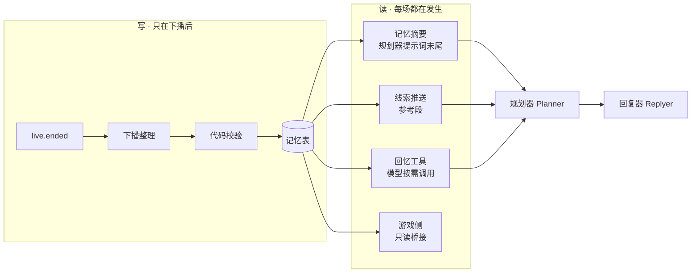
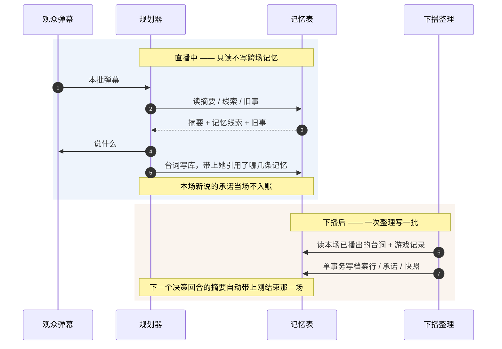
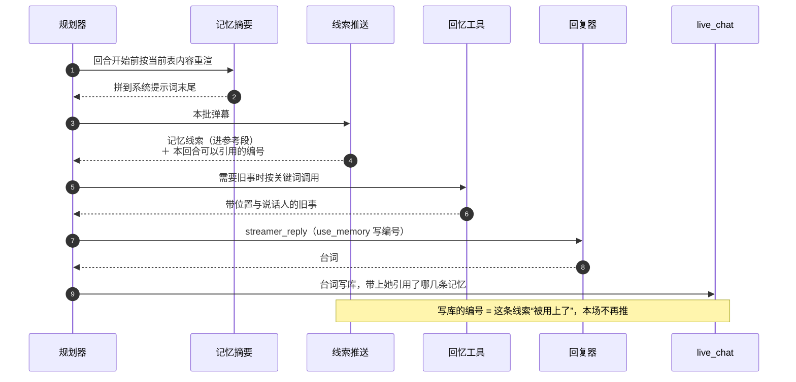

# 主播记忆

> 主播跨场记忆的总览与入口。这套系统记四类东西：**她当众答应过、还没兑现的事**（承诺表）、**前几场干了什么、哪些事还成立**（场次档案与档案快照）、**游戏里单个玩家与她的一对一往来**（游戏玩家档案）、**多人存档里的群体环境与共享惯例**（游戏社交事实）。
>
> **怎么读**：要改下播整理，看[下播整理](settlement.md)；要改跨场摘要怎么滚，看[档案快照](snapshot.md)；要改她被喂的记忆，看[记忆摘要](brief.md)与[线索推送](cues.md)；要改她主动查旧事，看[回忆工具](recall.md)；要改人怎么审、怎么删，看[审核与删除](review-deletion.md)；要改游戏侧的记忆，看[游戏侧记忆](game-memory.md)。表结构与配置以代码为准（`src/modules/storage/schema.py`、`src/modules/config/`）。

## 记什么、不记什么

记忆出现在三个位置，先说清楚：

- **系统提示词**——规划器的指令与设定，包含人设与老梗栏。
- **参考段**——提示词里固定放在对话之后的一段元信息（环节描述、直播间快照、记忆线索、游戏那边此刻），不是她说的话。
- **对话历史**——她这一场说过的话与收到的弹幕。

**规划器**（Planner）想该说什么，**回复器**（Replyer）把决定变成台词；两个都是模型，记忆在这条链上被读进来。

| 记什么 | 存在哪张表 | 谁会读到它 |
|---|---|---|
| 她当众答应、还没兑现的事 | 承诺表 `commitments` | 记忆摘要的【还惦记的事】一段、记忆线索、回忆工具 |
| 前几场干了什么、哪些事还成立 | 场次档案 `archive_lines` + 档案快照 | 记忆摘要、记忆线索、回忆工具 |
| 游戏里单个玩家与她的一对一往来 | `game_players` 系列表 | 玩家线索、对玩家的承诺 |
| 多人存档里的群体环境与共享惯例 | `game_social_facts` | 参考段的【游戏社交事实】一段、游戏侧只读桥接、回忆工具 |

运营者手写的老梗栏（人设字段 `inside_jokes`）是配置文本，不进这些表。

当场的工作记忆（对话时间线、前情提要）不在本文范围，见[主播上下文构成](../streamer-context.md)。

## 全局规则

下面几条对写侧与读侧都成立，各篇不再重复：

1. **只从她播出的原话长出来**：档案行与承诺只取自本场已播出的台词，每条带逐字原话；没播出的不进。观众的话要人批准、且她当场接受过，才进跨场记忆。
2. **直播中不写跨场记忆**：整理集中在 `live.ended` 之后。本场新说的承诺当场只活在对话历史里，靠它记得；下播整理后才入账。
3. **渲染只依赖表内容、不含时刻**：表没变时每个决策回合的输出逐字节相同，系统提示词的前缀缓存照常命中；表一变（直播中改了旧事、上一场刚整理完），下一窗就变。
4. **模型挑、代码判**：模型只做挑选与措辞，一切校验在代码里做，模型说的不算数。
5. **身份判断是确定性代码**：观众按内部观众 ID 定位，外部 ID 只用于精确解析；昵称只在渲染与打码时经 `viewers` 表使用。任何面向主播的通路都不出现精确天数、场次数与日期。
6. **读写解耦**：读这一侧任一环节出异常，只丢那一段，不阻断决策。

## 整体结构

写只有一条线：下播整理把一场正式直播整理成承诺表与场次档案。

读有三条线，每场都在发生：

- **记忆摘要**——规划器提示词末尾常驻的一段摘要，内容来自上面那些表，每个决策回合重渲一次。见[记忆摘要](brief.md)。
- **线索推送**——每批新弹幕进来时算一遍"这一批她该想起的事"，做成几条线索放进参考段。见[线索推送](cues.md)。
- **回忆工具**——她想查旧事时自己按关键词调用的查询工具。见[回忆工具](recall.md)。

一场直播在时间上长什么样：

一个决策回合就是"一批新弹幕进来 → 她想一遍 → 决定说不说、说什么"。三个读出口在同一个决策回合里这么协同：

## 降级

| 缺什么 | 表现 |
|---|---|
| 承诺或档案存储对象任一没接上 | 记忆摘要与线索推送整体关闭、回忆工具不注册，决策照常（只是记不住事） |
| 存储对象没接上或模型不可用 | 下播整理关闭；失败的场次留在待整理里，等运营者在 WebUI 手动重排 |
| `settle` 档位不可用 | 下播整理不写（原因进整理报告），直播主链路不受影响 |
| 嵌入服务没配或连不上 | 语义一路关掉，回忆与被动想起退回关键词、触发词与地点，记 warning 带原因与退避时间；索引任务把没算上的留到下一轮 |
| 游戏玩家存储对象没装配 | 玩家线索不推、对玩家的承诺这一场认不出，其余照常 |
| 摘要、线索、回忆任一读取异常 | 该段整段省略或返回"没查到"，不阻断决策 |

## 边界（不做什么）

- 不在说话路径上调模型挑选或重排序：检索与被动想起都是本地计算加异步嵌入，重排序模型只在离线评测里量。
- 观众弹幕不进持久索引，跨场记忆里的观众的话只有人批准过的那几条。
- 不在直播进行中写跨场记忆：本场新说的承诺要等下播整理才入账，本场靠对话历史记得。
- 不存观众的往事与画像：认人只做到"认出老观众、知道多久没来"。游戏玩家只记她亲身经历、画面里看得到的互动，玩家说他自己的事不自动记；玩家记忆只给主播，不给游戏 Agent。
- 不跨平台聚合：不同平台的观众始终是不同的人；同一平台内的账号 ID 与开放平台 ID 由观众表关联到同一人。

## 记忆相关的配置

| 键 | 在哪 | 作用 |
|---|---|---|
| `memory_passive_recall_enabled` | `agents.toml` `[agents.streamer]` | 被动想起总开关。关掉后线索只剩对象开口等承诺线索 |
| `memory_passive_recall_vector_enabled` | `agents.toml` `[agents.streamer]` | 被动想起的语义一路 |
| `memory_brief_min_session_ms` | `agents.toml` `[agents.streamer]` | 算"上一场"的最短场次时长 |
| `inside_jokes` | `agents.toml` `[agents.streamer.persona]` | 老梗栏，一行一条，别名写在冒号前、用 `/` 分开。只进规划器系统提示词、整场不变，观众提起时才接。别写观众昵称（删除函数管不到配置文本） |
| `[embedding]` | `model.toml` | 引用一个 provider 条目；没填模型名或密钥留空即没开语义检索 |
| `[privacy]` | `storage.toml` | "忘了我"的短语表与执行参数 |
| `[retention]` | `storage.toml` | 保留期天数，默认不自动删除 |

旧的 `[agents.streamer.memory]` 段已不存在——记忆策略由代码与提示词决定，没有记忆策略开关。

## 相关文档

- [主播上下文构成](../streamer-context.md) — 决策回合消息形态、参考段与系统提示词位置
- [存储](../storage.md) — 表、迁移、删除函数与保留期
- [与 MaiBot 同步](../../guides/maibot-sync.md) — 对外同步只剩直播近况与整场记录
- [提示词管理](../../guides/prompt.md) — 提示词模板清单与渲染契约
