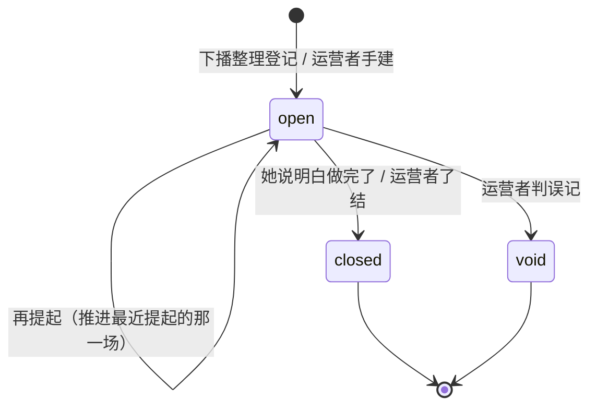

# 记忆摘要

> 记忆摘要是拼在规划器系统提示词末尾的一段记忆摘要（人设与老梗栏之后），内容来自承诺表、场次档案与档案快照。全局规则见[总览](README.md)。

代码在 `src/agents/streamer/memory/brief.py`、`zones.py`、`commitment_ttl.py`、`render.py` 与 `tools/memory_correct.py`。

## 每个决策回合按当前表内容重渲

渲染只依赖表内容、不含时刻。表没变时每回合输出逐字节相同，系统提示词的前缀缓存照常命中；表变了（直播中判误记、了结、删一行，或上一场整理刚写完）下一窗就反映出来。

## 四段内容

四段各自算名额，互不挤占（`zones.py`）。方括号里的是系统实际渲染出来的分段标题：

| 分段 | 装什么 |
|---|---|
| 【这个世界里】 | 当前存档里长期成立的事。宠物、跟班、地点取名压成紧凑名字表；住处、关系、规矩等其余长期成立的事逐行展示且不附长原话 |
| 【最近几场】 | 当前存档里最近两三场发生的普通事件，分"上一场"与"再往前两场"（按最近被提起排序） |
| 【还惦记的事】 | 当前存档及不关联游戏的、还没兑现的承诺。抬头固定写着"【还惦记的事】（想做再做的事，不用赶）："，意思是这些是可选的、不是欠债 |
| 【直播间里的事】 | 不关联任何游戏存档的跨场设定、杂谈与互动。换任何游戏存档照样带着 |

各段行数名额在 `zones.py`。

## 代表性事件分段按说话模式双态展开

- 常规边玩边说模式（`speaking_mode="gameplay"`）：严守存档隔离，仅在当前存档有已滑出近期窗口的历史代表事件时追加【忘不掉的名场面】（存档里早就过去了、但还值得留着的那些事）。
- 纯杂谈环节（`speaking_mode="zatsudan"`）：展开跨存档的【一起经历过的名场面】（跨存档的同一批代表事件），行内显式标注所属游戏与存档。

两个分段统一纳入可合法引用的名单与"本场已提过"防复读护栏。

## 承诺过期分两档门槛

过期判定是读时计算（`commitment_ttl.py`），不改库里的 `status='open'`，回忆工具照查：

- 近期一次性时间词（今晚、明天、下次等）的承诺更快过期；一般承诺要隔更多个场次。两档各隔多少场，在 `commitment_ttl.py`。
- 一旦在后续场次被再次提起，"最近提起的那一场"往前推进，自动回到活跃区。
- 长期没再提的承诺与超出名额的条数合并折成一句"另有若干件搁了很久，可以用 memory_recall 查"。

承诺在库里的状态只有三种，"长期没再提"是读时算出来的、不是第四种状态：

`open` 过了过期门槛就算"长期没再提"，但**库里的 `status` 仍是 `open`**——它只是读时算出来的分档，回忆工具照查得到。

## 场内更正

直播中规划器可以改旧事：调 `streamer_memory_correct`，附本场证据（游戏回执、玩家游戏公屏、运营提醒或亲眼确认）标某条 `档#N` 或 `约#N` 为做完了、不成立或记错了。编号是引用记忆用的两类代号：`档#N` 指一条档案行，`约#N` 指一条承诺，同号不同义。

- 档案行本场后续每回合渲染附"（本场更正：……）"。
- 承诺当场改状态，运营者可在 WebUI 记忆页一键撤回。
- 运营递话里的纠错同步记入本场更正表（`memory_corrections`），摘要顶部保留最近几条本场运营提醒。

## 上次收尾

【上次收尾】指"上一场下播收工时的实况"。它只在开播最初几个决策回合（或到本场第一件委派被接下为止——委派指主播交给游戏 Agent 去做的活）注入参考段，不改动系统提示词前缀缓存。用写库里的确定记录拼出，不依赖下播整理的模型调用（代码在 `last_wrapup.py`）：

- 上一场最后在哪个存档（对比眼下所在存档）。
- 下播时还在做、待办或搁下的委派及状态。
- 下播前最后播出的几句台词。
- 上一场已整理完成时，再附上那一场新登记的承诺；还没整理完则明确注明"上一场的事还没整理，下面只有账面记录"。

## 上一场的定义

整理失败、或既没有快照也没有档案行的场次不算；空场次不会被当成"上一场"；时长不到最短场次门槛的场次也不算，往前找（门槛是配置 `memory_brief_min_session_ms`）——开错后马上重开的那一小段照样整理得出档案行，不跳过就会顶掉真正的上一场。最近已结束正式场尚未完成整理时，摘要注明快照来自更早一场。

## 同一件事只列一遍

- 档案行与列出的承诺出自同一句台词（同一 `evidence_chat_id`）时只留承诺那一条。
- 本场台词已经引用过的承诺（`memory_refs` 里有它、且那句送达了）不再进后面的摘要。
- 引用过的档案行留在摘要里，末尾标"（本场已提过）"；规划器代码对非回人轮次的二次主动引用退回换话题（每回合有退回上限）。

本场新说的承诺不进记忆摘要：它就在规划器的对话历史里，下播整理后才入账。

时间词只用"上一场""之前"，相对本场开播固定，不出现日期、天数与场次数。

## 相关决策

- [记忆注入切到账本](../../decisions/066-memory-injection-switch.md)
- [记忆摘要分区与场内更正](../../decisions/077-memory-zones-opening-wrapup-ttl-and-in-stream-correction.md)
- [记忆摘要按表快照逐窗重渲](../../decisions/082-brief-re-render-per-decision-window.md)
