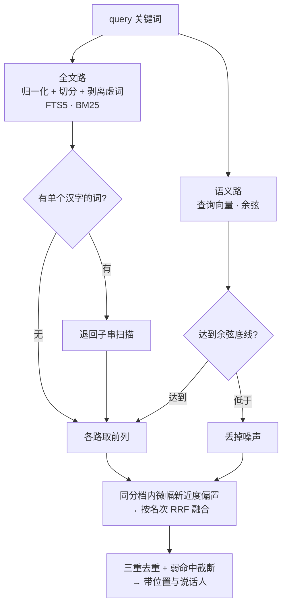

# 回忆工具

> `memory_recall`：她想查旧事时自己按关键词调用的查询工具。注册进 `ToolRegistry`，provider 名 `memory`；默认只对主播可见，主控态的游戏 Agent 也会并进可见名单（每次列工具时现算，不改常量规格）。全局规则见[总览](README.md)。

代码在 `src/agents/streamer/memory/recall.py`，检索在 `memory/search.py`，文本处理在 `memory/textmatch.py`，索引任务在 `memory/index.py`。

## 参数

| 参数 | 取值 | 默认 |
|---|---|---|
| `query` | 关键词，多个用空格分开，个数不限 | 必填 |
| `scope` | `all` 查全部历史；`this_stream` 只查本场 | `all` |
| `order` | `relevant` 最相关的在前；`newest` 最近的在前；`oldest` 最早的在前 | `relevant` |

## 查找范围

- 她已播出的台词（正式场全部历史；展示时按长度预算拼合同场前后紧邻的主播台词）。
- 档案行。
- 对所有人许的承诺（未了结与已了结都给，标明状态，带了结原话；判误记的不给）。
- 游戏里程碑与阶段汇报。
- 现行游戏社交事实。
- 当前已认出存档的游戏工作笔记与未完待办（`game_work_docs`，别的存档严格隔离并把昵称换成代号）。
- 本场观众弹幕（不论 `scope` 都只查本场）。

不查往场观众弹幕。对某位观众、某位玩家的承诺只经线索推送出现，回忆工具不返回。

## 混合检索

- **关键词一路**：剥离高频疑问口水词后，在 FTS5 全文索引里按 BM25 取候选。查询词里有单个汉字时（"炸TNT"的"炸"、单独查的"猫"）按词查必漏，退回子串扫描兜底。
- **语义一路**（配了嵌入服务时）：过滤低于余弦底线的噪声后取前列。
- 两路在同分档内施加封顶微幅新近度偏置后，按名次融合（RRF，分数由各路名次算出）。
- 语义一路没开或暂不可用时，结果注明"这次只按字面查"。

全文与向量索引是**派生表**（`memory_fts_*` 与 `memory_vectors_*`，跟着源表增删），由后台任务按"缺什么补什么"慢慢补上——全文是本地切词、毫秒级，向量要调嵌入服务。

## 组装与去重

一次返回的条数有上限，组装时执行三重去重与弱命中截断：

1. 裸台词与引用它的档案行或对所有人许的承诺同源合并，保留带标题、完成状态或存档注记的那一条。
2. 已被前排条目完整拼进正文的同场邻句不再重复占坑。
3. 跨场或同场近似原样复读（相似度门槛）的台词一次里至多留有限几条。
4. 纯字面路径剔除零实词凑数尾行；整次查询仅剩字面弱擦边时至多留有限几条，并提醒拿不准直说记不清。

## 不按名字查人

本场以外的结果里出现的已知观众昵称（当前名与曾用名）一律换成"某位观众"。关键词恰好是某位已知观众的昵称时丢掉这个词，并在抬头说明（"回忆工具不按观众名字查，已忽略若干个名字"）。本场结果不替换。

关联了游戏的档案行、承诺与游戏进展，逐条注明是在哪个存档；她过去说过的话，那场只在别的存档里玩过时注明。

结果按 `order` 排列，每条带位置（"本场 00:12""上一场""之前"）与说话人（"你""观众"）。查询失败返回"没查到（原因）"，不挡说话。

## 相关决策

- [混合检索与被动想起](../../decisions/072-memory-hybrid-search-and-passive-recall.md)
- [检索抗干扰、双侧桥接与名场面分层](../../decisions/079-memory-anti-noise-cross-agent-bridge-and-highlights.md)
