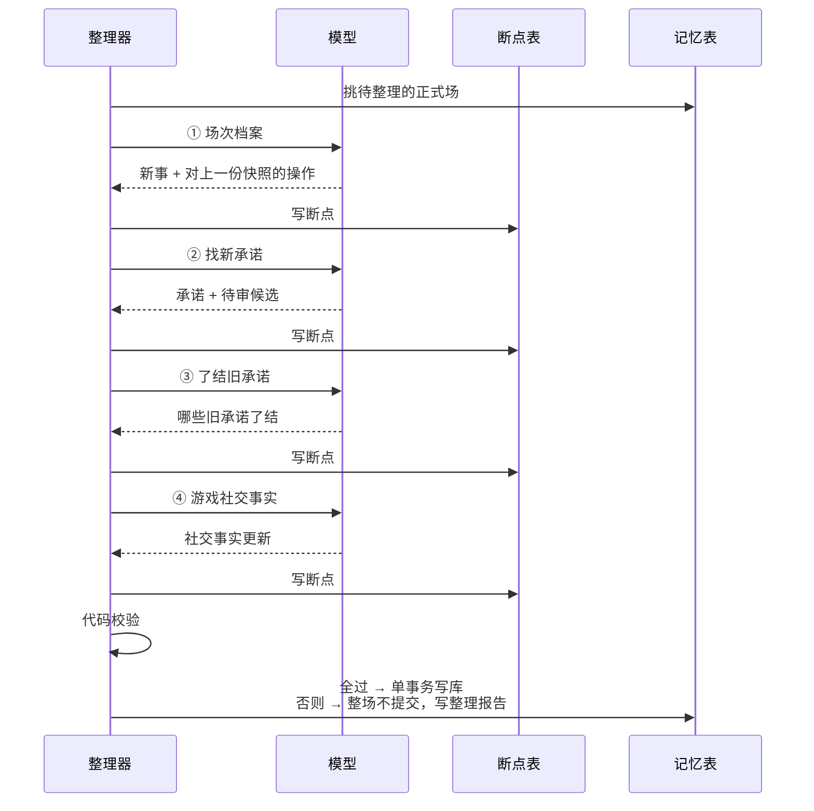

# 下播整理

> 下播整理把一场正式直播整理成承诺表与场次档案：几次模型调用做挑选，代码校验把关，一个事务写库。全局规则见[总览](README.md)。

代码在 `src/agents/streamer/memory/settle.py`，跨表写库在 `SessionRepo.apply_settlement`。

## 触发与调度

- **触发**：`live.ended` 的道别轮跑完、队尾台词播完之后排进后台。TTS 卡住不挡住整理。进程启动时也补跑一次。
- **挑哪些场**：只挑已结束、还没整理过、自动重试次数没用满的**正式场**，按开播时刻从早到晚逐场整理。彩排场（内部演练、不对外的直播）永不进候选，读取也按场次类型过滤。
- **开播不阻塞等待**：新场次开播时先按当前表内容拼第一份记忆摘要，再把待整理场次排进后台任务。后台整理写完档案后，下一个决策回合的摘要自然带上刚结束那一场；期间摘要退化为更早一场，不影响开播。
- **同一场只付一次模型调用**：下播后台、开播补整理、隐私清理前的等待共享同一个还没跑完的任务。写库这一侧用"整理完成时刻为空"抢占，两个进程同时跑只有一个写事务成功。
- **场次类型改动**：正式场改成彩排时，这一场写的档案行、快照、登记的承诺与整理进度一并清掉；删除场次同样。彩排改成正式后，下一次调度自然会整理它。

## 四次模型调用

各只做一种判断，都走 `settle` 档位（专门配给下播整理用的模型档位）。每跑完一步立即把输出写进 `settle_checkpoints` 表，重启或重试时从没跑完的那一步接着跑。

| 步骤 | 判断什么 | 何时不调 |
|---|---|---|
| ① 场次档案 | 挑出值得下次开播提起的新事；同时对上一份快照逐行挑留 / 去掉 / 替换 | 本场没有任何播出台词时不调模型，直接记成已整理 |
| ② 找新承诺 | 她当众答应过、还没兑现的事 | — |
| ③ 了结旧承诺 | 她说没说明白做完了或不做了 | 本场之前没有未了结承诺时不调 |
| ④ 游戏社交事实 | 更新社交事实与有据互动 | 没接社交事实存储对象、或本场没玩游戏时不调 |

断点的作用是**不重复付模型调用**：重启或重试时从最后写完断点的那一步接着跑。

## 喂给模型的原料

- 本场全部已播出台词（按时间编号，不抽样、不截断）。
- 回应弹幕的那句，附被回应的弹幕原文与发言人代号（本场内稳定的"观众1、观众2"）。
- 本场玩过的游戏与游戏关键事件（事件前标着当时的存档；一场里换过存档的游戏另起一行说明）。
- "她能做的事"一行（启用的游戏 Agent 名单加聊天、讲故事一类）。游戏 Agent 是替她在游戏里操作的角色，例如 Minecraft。
- 本场记住的地点。
- 本场开播前未了结的承诺、最近已了结与已判误记的承诺标题。
- 本场游戏玩家（代号"玩家1、玩家2"与名字）与她在游戏公屏打出去的字（编号"游戏公屏#N"，前面附着玩家说的话）。

## 代码校验

校验全在代码，模型说的不算数。没通过的条目连同原话写进整理报告，运营者在 WebUI 里逐条判断。逐条对应的代码在 `memory/settle_proof.py`（"做成了"的核对）、`settle_cues.py`（触发词与地点）、`settle_players.py`（对谁）、`settle_candidates.py`（待审候选），通用校验器在 `memory/textmatch.py`（原话一字不差的核对）。

1. **原话必须一字不差**：引用的那句话必须是所引那一行台词的原样片段，不能改一个字、也不能超长；超出的整条丢弃，标题超长则截断。新写的档案行拒绝疑问句、反问句与猜测句作证据，并剥除误入标题的真实观众昵称。
2. **关联的游戏**：必须是本场玩过的，或是已启用的游戏 Agent，否则置空。关联了游戏的，按那句台词的时刻对上本场各游戏的存档时间段。
3. **承诺是对谁许的**：对某位观众答应的，那一行必须回应了真实观众的弹幕；对某位玩家答应的，按台词记下的回应对象，或游戏公屏上点了名与紧接着回话，对上那位玩家。对不上不登记，进"没通过校验"的清单。游戏公屏上打的字只登记对玩家的承诺。
4. **说"做成了"**：档案新事、替换旧行里的完成说法、了结关联了游戏的承诺，都必须引本场游戏记录撑着。代码核对引的那条存在、能作证、同一个游戏、不晚于她说那句（时刻容差以代码为准）。没核实到的照写，但写成"她说……（游戏记录里没核实到）"，不算长期成立的事；了结不认。
5. **触发词与地点**：触发词必须在标题或原话里出现；地点必须照抄本场记住的地点，且说得通（那句台词里说到这个地名，或她说这句时就在这个地点跟前）。
6. **不重复、不改判**：与未了结的旧承诺是同一件事、或那句台词已经引用过某条承诺，都不新建，只推进"最近提起的那一场"。了结只改 `open` 的行，运营者已处理过的结论不被模型翻改。
7. **人改过的行模型动不了**：模型对它的去掉、替换一律不采纳，写进整理报告。

## 写库、失败与重试

- 四步全部就绪后**在一个事务里**写库：本场档案行、本场档案快照、新承诺、旧承诺了结与重申推进、社交事实更新、本场待审候选、本场整理完成时刻一起提交，同时清掉该场的 `settle_checkpoints`。重新整理前先清空该场旧断点，只替换这一场自己的档案行与快照。
- **失败判定**：任一次调用失败、输出读不懂、输入超出模型窗口、上一份档案快照读不出来，都算这一场失败。整场不提交，重试次数加一、原因写进整理报告。次数用满后不再自动补跑，等运营者在 WebUI 点"重新整理"（把次数清零，下一次调度就会再挑到它）。一场失败不挡后面的场。
- **整理报告**另有"唠叨指标"一节：本场引用旧事几次、同一条最多几次、没人问时主动提几次、短时间内绕回的条目、记忆线索推了几条用上几条、只由她自己的话触发几条、同一位玩家被推几条。只有编号和数字。

## 相关决策

- [ADR-065：主播记忆改按账本记录](../../decisions/065-memory-ledger-shadow-run.md)
- [ADR-050：场次分正式与彩排](../../decisions/050-session-kind-live-and-rehearsal.md)
