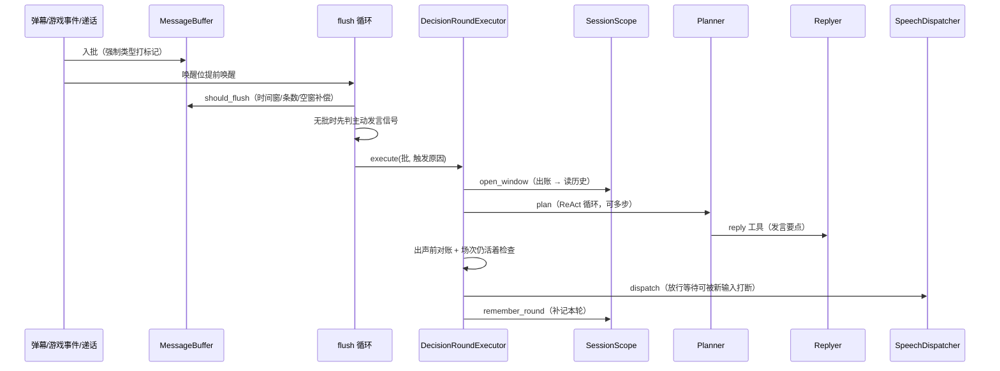

# 主播 Agent 总述

主播 Agent（`src/agents/streamer/`）是全场唯一自我驱动的组件：直播期间它自己的循环持续在跑，没人调也在跑——攒弹幕、开决策回合、决定说不说、把说出口的台词送进语音与字幕。本文是这个 Agent 的机制总述：它由什么组成、一轮决策怎么循环、发言怎么管线化输出、后台在维护什么、一场直播从开播到下播怎么持有。

想干什么读哪节：

- 想知道每轮决策的输入（弹幕批、历史、参考段、记忆）怎么拼——[主播 Agent 决策回合上下文](streamer-context.md)，本文不复述
- 想知道跨场记忆（记忆摘要、记忆线索、承诺表、场次档案、下播整理）——[主播记忆](memory/README.md)
- 想知道流程单（导演预写的环节清单）怎么推进——[流程单编排机制](rundown.md)
- 想知道她说出口之后语音怎么合成——[语音合成（TTS）](tts.md)；虚拟形象怎么动——[虚拟形象（Avatar）](avatar-platform.md)
- 想知道游戏主控权怎么在主播与游戏 Agent 之间切换——[动态主从](dynamic-lead.md)
- 想知道某个模块文件在包里的位置与职责——本文[模块地图](#模块地图)一节

本文不写阈值与额度数值（攒批窗口、冷场秒数、队列容量等），只写代码位置；调参直接看配置项与常量。

## 组件组成

主播 Agent 的主体是"两件模型部件 + 一条即时通路"，全部是 Agent 内部件（代码直连，不进工具表）：

| 组件 | 模块 | 一句话 |
|------|------|--------|
| 规划器 | `planner.py` | 每批新弹幕进来后想一遍该说什么的模型，跑有界 ReAct 循环 |
| 回复器 | `replyer.py` | 把规划器定下的发言要点变成她开口的台词 |
| 即时反应 | `mouth.py` | 游戏里出突发状况时不经规划器、几秒内当场出一句短反应 |
| 发言分发器 | `speech_dispatcher.py` | 决策与即时反应共用的出声出口：业务事件 + TTS 队列 + 字幕 |
| 后台维护器 | `background.py` | 直播间记账与话题摘要的双任务后台循环 |
| 场次作用域 | `session_scope.py` | "这一场主播记得什么"的进程内状态单点 |

组件关系（决策数据怎么流）：

```mermaid
graph LR
    弹幕/游戏事件 --> 缓冲[MessageBuffer 攒批]
    缓冲 --> 执行器[DecisionRoundExecutor]
    触发信号[ProactiveSignals/ProactiveTrigger] --> 执行器
    执行器 --> 开窗[SessionScope.open_window]
    开窗 --> 规划器
    规划器 -- "reply 工具（发言要点）" --> 回复器
    回复器 --> 守卫[speech_guard 出口守卫]
    即时反应 --> 守卫
    守卫 --> 分发[SpeechDispatcher]
    分发 --> TTS / 字幕 / streamer.speech 事件
```

游戏事件在进决策前先进游戏事件账本（`game_ledger.py`：入账、折叠连发、决策回合边界出账成时间线行），主播不直接消费游戏事件的原始载荷。

## 规划器（planner.py）

规划器是决策主体：每个决策回合内跑一次有界 ReAct 循环——查信息（经 `ToolRegistry` 调工具）→ 决定说不说 → 调 reply 工具收尾。步数上限 `planner_max_steps` 防失控；LLM 异常、超步、reply 不可用都降级为本轮沉默（不抛异常）。

- **触发来源**不归规划器管：它只拿到"这一批是什么、为什么开这一轮"（`trigger_cause.py` 的类型化触发原因）。
- **人设分工**：规划器注入名字、性格与行为准则（`[persona].behavior_style`），知道她是谁才能替她挑话题、在回复指引里定态度；措辞风格只给回复器。
- **参考段组装**是纯函数层（`planner_context.py` / `planner_render.py`），对话部分由 `canonical.py` 统一映射——详见 [决策回合上下文](streamer-context.md)。
- **委派工作台**（`delegation_workbench.py`）：跟踪"我手头在游戏里做的事"——每个游戏最近受理的委派、补充要求、说出口的打算；`framework_delegate` 等两个工具名的受理规则收在这里，规划器只留薄循环。
- **委派停滞兜底**（`delegation_stall_watch.py`）：同一委派的停滞告警按次数计数，第 N 次仍无决断判自动撤单并补一条场记事实；`delegation_posture.py` 是"一件委派此刻处在哪种处境"的唯一判定点。
- **话题匣**（`talk/deck.py`，工具名 `talk_draw_cards`）：有话题卡仓储时按场次预摆或供她主动抽卡；**话头工作台**（`talk/workbench.py`）跟踪当前环节提纲要点进度、被打断的尾句与观众话头短余温；说话档位（边玩边说 / 杂谈）由 `talk/speech_mode.py` 按流程单环节与游戏状态判定。
- **冷场兜底**：冷场阈值与主动发言共用同一配置（`config.proactive.cold_timeout_ms`），"多久算冷"只配一处。
- **场内更正**：注册 `streamer_memory_correct` 工具，本场内纠错承诺与档案，写完立即重渲记忆摘要（机制见 [记忆总述](memory/README.md)）。
- **发言要点点名校验**：reply 参数里点名记忆编号（档#N / 约#N）时，规划器在 `_resolve_use_memory` / `_resolve_archive_ref` 里核对编号是否在本回合合法名单内，没人问起时的档案复提被拦下（`_repeated_archive_id`），游戏公屏没回的玩家搭话被要求先回（`_missing_game_chat_error`）。

## 回复器（replyer.py）

回复器把规划器定下的发言要点变成纯文本台词。模型只负责措辞，不接收工具；情绪与强度由上层 reply 调用组装（`tools/reply_tool.py`，工具名 `streamer_reply`）。

- **两档写法**：台词长度预算分"边玩边说"与"杂谈"两档（`speech_max_chars` / `talk_speech_max_chars`），超出先让模型重说、仍超按完整句截短。
- **人设块稳定**：系统提示词只放人设块与提炼过的说话规矩，整段每轮逐字一致，吃前缀缓存。
- **敏感词**：出口过敏感词过滤器（`config.word_filter`），命中按配置替换或整条丢弃；长度预算与敏感词的裁决规则收在 `speech_guard.py` 单点，规划器台词、即时反应台词、直通回复器的欢迎与解说共用它。
- **情绪标注**：回复器产出情绪名与强度，随 `streamer.speech` 事件发出，虚拟形象适配器订阅后切表情（本文不展开，见 [虚拟形象](avatar-platform.md)）。
- **表达意图契约**：规划器与回复器之间的发言要点数据结构是 `plan.py` 的 `DecisionPlan`（说不说、回谁、话题摘要、回复指引、情绪、强度）。
- **边界栏共用**：规划器、回复器、即时反应三条通路的"她不答应的事"共用一份渲染写法（`persona_rules.py`）。

## 即时反应（mouth.py）

游戏里出现高光目击（强敌、稀有矿藏进入视野）、高光里程碑（开箱发现稀罕宝物）或非自选的意外阵亡时，不经规划器、几秒内当场出一句短反应。主播 Agent 在这些事件到达时调 `mouth.react(...)` 把由头转进来；轻微掉血、摔伤、天色变换只留进现场背景不出声。

- **事实快照**：即时反应每次开口前读一份当前处境事实（`scene_card.py` 的 `SceneInputs`：现在的状态、手上的目标、刚发生的事、她刚说过的话）——没有这份快照的即时反应会编现场。
- **不带记忆**：长期笔记与备忘录都不给，几秒内的一句反应用不上，带上只会让她在急事里翻旧账。
- **只出第一声**：即时反应不拍板承诺下一步行动，采掘、迎战、撤离等委派决定一律归紧随其后的规划器。
- **与规划器对账**（`mouth_reconcile.py`）：规划器从开窗到出声隔十多秒，期间即时反应可能已经接过同一件事。决策台词出声前对账——重复欢迎确定性剥除；即时反应说过话时用独立核对档判一次，三选一裁决（放行 / 重复 / 作废），被推翻的整句作废交规划器按新现场重想，模型只判不写。
- **主控权分流**：主播主控态下高光事件同时置位游戏待定夺信号、唤醒规划器下发任务；游戏主控态下只出声、不拉起重型规划器（见 [动态主从](dynamic-lead.md)）。

## 决策回合循环

一个决策回合 = 攒一批输入 → 开窗 → 规划（可能多步）→ 决定发言或沉默 → 台词进发言管线。调度半在 Agent（`_flush_loop` / `_maybe_flush`），执行半在 `decision_executor.py`（`DecisionRoundExecutor`）。



回合内要点：

- **攒批**（`message_buffer.py`）：时间/条数窗口内聚合多条弹幕；醒目留言、上舰等强制触发类型跳过节奏采样立即响应；慢直播有空窗补偿。
- **触发来源清单**：观众弹幕与付费消息（`room.message.danmaku|gift|super_chat|guard`）、流程单环节变更与超时（`RundownCoordinator` 回调置位）、主动信号（`proactive_signals.py`：外部点播 / 流程单环节 / 游戏待定夺三路，各有确认消费纪律）、游戏事件（`game.*` 三通道、身体侧遭遇、玩家游戏公屏）、运营递话（`receive_prompt`，必达语义，队列满拒收）、冷场与定时兜底、外部 API 点播。同一 tick 多信号并发时按优先级取最高的一个（优先级序见 `proactive_trigger.py`）。
- **回合前置**：每轮开头先同步各游戏眼下所在存档、按表快照重渲记忆摘要，再进执行器。
- **开窗**（`session_scope.py` 的 `open_window`）：出账（游戏账本待入账行写进时间线）先于读历史，这个顺序不变量内化在开窗动词里；运营提醒与续播重放缓冲也在这里取空注入。
- **出声前检查**：台词作废的两条闸——本轮开窗时的那场已经下播则不出声（下播后只有道别那一轮能开口）；与即时反应或新现场矛盾的台词作废重想。
- **放行等待**：发言等上一句播完的背压等待可被新输入（弹幕、玩家游戏公屏、游戏急事、递话）打断，过时台词撤回、锁立即可用。
- **沉默也是结果**：规划器自然终止（无工具调用）或降级路径都产出带原因的沉默，记进 `planner.decision` 事件。

## 发言管线

规划器台词与即时反应台词走同一条出声出口（`speech_dispatcher.py`）：

1. **业务事件**：`streamer.speech` 在派发路径上同步发出（落库、字幕、虚拟形象反射都订阅它）。
2. **TTS 编排**：启用 TTS 时经 `utterance_queue.py` 的播放队列串行播出。队列按优先级排队（同级先来先播）；溢出丢"优先级最低里最旧的"一条；反应类台词带过期时刻，过时跳过；长段话的几句标同一段落号，被更高优先级插进来时剩余句子直接丢。打断档位与动态主从下解说、欢迎、道别各走什么档，见[动态主从](dynamic-lead.md)。
3. **字幕**：异步扇出推送（见 [TTS](tts.md) 与 [字幕单一来源](../decisions/025-subtitle-single-source.md)）。
4. **口头流水**：每播出一句记进本场口头流水（`mouth_reconcile.py` 的 `SpokenLog`），供即时反应的事实快照与决策出声前对账共用；同时核销进房已欢迎名单。

情绪渲染不在管线内扇出：虚拟形象适配器订阅 `streamer.speech` 自行切表情，主播域不携带虚拟形象平台知识。

## 后台维护者

`background.py` 的后台维护器是双任务模型：轻循环（周期 tick，纯机械）+ 压缩 worker（等队列，LLM 秒级任务不冻结快节拍）。角色是"记账者 + 提醒者"，不注入决策上下文：

- **直播间记账**：轻循环周期读 `room_state.py` 的态势快照（热度、弹幕词频、进房与发言时刻，纯规则滑动窗口），按 `session_manager` 解析的当前场次写 `live_sessions` 实时状态。
- **话题摘要**：轻循环做关键词增量聚合，窗口滑过阈值后交给压缩 worker 用 summary 档位写一句话话题摘要，落地成 `timeline_summary` 与 topics 快照；场次概览（`session_overview.py`）在下播后用这些原料写"这一场发生了什么"（给人看，不进记忆）。
- **空转检测**：冷场信号由 `proactive_trigger.py` 承载（纯规则判定，无 LLM、无 I/O），流程单超时提醒也并入它的触发源；真正开口走决策回合，不在后台循环里说话。
- **主动开口**：主动信号的"置位 → 按 tick 读数 → 确认消费"判定序收在 `proactive_signals.py` 单点，flush 循环每个空缓冲 tick 调它一次，命中即执行一轮主动决策。
- **记忆索引补算**（`memory/index.py`）：后台补全文与向量索引，不属后台维护器、由 Agent 直接持有——见[主播记忆](memory/README.md)。

## 场次生命周期

场次（一次开播到下播）是主动发言的业务边界：没开播只回弹幕不主动开题。场次行的唯一事实源是 `LiveSessionManager`（表 `live_sessions`），Agent不自建场次、只按事件持有"这一场"的进程内状态（`_live_active` 位与开播计数）。

**开播序列**（`live.started` 回调）：

1. 开播计数加一、放行主动发言；清即时反应状态。
2. 新开场清场：对话轮、话头工作台、手头的事、口头流水、游戏流水归零（断线续播场不清，接着读库）。
3. 流程单开播起算（armed → running）；按场次类型拼第一份记忆摘要。
4. 断线续播场（`resumed=True`）额外做减法：还原流程单实例快照、认领重启前没交付完的委派、从诊断事件流重放上一进程没送达的递话与她还没回的玩家聊天、接回本场已聊话题，然后排一轮"信号回来了"的接回发言。

**下播收尾编排**（`live.ended` 回调）：

1. 收回游戏主控权，主动发言收闸。
2. **道别那一轮**：一场强制决策回合，把正在结束的那一场显式交下去（`ClosingSession`，道别句记进这一场）；被新开场次顶掉的不道别，直接收拾本场。
3. 道别跑完清场：对话与备忘录归零（道别期间已开新场次时不清，免得抹掉新场次的开场内容）。
4. 后台收尾排进任务：等队尾台词播完 → 本场整理（`memory/settle.py` 的 `SessionSettler` 写承诺表与场次档案，有等待上限）→ 记账器到期清理 → 场次概览。整理的模型调用步骤有断点落库，进程退出没跑完的场次下次启动补写。删除与保留期的完整顺序见[记忆：删除与遗忘](memory/review-deletion.md)。

停机路径（Agent 先停、`live.ended` 后到）不起整理：这场该做的删除与整理由下次启动的善后补上。

## 游戏主控态下的主播

配置 `lead_mode=dynamic` 时，主播可以把游戏环节的主控权交给就绪的自主游戏 Agent：主播侧停掉重型规划器的唤醒（弹幕仍记账、进房改走轻量秒迎、游戏事件只留近况供回答观众知情），流程单超时与静默提醒节流推给主控游戏侧，运营递话同步转发前线；游戏故障被动降级时主播收回主控并自然圆场。切换条件、交权记忆摘要与解说通路的机制细节见[动态主从](dynamic-lead.md)；本文只陈述主播侧视角：主控权离开期间主播的决策回合与主动发言降频待命，即时反应照常出声。

## 模块地图

`src/agents/streamer/` 包内各模块的职责一句话（子包按文件列出）：

| 模块 | 职责 |
|------|------|
| `streamer_agent.py` | 主类：生命周期、事件订阅、决策调度半、下播收尾编排、动态主从接线 |
| `config.py` | 包内配置 Schema（`[agents.streamer]` 各段的权威定义） |
| `stats.py` | 决策循环各分支的运行时计数器 |
| `session_scope.py` | 场次作用域：这一场记得什么，开窗/读历史/补记/清场的动词单点 |
| `message_buffer.py` | 弹幕聚合缓冲：时间/条数窗口、强制触发标记、空窗补偿 |
| `trigger_cause.py` | 触发原因值对象：一轮决策"为什么被触发"的封闭枚举 |
| `decision_executor.py` | 决策执行半：开窗 → 规划 → 出声前检查 → 送发言管线 |
| `canonical.py` | 对话 canonical 映射：live_chat 行/弹幕批 → LLM 消息的单一序列化点 |
| `timeline.py` | 本场对话的只追加投影，超预算按章压前情提要（吃前缀缓存） |
| `planner.py` | 规划器：有界 ReAct 决策循环 |
| `planner_context.py` | 规划器元数据参考段的纯函数渲染 |
| `planner_render.py` | 规划器回看素材（委派/打算/补充要求）与 ReAct 文本杂项 |
| `delegation_workbench.py` | 规划器的"手头的事"工作台：委派受理与状态迁移规则 |
| `delegation_stall_watch.py` | 委派停滞告警计数与自动撤单兜底 |
| `delegation_posture.py` | 委派处境判定：两套状态词归纳成主播侧关心的几类 |
| `plan.py` | `DecisionPlan`：reply 工具与回复器之间的发言要点契约 |
| `thinking_stream.py` | 思考流旁路通道契约（best-effort 观测，不经 EventBus 不落库） |
| `term_sanitizer.py` | 注入边界术语脱敏：任务号等内部标识不进主播上下文 |
| `game_ledger.py` | 游戏事件账本：入账、折叠连发、决策回合边界出账 |
| `game_now.py` | 【游戏那边此刻】参考块：每回合重建游戏侧现况读数 |
| `event_log_reader.py` | 诊断事件流文件的窗口读取器（续播重放数据源） |
| `paid_viewers.py` | 付费观众标注：本批消息行加「（付费观众）」 |
| `replyer.py` | 回复器：按复古提示词格式生成纯文本台词 |
| `speech_guard.py` | 台词出口守卫：长度预算与敏感词净化裁决规则单点 |
| `persona_rules.py` | 人设边界栏的统一渲染（三条说话通路共用） |
| `speech_dispatcher.py` | 发言管线：`streamer.speech` 事件 + TTS 队列 + 字幕扇出 |
| `utterance_queue.py` | 播放队列：按优先级串行调度、溢出丢弃、打断档位 |
| `mouth.py` | 即时反应：高光瞬间不经规划器当场出一句短反应 |
| `mouth_reconcile.py` | 即时反应与规划器的对账：口头流水与出声前裁决 |
| `scene_card.py` | 事实快照：即时反应开口前读的当前处境事实 |
| `proactive_trigger.py` | 主动发言纯规则判定：该不该开口、为什么 |
| `proactive_signals.py` | 一次性主动触发信号的统一账：置位→读数→确认消费 |
| `background.py` | 后台维护器双任务：轻循环记账 + 压缩 worker 话题摘要 |
| `room_state.py` | 直播间态势规则层：热度/词频/进房发言时刻滑动窗口 |
| `session_overview.py` | 场次概览：下播后写一段给人看的"这场发生了什么" |
| `rundown/rundown_coordinator.py` | 流程单子系统粘合：状态机与仓储/总线/场次解析 |
| `rundown/rundown_state.py` | 流程单运行时状态机（armed/running 等迁移） |
| `rundown/dispatch.py` | 流程单动作翻译（Dashboard 手动控制） |
| `rundown/presentation.py` | 流程单视图拼装（编排页/提示词文本） |
| `command/router.py` | 观众命令接线：白名单弹幕 → 委派/工具调用，命中即短路 |
| `command/command_parser.py` | 观众命令解析 |
| `command/command_registry.py` | 命令映射表登记 |
| `command/command.py` | 命令数据结构 |
| `talk/deck.py` | 自备话题匣：按场次挑未用话题卡预摆或供抽卡 |
| `talk/workbench.py` | 话头工作台：环节提纲要点进度、被打断尾句、观众话头余温 |
| `talk/speech_mode.py` | 说话档位判定：边玩边说 / 杂谈 |
| `talk/profile.py` | 结构化人物设定档案：本地 Markdown/TOML 解析（`profiles/`） |
| `memory/`（21 个文件） | 跨场记忆全套：摘要、线索、回忆、检索索引、下播整理、隐私与删除——见[记忆总述](memory/README.md) |
| `tools/reply_tool.py` | `streamer_reply` 工具提供者：发言要点 → 回复器调用 |
| `tools/rundown_tool.py` | `rundown_control` 工具提供者（环节推进归当场主控） |
| `tools/memory_correct.py` | `streamer_memory_correct` 场内更正工具提供者 |
| `tools/social_fact.py` | `streamer_social_fact` 游戏社交事实登记工具提供者 |
| `tools/talk_cards_tool.py` | `talk_draw_cards` 抽话题卡工具提供者 |
| `tools/working_note.py` | `streamer_note` 跨回合工作便签（等待意图与下一步打算） |
| `profiles/` | 人物设定档案素材（如 `maimai_profile.md`） |

## 相关决策

- [ADR-011 流程单取代议程](../decisions/011-rundown-replaces-agenda.md)与[ADR-013 异步任务基建与委派](../decisions/013-async-task-infrastructure-and-delegation.md)：流程单与委派两个机制的决策依据
- [ADR-015 live_chat 单一事实源](../decisions/015-live-chat-single-source.md)与[ADR-040 上下文分层与检查点](../decisions/040-context-layering-and-checkpoints.md)：对话历史为什么这样记、这样消费
- [ADR-080 发言与思考节奏解耦](../decisions/080-speech-thinking-cadence-decouple.md)：出声前核对只判不写的裁决契约
- [ADR-081 动态主从交接](../decisions/081-dynamic-lead-handover.md)：主控权切换
- [ADR-082 记忆摘要按决策回合重渲](../decisions/082-brief-re-render-per-decision-window.md)：每回合重渲记忆摘要的前提
- [ADR-050 场次类型：正式场与彩排场](../decisions/050-session-kind-live-and-rehearsal.md)：场次为什么分类型
- [ADR-035 升级账语义](../decisions/035-escalation-ledger-semantics.md)与[ADR-076 单件在手与切换结算](../decisions/076-delegation-one-in-hand-and-settle-on-switch.md)：委派账的语义

## 相关文档

- [主播 Agent 决策回合上下文](streamer-context.md)——每轮输入的构成与缓存硬要求
- [主播记忆](memory/README.md)——跨场记忆全套机制
- [流程单编排机制](rundown.md)
- [动态主从](dynamic-lead.md)
- [语音合成（TTS）](tts.md) / [虚拟形象（Avatar）](avatar-platform.md)
- [MinecraftAgent 设计](minecraft-agent.md)——委派的执行侧
