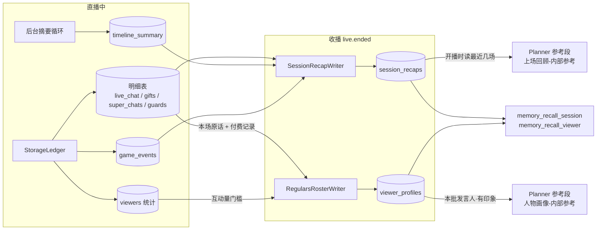

# 主播记忆（场次回顾 + 观众画像）

> 本文档是主播跨场次记忆的权威设计说明。
> 主播必须自己记住、现场又推不出来的东西只有两样：**自己做过什么**（场次回顾）与**常客是谁**（观众画像）。两样都在收播时整理，开播与决策时按场次序号或观众身份直接取用。
> 决策依据见 [ADR-042（场次回顾 + 观众画像）](../decisions/042-streamer-memory-recap-and-roster.md) 与 [ADR-029（身份复合键与货币口径）](../decisions/029-viewer-identity-key-and-currency-unit.md)。当场的工作记忆（时间线、前情提要）见 [主播上下文构成](streamer-context.md)。

## 设计公理

1. **按身份取，不按文本搜**：场次回顾按场次时间序取（"往前第 n 场"），观众印象按观众身份取。主播不必猜关键词。
2. **收播时整理**：记忆的写入集中在 `live.ended` 之后的后台任务，直播进行中不为记忆额外调用模型。
3. **有印象才注入**：没形成印象的观众不占提示词——"不注入"是门槛过滤的自然结果，不是独立排除逻辑。
4. **身份判断是确定性代码**：常客按 `(platform, user_id)` 定位，昵称只在注入与查询时经 `viewers` 实时解析，LLM 只负责读与写正文。

## 数据流

生成、注入与工具逻辑在 `src/agents/streamer/memory/`；两张表的仓储 `SessionRecapRepo` / `ViewerProfileRepo` 在 `src/modules/storage/repos/`。

## 场次回顾

| 环节 | 规则 |
|---|---|
| 写入时机 | `live.ended` 后后台写本场；空场次（无明细行、场次行已删）不写。启动时补写最近一场"已结账却无回顾"的场次，并顺带补跑该场的观众画像更新（进程退出时收播整理没跑完的善后） |
| 原料 | 按场次主键取：主播自己说过的话（`live_chat` 的 assistant 行）、话题摘要轨迹（`timeline_summary`，相邻重复去重）、游戏里程碑（`game_events`）、本场弹幕最多的观众与付费三表。各类各自封顶，整体超限从尾部截断 |
| 生成 | summary 档位，提示词 `session_recap_system`；以主播第一人称写这场做了什么、答应过谁什么、聊过的梗、谁来得多；超长按 `recap_max_length` 截断 |
| 注入 | `live.started` 时读出最近 `recap_inject_count` 场（排除本场），渲染为"【日期 的直播，时长】正文"，作为参考段**最前面**的"上场回顾-内部参考"整场固定 |
| 工具 | `memory_recall_session(n_back)`：往前第 n 场（1 = 上一场；进行中的本场不算） |

## 观众画像

| 环节 | 规则 |
|---|---|
| 候选 | 本场弹幕最多的观众（按条数倒序扫描），且 `viewers.interaction_count` ≥ `roster_min_interactions`；每场最多 `roster_batch_max` 人 |
| 原料 | 旧印象 + 该观众本场在上次整理（`last_compressed_at_ms` 记录已整理到的时间点）之后说过的原话 + 付费与身份记录（累计付费、最近三条明细、最近一次付费时的牌子 / 舰队快照，金额经 `to_cny`；直接查付费三表取得） |
| 生成 | summary 档位，提示词 `profile_system`；不超过 `profile_max_length` 字；写回并把已整理时刻推进到当下。上次整理之后没有新话（同一场重复收尾）不调用模型 |
| 失败 | 逐人降级：该观众印象不动、已整理时刻不推，下场再来 |
| 注入 | 本批发言人按发言时间倒序去重，逐人查印象，无印象跳过不占位；行渲染 `- {昵称}: {印象}`，昵称经 `ViewerRepo` 实时取，无统计行回退 `platform/user_id` |
| 工具 | `memory_recall_viewer(nickname | user_id)`：昵称经 `viewers` 反查身份键 |
| 管理 | WebUI 观众画像页（`/api/v1/memory/*`）：列表 / 搜索 / 人工纠正 / 删除。纠正不改已整理时刻，纠正版作为旧印象参与下次更新 |

## 配置（agents.toml `[agents.streamer.memory]`）

| 键 | 默认 | 含义 |
|---|---|---|
| `recap_enabled` | `true` | 收播写回顾、开播注入上场回顾 |
| `recap_max_length` | `500` | 单场回顾长度上限（字符） |
| `recap_inject_count` | `1` | 开播注入最近几场（0 = 只留工具按需查） |
| `roster_enabled` | `true` | 收播更新观众印象（关闭后已有印象仍注入） |
| `roster_min_interactions` | `3` | 建档的累计互动量门槛 |
| `roster_batch_max` | `5` | 每场最多更新几位常客 |
| `profile_max_length` | `400` | 单人印象长度上限（字符） |

## 降级

- 记忆两仓储任一未注入：对应写入与注入关闭；两者都在时才注册记忆工具。
- summary 档位不可用：回顾与印象都不写（有日志），直播主链路不受影响。
- 读回顾或印象异常：该段整段省略，不阻断决策。

## 边界（不做什么）

- 不做自由文本或语义检索；不做 embedding。
- 不在直播进行中更新印象：本场新形成的认识靠对话上下文本身，下场才进注入段。
- 不跨平台聚合：每个 `(platform, user_id)` 是一个独立的人。
