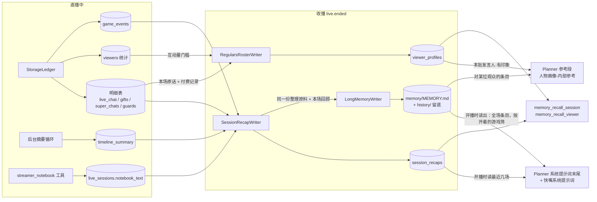

# 主播记忆（场次回顾 + 观众画像 + 长期记忆 + 本场备忘录）

> 本文档是主播跨场次记忆的权威设计说明。
> 主播必须自己记住、现场又推不出来的东西有三样：**每场做了什么**（场次回顾）、**常客是谁**（观众画像）、**跨很多场一直记着的事**（长期记忆 MEMORY.md：答应过的事、老梗、长线目标、对自己的认识）。都在收播时整理；本场的结论先记在本场备忘录里，收播时沉淀进来。
> 决策依据见 [场次回顾 + 观众画像](../decisions/042-streamer-memory-recap-and-roster.md)、[长期记忆](../decisions/051-streamer-long-term-memory-file.md)、[条目化与淡出](../decisions/058-streamer-memory-items-and-fading.md) 与 [身份复合键与货币口径](../decisions/029-viewer-identity-key-and-currency-unit.md)。当场的工作记忆（时间线、前情提要）见 [主播上下文构成](streamer-context.md)。

## 设计公理

1. **按身份取，不按文本搜**：场次回顾按场次时间序取（"往前第 n 场"），观众印象按观众身份取，长期笔记按对象与游戏筛选后注入。主播不必猜关键词。
2. **收播时整理**：记忆的写入集中在 `live.ended` 之后的后台任务，直播进行中不为记忆额外调用模型。本场备忘录是唯一直播中写的，由模型经工具主动写、每次写入都落进场次行。
3. **默认会淡出**：长期笔记里模型记下的条目，只有观众或游戏再次提起才算"续上"，主播自己又念一遍不算；连续几场没人提就挪进搁置区、不再注入。
4. **出现在该出现的时候**：答应某位观众的事只在 ta 发言时给主播看，只跟某个游戏有关的只在那个游戏开着时给；没形成印象的观众不占提示词。
5. **人写的说了算**：人写或人改过的条目模型只读不改、也不淡出；每次写入留底，改错了能撤回。
6. **正式与彩排各一条线**：场次开启时声明类型（正式 / 彩排，见 [场次分正式与彩排](../decisions/050-session-kind-live-and-rehearsal.md)）。回顾每场都写，读取只取同类型场次；长期笔记正式与彩排各一份文件；画像只更新真假与场次类型相符的观众。
7. **身份判断是确定性代码**：常客按内部观众 ID 定位（同一位观众换了数据源也是同一份画像），昵称只在注入与查询时经 `viewers` 实时解析，LLM 只负责读与写正文。

## 数据流



生成、注入与工具逻辑在 `src/agents/streamer/memory/`（长期笔记的条目格式在 `notes.py`，合并操作与淡出规则在 `note_merge.py`）；两张表的仓储 `SessionRecapRepo` / `ViewerProfileRepo` 在 `src/modules/storage/repos/`，长期记忆文件存储 `LongMemoryStore` 在 `src/modules/storage/long_memory.py`。收播整理的顺序是回顾 → 长期记忆 → 画像，三步都走完才在回顾行记整理完成（`settled_at_ms`）。停止 Agent 或进程退出打断的整理，下次启动从断点补完：回顾已有不重写，长期记忆按回顾行的合并时刻（`long_memory_merged_at_ms`）每场只并一次，画像只取上次整理之后的新话。

## 本场备忘录

| 环节 | 规则 |
|---|---|
| 写入 | 模型经 `streamer_notebook` 工具整份覆盖写（沉淀结论，不沉淀流水）；每次写入后全文同步落进进行中场次的 `live_sessions.notebook_text`，已结账的场次不再接受写入；开播前写下、带进这一场的备忘录在开播时也落一次 |
| 注入 | 决策参考段末尾的"备忘录-内部参考"与表达层，每轮读进程内那份 |
| 生命周期 | `live.ended` 时清空进程内那份；收播整理（含下次启动的补整理）按场次主键从场次行读回 |

## 场次回顾

| 环节 | 规则 |
|---|---|
| 写入时机 | `live.ended` 后后台写本场；空场次（无明细行、场次行已删）不写。启动时补完最近一场"已结账却没整理完"的场次（没有回顾，或回顾写完后整理被打断），缺的回顾、长期记忆合并、观众画像更新一并补上 |
| 原料 | 按场次主键取，顺序：场次头 → 备忘录全文 → 主播自己说过的话 → 话题摘要轨迹（相邻重复去重）→ 游戏里程碑 → 本场弹幕最多的观众与付费三表 → 观众指出主播说错、记错的弹幕（连同主播前一句）。发言、话题、游戏三类先取全场，再按时间均匀取样（首尾都在）；整体超长时先把发言隔行抽稀，抽到下限仍超才从尾部截断，场次头与备忘录不截 |
| 生成 | summary 档位，提示词 `session_recap_system`；以主播第一人称写这场做了什么、明确答应过谁什么（观众只是请求的写清是请求）、放弃了什么、聊过的梗、谁来得多；超长时停在 `recap_max_length` 内最后一个完整句子之后 |
| 注入 | `live.started` 时读出最近 `recap_inject_count` 场**同类型**场次（排除本场），渲染为"【日期 的直播，时长】正文"，放在 Planner 系统提示词末尾的"上场回顾（内部参考）"，整场固定 |
| 工具 | `memory_recall_session(n_back)`：往前第 n 场同类型场次（1 = 上一场；进行中的本场不算；未开播按正式场数） |

## 长期记忆

### 文件格式

数据库同目录 `memory/MEMORY.md`（正式）、`memory/MEMORY.rehearsal.md`（彩排）；纯文本 UTF-8，人可直接用编辑器改。分节，`## 节名` 下每行一条 `- 正文`，行尾可带一组标签：

```
## 答应过的事
- 我答应老王下次玩恐怖游戏〔未兑现 · 对 老王#12 · 始于 #43 · 最近 #45〕
## 长线目标
- 在 minecraft 里给苦力怕盖海景房，地基打好了〔游戏 minecraft · 始于 #40 · 最近 #45〕
## 老梗与口头禅
- 床名叫咕咕床〔人工〕
```

| 节 | 注入 | 用途 |
|---|---|---|
| 答应过的事 | 是 | 约定，标签记结局：未兑现 / 已兑现 / 放弃 |
| 老梗与口头禅 | 是 | 观众会接的梗、主播常说的话 |
| 长线目标 | 是 | 跨场次推进的事与进展 |
| 关于我自己 | 是 | 与人设一致的喜好、习惯、立场 |
| 不确定 | 否 | 还没坐实的（观众自称的身份关系、拿不准的） |
| 搁置 | 否 | 已淡出的旧条目，有人再提可挪回 |

| 标签 | 含义 |
|---|---|
| `未兑现` / `已兑现` / `放弃` | 约定的结局 |
| `对 昵称#观众编号` | 只对这位观众的条目：ta 发言时才给主播看 |
| `游戏 名字` | 只跟这个游戏有关：游戏开着时才给主播看 |
| `来自 来源` | 别处经同步接口写进来的（如 QQ 群里答应的事）：照常整理、淡出，注入时注明来处，不算人改的行 |
| `始于 #场次` / `最近 #场次` | 哪一场记下的、最近一次有新证据是哪一场（`#` 后是场次编号） |
| `人工` | 人写的条目：模型只读不改、不淡出 |
| `整理` | 模型写的、暂时没有别的标签 |
| `原 节名` / `搁置 #场次 原因` | 搁置区条目原来在哪一节、哪一场因何搁置（过期 / 已了结 / 篇幅） |

不认识的标签与人自己加的节、标题前的说明文字原样保留。有标签的文件里没带标签的行算人工；整份没有标签的旧笔记按模型条目读入，"（未兑现）"读成状态。

### 收播合并

| 环节 | 规则 |
|---|---|
| 时机 | 收播整理里排在场次回顾之后；本场没写成回顾就不动；启动补完整理的场次同样补一次，已合并过的场次不再合并 |
| 原料 | 编号条目清单（人工条目标只读）+ 人设 + 接入的游戏 + 本场观众名单（弹幕最多的与付过费的）+ 本场回顾 + 整理原料（与回顾同一份） |
| 生成 | summary 档位，提示词 `long_memory_system`；模型只回操作 JSON：`add`（新增，可挂观众与游戏）、`seen`（观众或游戏又提到，搁置的据此挪回）、`edit`（改写）、`done`（兑现）、`drop`（放弃）、`move`（挪节）、`remove`（删除）。门槛：约定只记明确答应且做得到的；续上只认别人提起；"关于我自己"不收即兴编的经历；观众自称的身份进"不确定"；不记此刻状态 |
| 执行 | 代码逐条执行，没动到的行一字不变；对人工条目的操作不执行、记进改动清单；观众编号不在名单里、游戏没接入就不挂；新增与已有相同按续上处理；输出读不出操作时保留旧版本、不记合并时刻 |
| 人改过的行 | 合并写下的全文另存为基线（`memory/history/<类型>/baseline.md`）；下次合并先拿当前文件和基线比，人新增或改过正文的行记成人工 |
| 淡出 | 模型条目连续 `long_memory_stale_sessions` 场同类型、写过回顾的场次没有新证据就搁置；已兑现或放弃的约定留一场再搁置；注入四节合计超过 `long_memory_max_chars` 时先搁置最久没被提起的模型条目；人工条目永不搁置；搁置区只留最近 30 条 |
| 写回 | 带读出时的版本号写回；合并期间文件被人保存过，就在新版本上重做同一批操作 |

### 注入

| 去处 | 内容 |
|---|---|
| Planner 系统提示词末尾"她的长期笔记（内部参考）" | 四个注入节里的全场条目，只含开着的游戏的；去掉标签，约定附"还没兑现 / 已兑现 / 放弃" |
| 人物画像段 | 本批发言的观众若有对 ta 的条目，在 ta 的画像行下加"（笔记）"行；没有画像也给 |
| 快嘴系统提示词 | 四个注入节里的全场条目（不按游戏筛） |

开播时（以及启动善后时）读出并解析一次，整场不变；笔记写明"用得上时再用，不必主动提起"。

### 留底与管理

| 环节 | 规则 |
|---|---|
| 留底 | 每次写入把旧全文存进 `memory/history/<类型>/<编号>.md`，来由（收播整理 / WebUI 保存 / 恢复旧版本）、场次与逐条改动追加到同目录 `changes.jsonl`；只留最近 50 条；内容没变不留底 |
| 管理 | WebUI 主播记忆页顶部的长期记忆面板：正式 / 彩排切换、整份编辑；"改动记录"列出每次写入的来由与逐条改动，可只读查看改之前的全文、撤回某次改动（撤回也留底）。接口 `GET / PUT /api/v1/memory/long-term/{kind}`、`GET .../history`、`GET .../history/{id}`、`POST .../history/{id}/restore`；改动从下一次开播起生效 |

### 与 MaiBot 共用

开了 infra.toml `[maibot_sync]` 且 `share_notes = true`（默认）时，正式场笔记的正本放在 MaiBot 适配器插件，本地 `memory/MEMORY.md` 当缓存；没开时完全不经过下面这些。取舍见 [ADR-059](../decisions/059-shared-notes-with-maibot.md)。

| 环节 | 规则 |
|---|---|
| 读 | 先拉正本：本地没改过就采纳（留底，来由"从 MaiBot 同步"）；本地有没推上去的改动就推上去；两边都改过按条目三方合并，共同版本是上次同步的全文（`memory/maibot/synced.md`） |
| 写 | 收播整理带版本号推给正本，冲突就在新版本上重做；WebUI 保存与恢复旧版本先合并正本这期间的改动再推；推成功再写本地缓存 |
| 连不上 | 读用本地缓存，写只写本地并记为待推；后台按 30 秒 / 2 分钟 / 10 分钟补推 |
| QQ 那边 | 只有白名单群（插件 `qq.group_ids`）看得到注入的四节（不含对某位直播观众的条目），也能经工具记下约定（`来自 QQ群`）；名字每次读写都与 MaiBot 昵称核对，不一致时告警 |
| 彩排场 | 不同步，照旧只在本地 |

## 观众画像

| 环节 | 规则 |
|---|---|
| 候选 | 本场发过弹幕的观众（按条数取前 50）加本场付过费的观众，且 `viewers.interaction_count` ≥ `roster_min_interactions`、真假与场次类型相符（正式场只看真实观众，彩排场只看模拟观众）；上次整理之后这场至少说了两句或付过费才算 |
| 轮换 | 还没建档的先来，其次印象最久没更新的（同样旧的话多的先来）；每场最多 `roster_batch_max` 人 |
| 原料 | 旧印象 + 该观众本场在上次整理（`last_compressed_at_ms` 记录已整理到的时间点）之后说过的原话 + 付费与身份记录（累计付费、最近三条明细、最近一次付费时的牌子 / 舰队快照，金额经 `to_cny`；直接查付费三表取得）；只付费没说话的写明"这场没说话，只有付费" |
| 生成 | summary 档位，提示词 `profile_system`；观众自称的身份关系写成"他自称……"；超长时停在 `profile_max_length` 内最后一个完整句子之后；写回并把已整理时刻推进到当下 |
| 失败 | 逐人降级：该观众印象不动、已整理时刻不推，下场再来 |
| 注入 | 本批发言人的外部 ID 先换算成观众、按观众去重（发言时间倒序），逐人查印象与长期笔记里对 ta 的条目，都没有就跳过不占位；行渲染 `- {昵称}: {印象}`（没印象写"还没形成印象"），改过名的写成 `- {昵称}（以前叫{曾用名}）: {印象}`，对 ta 的笔记另起"（笔记）"行 |
| 工具 | `memory_recall_viewer(nickname | viewer_id)`：昵称先比当前昵称、再比曾用名；命中曾用名时告诉主播对方现在叫什么 |
| 管理 | WebUI 主播记忆页的画像表（`/api/v1/memory/profiles`）：列表 / 搜索 / 人工纠正 / 删除。纠正不改已整理时刻，纠正版作为旧印象参与下次更新 |

## 配置（agents.toml `[agents.streamer.memory]`）

| 键 | 默认 | 含义 |
|---|---|---|
| `recap_enabled` | `true` | 收播写回顾、开播注入上场回顾 |
| `recap_max_length` | `500` | 单场回顾长度上限（字符） |
| `recap_inject_count` | `1` | 开播注入最近几场（0 = 只留工具按需查） |
| `roster_enabled` | `true` | 收播更新观众印象（关闭后已有印象仍注入） |
| `roster_min_interactions` | `3` | 建档的累计互动量门槛 |
| `roster_batch_max` | `5` | 每场最多更新几位常客 |
| `profile_max_length` | `400` | 单人印象长度上限（字符） |
| `notebook_max_chars` | `2000` | 本场备忘录容量上限（字符） |
| `long_memory_enabled` | `true` | 收播合并长期记忆、开播注入（关闭后既不更新也不注入，文件保留） |
| `long_memory_max_chars` | `2000` | 注入的四节合计长度上限（字符），超出先搁置最久没被提起的 |
| `long_memory_stale_sessions` | `3` | 连续几场没人提就搁置 |

## 降级

- 记忆两仓储任一未注入：对应写入与注入关闭；两者都在时才注册记忆工具。长期记忆需要文件存储与场次回顾仓储都在。
- summary 档位不可用：回顾、印象与长期记忆都不写（有日志），直播主链路不受影响。
- 读回顾、印象或长期记忆异常：该段整段省略，不阻断决策。
- 备忘录落盘失败只告警，模型照常拿到写回执；这一版可能缺席本场整理。

## 边界（不做什么）

- 不做自由文本或语义检索；不做 embedding。
- 不在直播进行中更新印象与长期笔记：本场新形成的认识靠对话上下文与备忘录本身，下场才进注入段。
- 不跨平台聚合：不同平台的观众始终是不同的人；同一平台内的账号 ID 与开放平台 ID 由观众表关联到同一人（见 [观众身份映射](../decisions/047-viewer-identity-mapping.md)）。
