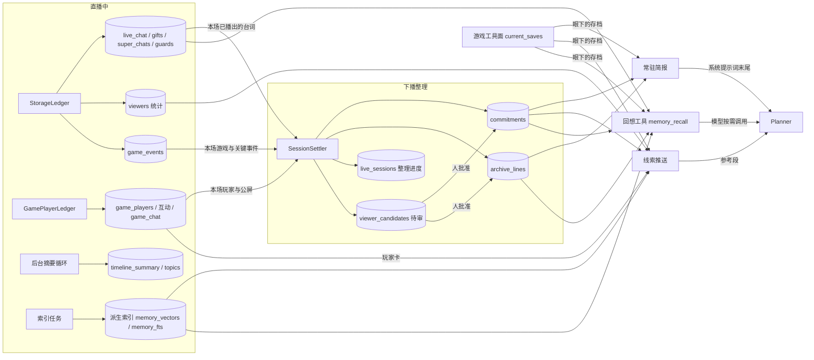

# 主播记忆（承诺账本 + 场次档案）

> 本文档是主播跨场次记忆的权威设计说明。
> 主播必须自己记住、现场又推不出来的东西分四类：**她当众答应过、还没兑现的事**（承诺账本 `commitments`）、**前几场干了什么、哪些事还成立**（场次档案 `archive_lines` 与滚动快照）、**游戏里单个玩家与她的一对一往来**（游戏玩家档案 `game_players`），以及**多人游戏存档里的群体环境与共享惯例**（游戏社交事实 `game_social_facts`）；另外还有运营者手写的老梗栏（人设字段 `inside_jokes`，配置文本，不在账本里）。
> 旧的场次回顾、观众画像、长期笔记文件与主播备忘录已退役：阶段 3b 起停写、也不再进任何提示词；v25 迁移删除两张旧表与场次表的备忘录列，并把库文件旁的旧笔记目录整目录移进 `backups/memory-pre-v25-<时刻>/`（不删除、可手工取回；不可逆，见 [清掉旧记忆的存储面](../decisions/067-irreversible-memory-cleanup.md)）。
> 决策依据见 [按账本记录](../decisions/065-memory-ledger-shadow-run.md)、[注入切到账本](../decisions/066-memory-injection-switch.md)、[不可逆清理](../decisions/067-irreversible-memory-cleanup.md)、[档案快照](../decisions/071-rolling-session-archive.md)、[混合检索与被动想起](../decisions/072-memory-hybrid-search-and-passive-recall.md)、[人工审核](../decisions/073-settlement-human-review.md)、[观众定下的事经人批准](../decisions/074-viewer-defined-memory-needs-approval.md)、[游戏里的人](../decisions/075-game-players-by-uuid.md)、[常驻简报分区与场内更正](../decisions/077-memory-zones-opening-wrapup-ttl-and-in-stream-correction.md) 与 [游戏社交事实边界治理](../decisions/078-game-social-facts-boundaries-and-governance.md)；当场的工作记忆（时间线与前情提要）见 [主播上下文构成](streamer-context.md)。

## 设计公理

1. **只从她播出的原话与有据公屏长出来**：承诺与档案只取自本场已播出的主播台词（`dropped_at_ms` 为空的行），每条带逐字原话；没播出的不进。观众的话只有经人批准、且她当场接受过，才进跨场记忆（含档案候选与弹幕来源的社交事实候选，见下文"人工审核与候选"）；对游戏玩家的承诺可引她在游戏公屏打出去的那句，多人环境社交事实引在场玩家已核实身份的公屏原话。逐字引文只能证明"说过"，证明不了"该记"，所以另由找承诺的提示词排除不该答应的（要花钱、寄东西、线下见面、一对一私下联系、要观众的私人信息）与改称呼、改身份、"以后都……"一类的话，提示词的红队样本评测在 `scripts/memory_eval/`。做不到的事照常登记：当众答应了观众就会等着，做不到由她当众说清楚，下播整理据此了结。
2. **跨场整理集中在收播后，场内纠错当场生效但守边界**：跨场档案、新承诺提取集中在 `live.ended` 之后的整理里完成，每场固定几次调用、并逐调用保存断点（`settle_checkpoints`）。场内若发现旧档案或旧承诺已过时、记错，决策环节可通过 `streamer_memory_correct` 附本场证据当场加注或结掉承诺，运营递话纠正也本场常驻保留，但跨场快照的去掉与替换仍统一交下播整理核对证据。
3. **一种记忆一个出场入口**：对某位观众的承诺只在 ta 开口时出现，对某位游戏玩家的承诺只写在他的玩家卡上（他开口或冲她做动作时）；不针对具体人的公开承诺（当前存档或不挂游戏）在近期活跃期内进常驻简报【还惦记的事】，隔场过期后转为搁置计数、不再靠游戏卡轮播刷屏；最近一份档案快照按四区独立名额常驻 Planner，开播头两窗另附确定性【上次收尾】。
4. **三个读出口、两档写法**：常驻简报（系统提示词末尾）、线索推送与环境参考段（参考段，含开播【上次收尾】、被动想起、玩家卡、【游戏社交事实】）、回想工具 `memory_recall`（按需调用，与被动想起共用一套混合检索）。同一套渲染函数产出 Planner 档与说话档，说话模型只拿到动作标题。
5. **身份判断是确定性代码**：观众按内部观众 ID 定位，外部 ID 只用于精确解析；同平台待确认身份关联在只读统计到场场次数时合并去重，不自动改写身份归属；昵称只在渲染与遮名时经 `viewers` 使用。任何面向主播的通路都不出现精确天数、场次数与日期。
6. **正式与彩排两条线**：只有正式场会被整理成账本；彩排场永不进候选，读取也按场次类型过滤。场次类型见 [场次分正式与彩排](../decisions/050-session-kind-live-and-rehearsal.md)。
7. **可纠错、可遗忘**：运营者能看了结、判误记、撤回场内结单、删除、手建承诺、删单行档案，能在复盘页按句删她的台词；观众或游戏玩家发"忘了我"后由存储侧停止记录并在下播后删除，先按证据外键清掉本人原话作证行，再按名字使用期跨表替换提及文本（档案快照只引用原行，读到的也是替换后的）。

## 数据流

## 写入：下播整理

代码在 `src/agents/streamer/memory/settle.py`，跨表落库在 `SessionRepo.apply_settlement`。

| 环节 | 规则 |
|---|---|
| 触发 | `live.ended` 道别那一轮跑完、队尾台词播完（等多久由代码常量限定，TTS 卡住不挡住整理）之后排进后台；进程启动时也补跑一次。存储升级到账本（v24）时，存量场次一律记成已整理，只留升级前最后一场够长的正式场待整理，启动补整理从它长出第一份档案与承诺（旧记忆同一次升级退役，不留这一场账本就是空的）。只挑已结束、尚未整理、自动重试次数还没用满的**正式场**，按开播时刻从早到晚逐场整理，彩排场永不在候选里 |
| 开播补整理 | 新场次开播时不再同步等整理：先按当前表快照拼第一份常驻简报，再把待整理场次排进后台任务（同一场与下播整理共享在途任务，只付一次模型调用）；后台整理写完档案后，下一个决策窗的简报自然带上刚结束那一场，期间简报退化为更早一场，不影响开播。这份后台任务失败按普通整理失败计次、写整理报告，下次启动、下次开播补整理或 WebUI"重新整理"再跑 |
| 取料 | 本场全部已播出台词（按时间编号，不抽样、不截断），回应弹幕的那句附上被回应的弹幕原文与发言人代号（本场内稳定的"观众1、观众2"）；本场玩过的游戏与游戏关键事件（事件前标着当时的存档，一场里换过存档的游戏另起一行说明）；"她能做的事"一行（启用的游戏 Agent 名单加聊天、讲故事一类）；本场记住的地点（来自地点动静事件）；本场开播前未了结的承诺、最近已了结与已判误记的承诺标题；本场的游戏玩家（代号"玩家1、玩家2"与名字）与她在游戏公屏打出去的字（编号"公屏#N"，前面附着玩家说的话），回应玩家的台词标"回应玩家N" |
| 四次调用与断点续跑 | 各只做一种判断，都走 `settle` 档位，每跑完一步立即写入 `settle_checkpoints` 表，重启或重试时从没跑完的那一步接着跑：①场次档案（排最前，优先产出快照；挑本场值得下次开播提起的事、对上一份快照逐行只挑不改写并核对【本场更正】、顺带列观众候选）②找新承诺（行号或公屏编号、原话、标题、对谁、挂哪个游戏、重申的 `same_as` 推进最近提起场次；顺带列她说欠着、账上找不到的事）③了结旧承诺（只在本场前有未了结承诺时才调）④更新游戏社交事实与有据互动（只在装配了社交事实仓储且本场玩过游戏时才调）。直播切片自动选段排在待整理场次跑完之后执行，不与整理争抢模型并发；停机仍有未完整理时记告警并在下次打开 WebUI 首页时弹窗提示 |
| 代码校验 | 逐字引文必须是所引那一行文本的子串且不超过上限（超出的整条丢弃，模型写的标题超长则截断；档案新事拒绝疑问句、反问句与猜测句引文，并剥除误入标题的真实观众昵称）；挂的游戏（档案行与承诺同一口径）必须是本场出现过的、或是启用了的游戏 Agent，否则置空；挂了游戏的按那句台词的时刻对上本场的存档段记下存档（见下文"游戏存档"）；对某位观众答应的，那一行必须回应了真实观众的弹幕，对某位玩家答应的按两条证据路径对上那位玩家（见下文"游戏里的人"），对不上就不登记、进未登记清单；公屏上打的字只登记对玩家的承诺；游戏里做成了什么（档案新事与替换旧行里的完成说法，如搭好了、装上了、拿到了、做完了；挂了游戏的承诺了结时说做完了）要引本场游戏记录撑着：给模型的游戏记录是全本场的、按时刻编号，列了结了的委派（只有执行侧主动交付 `succeeded` 的能作证，发起方单方结单 `closed_by_initiator`、没交付或被打断的照列但标明不能作证）和写明做成了的里程碑、上报，可以引几条，代码核对其中有一条存在、能作证、同一个游戏、不晚于她那句（容两分钟）；没核实到的档案行照写，写成"她说……（游戏记录里没核实到）"、不算稳定的事，整理报告记下条数，了结则不认、进未登记清单；本场一条游戏记录都没有时无从核对，不拦；触发词必须在标题或原话里出现，地点必须照抄本场记住的地点且说得通；人改过的档案行模型动不了；与未了结的旧承诺是同一件事、或那句台词的记忆引用里已经点到某条承诺，都不新建并推进该承诺的 `last_mentioned_session_id`；与已判误记的承诺相近的进未登记清单；了结只改 `open` 的行，运营者已处理过的结论不被模型翻改；对旧行的操作（含按有据【本场更正】去掉）逐条校验，不合规的不采纳、旧行照留，写进整理报告 |
| 写入 | 四步全部就绪后在一个事务里落库：本场档案行、本场档案快照、新承诺、旧承诺了结与重申推进、社交事实更新、本场待审候选、本场整理完成时刻一起提交，同时清除该场的 `settle_checkpoints`；整理完成时刻先到先得；重新整理前先清空该场旧断点，只替换这一场自己的档案行与快照。校验没通过的条目连同原话写进整理报告，在 WebUI 里逐条列出，WebUI 首页顶部常驻一行提醒汇总整理失败停滞场次与待审候选数 |
| 失败与重试 | 任一次调用失败、输出读不懂、输入超出模型窗口、上一份档案快照读不出来都算这一场失败：整场不提交，重试次数加一、原因写进整理报告；次数用满后不再自动补跑，等运营者在 WebUI 点"重新整理"（把次数清零，下一次调度就会再挑到它）。一场失败不挡后面的场 |
| 空场次 | 本场没有任何播出台词时不调模型，直接记成已整理 |
| 场次类型改动 | 正式场改成彩排时，这一场写的档案行（所有快照里对它们的引用随外键一并撤掉）、这一场的快照、登记的承诺与整理进度一并清掉（同一事务）；删除场次同样；彩排改成正式后，下一次调度自然会整理它 |
| 何时忘 | 对象观众被删除时，对 ta 的承诺随删除函数一并删掉；档案与承诺长期保留，运营者可删单行/单条 |

承诺只来自正式场与运营者手建，不来自彩排；整理报告的未登记清单同时是评估提示词质量的样本来源，也是 `scripts/memory_eval/` 的难负例来源。

整理报告另有一节唠叨指标，和"记得住"成对看：本场台词点名旧事几次、同一条最多几次、没人问时（不在回应观众或玩家，前一分钟也没人提到同一条）主动提几次、半小时内绕回三次的条目、线索卡按卡类推了几张用上几张、只由她自己的话触发几张、同一位玩家被推几张。只有编号和数字；本场既没点名也没推卡就不写这一节。

## 档案快照

每份档案只写一场的事，碰上一场短的、乱的，前面几场的事就从简报里全掉出去；所以每个整理过的正式场另留一份档案快照，接住前几场仍然成立的事。决策依据见 [档案快照](../decisions/071-rolling-session-archive.md)，代码在 `src/agents/streamer/memory/rolling.py` 与 `settle.py`。

- **快照只引用原行**：快照的每一行引用一条 `archive_lines`，另记位置、是否稳定的事、最近一次写下或再提起它的那一场的开播时刻。原行被删（删单行、按句删台词、改彩排、删场次）时外键级联从所有快照撤掉；删观众改的是原行文本，快照读到的也是替换后的。留下的行标题、原话、证据、出自哪一场、存档不会变。
- **上一份快照**：开播早于本场的最近一份同类型快照，不看时长。升级前整理过的场次没有存下的快照，由它自己的档案行加往前几场的档案行现拼（场次数由代码常量限定，遇到存下的快照接上它就停，同一句原话只留最新一行）。
- **模型只挑不改写**：上一份快照每行编号"旧N"，注明原话、在哪个存档、是否稳定的事。没列出的行一律保留；保留时可以写上本场又提起它的那一行（记为再提起），可以重标是否稳定；去掉的理由必须以了结、不成立、记错、被取代四类之一开头，并指出本场哪一行台词是证据（代码核对它确实是本场播出的台词），"这场没提到""一次性的事"不算理由；同一件事写了两行时可以注明与哪一行重复去掉其中一行；替换的新行按本场台词写、原话照抄，过与新事同一个逐字引文校验器。不合规的操作不采纳、旧行照留，写进整理报告。
- **取舍**：快照按常驻简报的分区规则独立计额（`zones.py` / `rolling.py`）：人放回或新增的行（pinned）排第 0 档不挤 → 每个存档下取名类稳定事实至多 12 条（渲染压成 1～2 行名字表）、其余稳定事实补足至该存档【这个世界里】至多 12 行展示名额 → 游戏本场新进展至多 6 行、前两场保留进展至多 6 行 → 不挂游戏的直播间稳定事实至多 6 行、直播间普通事件至多 6 行；跨多存档累计总安全上限 40 行。被挤出的本场新事照样写成本场档案行，回想工具查得到，只是不进快照；挤出的行写进整理报告。
- **兜底**：输出里没有对旧行的操作（或整个输出为空）时上一份原样保留；操作不是列表、上一份读不出来都算整理失败，下次再试，上一份快照原样留着。
- **重新整理**：第 N 场的快照从它之前最近一份快照重新算，此前做过的去掉、替换随之作废；之后各场的快照不重放，第 N 场的旧行从它们里撤掉、新行不进去。要结果带到简报里，按时间顺序把之后的场次依次重新整理。
- **冷启动**：存储升到 v28 时库里还没有任何快照、而最近一个已结束的正式场已经按旧逻辑整理过，迁移把它放回待整理，启动补整理在现拼的基底上重新整理它；最近一场还没整理时它的第一次整理就是这样接的。不需要运维步骤。

## 人工审核与候选

整理照旧自动生效，人在 WebUI 记忆页事后改；观众定下的事要人批准才进记忆。决策依据见 [人工审核](../decisions/073-settlement-human-review.md) 与 [观众定下的事经人批准](../decisions/074-viewer-defined-memory-needs-approval.md)。

- **审核操作**：改标题、标或取消稳定、把被挤出或去掉的行放回最新快照、取消放回、从这一场她播出的台词里截一段原话新增一行、删行、标已审。改过标题或稳定标记、人新增的行锁住，之后的整理不能去掉或替换（整理报告写"人改过的行只有人能动"），也改不了它是不是稳定的事（模型重标、按重复去掉别的行时把稳定带过来都不算；只有"最近被提起"按本场台词证据照常更新）；放回与新增的行在快照取舍里排第 0 档，不挤、不占稳定的事的名额；一份快照至多 4 行，满了界面提示、要先取消一条放回才能再放回或新增（取消放回的行还在快照里，之后按规则取舍）。锁住但没放回的行被 12 行上限挤出快照不算"去掉"：锁住只是模型不能改它、删它，要不要一直留在简报里由放回决定，被挤出去的行还在档案里、回想查得到。原话不能改。每次操作记一条改动记录，与档案同寿命。
- **观众定下的事**：写档案那次调用顺带列出——观众起的名字、定的设定或梗、说游戏世界的事，她在回复那条真实观众弹幕的那一行接受了、自己却没复述。两段原话都要逐字；模型另写观众定下的名字或梗词，必须在标题与那条弹幕原文里原样出现，观众只问了名字、名字是她自己起的不列，写进整理报告；含个人信息模式的整条丢掉只计数，和档案行、驳回过的去重，一场至多 5 条。批准后写成一行观众来源的档案行（原话是她那句回应，挂着那条弹幕），锁住、以普通行放进最新快照最前面（稳定与否照批准时标的，不标放回）；这一场重新整理时它留着、接着带进快照；整理调模型那段时间里批准的，落库时同一事务里补进新快照最前面；读出口都注明"和观众一起定的，不记得是哪一位"，说话档只给标题；她那句回应里点了那位观众的名（弹幕上的名、现名、曾用名），常驻简报、线索卡渲染时换成"那位观众"，库里的原话不改，回想照旧按跨场遮名；人批过的标题不换（名字留在标题里说的是起的名字是什么，不是谁定的），原话里和观众定下的那个词相同的那一段也不换（候选存着这个词，早先的候选没存，原话照旧全遮）。
- **她说欠着的事**：找承诺那次调用顺带列出——她说"上次答应过""欠大家的"，账上（未了结、已了结）找不到对得上的。一行至多一条、一场至多 3 条，不自动登记；批准后登记成一条未了结承诺，审核区旁边列出账上字面最接近的几条。
- **候选的寿命与可见性**：待审的 14 天没人审自动删掉；驳回的留着，同一条以后不再列。批准前对她完全不可见（简报、线索卡、回想、检索索引都不读候选表，契约测试守护）。候选挂在观众那条弹幕与她那句回应上，删观众、"忘了我"、按句删、删场次随外键一起删，改彩排时由场次仓储撤掉；挂在别人弹幕上、只是提到 ta 的候选不删，昵称换成"一位观众"。

## 游戏里的人

她在游戏里遇到的别的玩家按 UUID 认，只记和她发生过的互动。决策依据见 [游戏里的人](../decisions/075-game-players-by-uuid.md)；代码在 `src/modules/storage/game_player_ledger.py`（落库）、`memory/cues.py`（玩家卡）、`memory/settle_players.py`（承诺对象核对）。

- **认人与记录**：存储台账订阅公屏聊天与 `game.player.interacted`，只给带 UUID、核对过在线的发言人建档；记打招呼（一场一行）、送东西、切磋；公屏聊天落 `game_chat`（认不出是谁的一句只占位、不存原话），私聊不落库。改彩排时撤掉本场互动。见过他的存档连同那台服务器验不验正版账号（`online_mode`：on / off / unknown）一起记，报了的按最新的写，没报的不抹掉已知的；记忆页"游戏里的人"列出这些存档，离线模式的标明"按名字认人，改名算新人，冒名认不出"。她看到的玩家卡与承诺核对不按它区别对待。
- **玩家卡**：本窗在公屏开口或冲她做动作、以前在正式场里和她有过往来的玩家，推一张卡（打招呼、送东西、切磋，现在与以前的名字，答应过他还没了结的事至多两条，带约#N，她点名用上和承诺卡一样认，说话档说"答应过他的名字"；本场已经点名用上的那件不再写）；按 UUID 对上，同一位每场至多两次、隔十分钟，她本场回应过他就不再推。不进常驻简报，只给主播的 Planner，不给游戏 Agent。
- **对玩家的承诺**：证据是她回应这位玩家的台词（落库时记下了回应对象；回应目标对得上本窗一条弹幕的编号或原文的那一句不算，拿公屏原话当目标的照算），或她在公屏打的那句（点了他现在或以前的名字，两个字的名字要整词出现；或在他上一句之后 3 句之内、60 秒之内、中间只有她的话）；对不上不登记。只写在他的玩家卡上，不进简报、游戏卡、回想。
- **对号与删除**：玩家与观众不自动对号，运营者在记忆页确认关联，关联永不告诉她，只用于连带删除。删玩家时他的互动、公屏聊天、对他的承诺一起删，他的名字（含以前的名字）在她的台词、档案、承诺、游戏事件、她打的公屏字里换成"一位玩家"，UUID 进不记录名单；删观众或观众"忘了我"连带删确认过关联的玩家；玩家在公屏打"忘了我"和观众同一套口令与宽限期。

## 游戏社交事实

多人联机存档里"谁和谁是什么关系、什么机器大家公用、眼下服务器里谁在牵头忙什么、她平时扮演什么分工"归 `game_social_facts` 表，按 `(game, save_id)` 分账。决策依据与四套记忆分工边界见 [游戏社交事实边界治理](../decisions/078-game-social-facts-boundaries-and-governance.md)，代码在 `src/agents/streamer/tools/social_fact.py`、`memory/settle_social.py` 与 `repos/social_facts.py`。

- **边界与六类**：封闭六类（`setting` 环境形态、`members` 成员关系、`sharing` 共享惯例、`works` 进行中的事、`her_role` 她的角色、`open_questions` 待弄清），每类每存档至多 4 条现行、每次注入至多 12 条。她自己亲历的事件归场次档案，她当众答应的待办归承诺账本，单个玩家与她的一对一履历归玩家互动表。
- **证据门槛**：场内工具只允许游戏公屏已核实玩家原话经逐字校验直写现行；引用观众弹幕时要求她本场已送达回应，且只写入 `viewer_candidates` 待人工批准。下播整理无逐字引文的模型归纳行（未锁定的 `her_role` / `open_questions`）与未锁弹幕行不进每轮常驻【游戏社交事实】，仅留库供检索与审核；单场跨多存档发言时无引文归纳行归入整游戏级（`save_id=""`）；代号 `"玩家N"` 按整词边界正则还原真名。
- **陈旧降级**：未锁定的 `works` 隔过两个及以上时长达标的已完结正式场未再证实，读时降为"待确认的旧进展"排到末尾并附注说明，满 4 条上限写入新 `works` 时自动让位被取代。
- **删除**：删观众或删玩家时，先按证据外键整行删除拿本人话语作证的社交事实行，再把其余提及该名字的社交事实、游戏工作文档（`game_work_docs`）、场内更正与整理断点统一脱敏替换。

## 游戏存档

同一款游戏的不同存档是互不相干的世界，挂游戏的记忆只在说它的那个存档里成立。决策依据见 [游戏里的记忆按存档分开](../decisions/069-game-memory-per-save.md)。同一 `save_id` 在历史事件里出现过多个显示名称时，统一按 `save_id` 归并并展示最新非空存档名。

- **眼下在哪个存档**：主播每个决策窗开窗前从 `ToolRegistry.current_saves()` 拉一次（游戏工具面的只读方法，报不出存档的游戏不在结果里）。某个游戏从一个认出的存档换到另一个时，清掉这个游戏已了结的委派与补充要求；任务账本上还在做的留着，由游戏 Agent 看眼前再决定接着做还是上报。
- **写**：下播整理按台词时刻对上这一场各游戏的存档段（由记下了存档的游戏事件按时间并成），取台词之前最近开始的那一段；这个游戏这一场没有带存档的事件就不记。
- **读**：判定集中在 `src/agents/streamer/memory/saves.py`，一条记忆相对眼下存档分不分存档、本存档、别的存档、不确定四种（眼下还没进存档时，记着存档的一律算别的存档）。常驻简报开头写眼下在哪个存档，别的存档里的档案行与承诺统一折叠计数；回想工具逐条注明在哪个存档。升级前的旧数据存档为空，按不确定照给。

## 读出口一：常驻简报与场内更正

代码在 `src/agents/streamer/memory/brief.py`、`zones.py`、`commitment_ttl.py`、`render.py` 与 `tools/memory_correct.py`，拼接在 Planner 系统提示词末尾（`planner.py`）。决策依据见 [常驻简报分区与场内更正](../decisions/077-memory-zones-opening-wrapup-ttl-and-in-stream-correction.md)。

- **四分区与独立名额**：
  - **【这个世界里】**：当前存档的稳定事实；宠物、跟班、地点取名（至多 12 条）压成 1～2 行紧凑名字表，住处、关系、规矩等其余稳定事实逐行展示且不附长原话，整区展示不超过 12 行。
  - **【最近几场】**：当前存档的普通事件，分"上一场"（至多 6 行）与"再往前两场"（合计至多 6 行，按最近被提起排序）。
  - **【还惦记的事】**：当前存档及不挂游戏的未了结公开承诺，取近期活跃的至多 5 条并注明只是"想做再做的可选项"；含近期一次性时间词（今晚、明天、下次等）隔一场正式场未再提、或一般承诺连续三场正式场未再提的转为搁置（库内仍为 `open`，回想可查），连同超额条数合并折成一句"另有 N 件搁了很久"。
  - **【直播间里的事】**：不挂游戏的跨场设定、杂谈与互动（至多 6 行），换存档时照常保留。
- **场内更正与运营常驻提醒**：决策环节调 `streamer_memory_correct` 附本场证据（游戏回执、玩家公屏、运营提醒或亲眼确认）标某条 `档#N` 或 `约#N` 为做完了、不成立或记错了——档案行本场后续每窗渲染附"（本场更正：……）"，承诺当场改状态并支持运营在 WebUI 记忆页一键撤回；运营递话里的纠错同步记入本场更正表，简报顶部保留最近 3 条本场运营提醒。
- **上一场**由此定义：整理失败或既没有快照也没有档案行的场次不算，空场次不会被当成"上一场"；时长不到 `memory_brief_min_session_ms`（默认 5 分钟）的场次也不算，往前找——开错后马上重开的那一小段照样整理得出档案行，不跳过就会顶掉真正的上一场。若最近已结束正式场尚未完成整理，简报注明快照来自更早一场。
- **每决策窗按表快照重渲**：渲染只依赖表快照，不含时刻；表没变时每个决策窗的输出逐字节相同，Planner 系统提示词的前缀缓存照常命中；表变了（场内更正、运营者判误记、了结、删一行，或上一场整理刚写完）下一窗就反映出来。
- **时间词只用"上一场""之前"**，相对本场开播固定，不出现日期、天数与场次数。
- 本场新说的承诺不进常驻：它就在 Planner 的对话历史里，下播整理后才入账。
- **同一件事只列一遍**：档案行与列出的承诺出自同一句台词（同一 `evidence_chat_id`）时只留承诺那一条；本场台词已经点名用过的承诺（`memory_refs` 里有它、且那句送达了）不再进后面的简报；点名用过的档案行留在简报里，末尾标"（本场已提过）"，Planner 代码对非回人轮次的二次主动点名退回换话题（每窗至多退一次）。

## 读出口二：开播【上次收尾】与线索推送

代码在 `src/agents/streamer/memory/last_wrapup.py`、`cues.py`、`passive.py` 与 `render.py`；结果进参考段。开播头两窗（或第一件游戏委派被受理前）由 `last_wrapup.py` 用确定性账面记录拼出一次【上次收尾】（上一正式场最后所在存档、下播时在做与待办委派及状态、最后几句已送达台词，以及上一场已整理完时新登记的承诺；未整理完则注明只有账面记录），不依赖下播整理模型调用。线索卡每批 Planner 调用前同步计算，每批至多 2 张卡。被动想起依据见 [混合检索与被动想起](../decisions/072-memory-hybrid-search-and-passive-recall.md) 与 [ADR-077](../decisions/077-memory-zones-opening-wrapup-ttl-and-in-stream-correction.md)。

| 优先级 | 线索 | 判定 | 推什么 |
|---|---|---|---|
| 1 | 对象开口 | 本批发言人按外部 ID 精确解析出观众编号（只读，不建观众；有待执行删除请求的不算），名下有未了结承诺；或本窗在游戏公屏开口、冲她做动作的玩家以前和她有过往来 | 对 ta 的承诺卡，只给动作标题（原话可能夹着 ta 的私事）；玩家卡（见上文"游戏里的人"） |
| 2 | 走到地点 | 角色从 48 格外走进某个记住的地点 24 格内（同一存档，每个地点每场一次） | 挂在那个地点的档案行或未搁置游戏承诺 |
| 3 | 触发词 | 本批观众弹幕里出现档案行的触发词或老梗栏的梗（归一化，三个字以上再按拼音）；她最近 3 句台词说到触发词时，仅当该档案行不在常驻简报且出自至少两场正式场以前才算（自触发，每条每场一次，老梗不算） | 档案卡（标题加原话）、老梗卡 |
| 4 | 意思相近 | 配置了嵌入服务时：最新几条弹幕逐条、或游戏情境（存档、走到跟前的地点、手上的委派，变了才查）和档案行、未搁置公开承诺余弦不低于 0.65 且融合后排进前 3；不认她自己的台词，对某位观众的承诺不走这一路 | 档案卡、承诺卡（取消无触发的游戏承诺卡轮播，仅在走到地点或语义情境命中时单推） |
| 5 | 老观众在场 | 本批开口或首次进房（进房熟客需来过三场及以上正式场，每场每人一次，与进房欢迎合并；同平台待确认身份关联簇合并去重场次数）、**这位观众本人**名下没有承诺卡、她本场还没回应过、没有待执行删除请求的观众，合成一行 | 名字加档位词（只有"前几天刚来过""有阵子没来"两档），人数由代码常量限定，多的写"等 N 位" |
| 6 | 遗忘命令回执行 | 本批弹幕命中"忘了我"，或命中撤回短语且记账侧确认撤回已生效 | 用弹幕编号指人的回执行，不写名字、不复述 ta 说过的事 |

- **限频与用上即停**：同一张卡每场的推送次数与两次之间的最小间隔由代码常量限定（推送计数在内存里，进程重启后从零算）；本场台词的 `memory_refs` 里已经有这张卡的编号（`约#N` 或 `档#N`）就是被用上了，本场不再推——这一条每批查一次库，进程重启也不丢。常驻简报里已经列着的、已转为搁置的承诺、别的存档里的、发过"忘了我"的观众触发的、模拟消息与遗忘命令本身都不推。
- **看得见与向量留痕**：每推一张卡记一行 `memory_cue_log`（哪一路命中、分数、用上的时刻，只记条目编号，不记观众身份或玩家名字）；语义向量路每次查询的前 3 名余弦分数无论是否达到推送门槛都记入 `memory_cue_log`（推出卡时附在 `detail.top3`，未推出任何卡时记为 `card_kind="vector_probe"` 探针记录，复盘页与唠叨统计排除探针行）。开关 `[agents.streamer]` 段的 `memory_passive_recall_enabled` 与 `memory_passive_recall_vector_enabled`，默认都开。
- **每批卡数与优先级**由代码常量限定；某位观众本人有卡时，不推他自己的老观众在场行，别人的卡不压他这一行。
- "回应过"每批查一次库，她回应 ta 之后这一行立即消失。

## 读出口三：回想工具 `memory_recall`

代码在 `src/agents/streamer/memory/recall.py`；注册进 ToolRegistry，可见名单只填主播。

- **参数**：`query`（关键词，空格分开，个数不限）、`scope`（`this_stream` 本场 / `all` 全部，默认 `all`）、`order`（`newest` 最新在前，默认 / `oldest` 最早在前）。
- **查找范围**：她已播出的台词（正式场的全部历史）、档案行、不针对具体的人的承诺（未了结与已了结都给，标明状态，带了结原话；判误记的不给）、游戏里程碑与阶段汇报、本场观众弹幕。不查往场观众弹幕；对某位观众、某位玩家的承诺只经线索推送出现，回想工具不返回。
- **不按名字查人**：本场以外的结果里出现的已知观众昵称（当前名与曾用名）一律换成"某位观众"；关键词恰好是某位已知观众的昵称时丢掉这个词，并在抬头说明（"回想工具不按观众名字查，已忽略 N 个名字"）。本场结果不替换。
- 走混合检索（`memory/search.py`）：关键词一路在 FTS5 全文索引（中文两字一组切开）里按 BM25 取前 50，语义一路按余弦取前 50，按名次融合；默认相关度高的在前，语义一路没开或暂不可用时结果末尾注明"这次只按字面查"。本场观众弹幕不进索引，仍按包含匹配。结果按 `order` 取前若干条（条数由代码常量限定），每条带位置（"本场 00:12""上一场""之前"）与说话人（"你""观众"）；档案行按它出自的那一场标位置（快照只引用原行，不会重复）；查询失败返回"没查到（原因）"，不挡说话；每次调用的耗时写日志，供加回信号取数。

## 两档写法与点名

代码在 `src/agents/streamer/memory/render.py`，所有通路共用同一套渲染函数。两档差别只有三处：

| 成分 | Planner 档 | 说话档（Replyer） |
|---|---|---|
| 编号 | 承诺有（`约#7`）、档案行有（`档#41`），用于点名 | 没有 |
| 时间 | 跨场只用"上一场""之前" | 跨场只用"上次""之前" |
| 内容 | 不针对具体观众的承诺给标题加原话；对某位观众的承诺只给动作标题；档案给标题加原话 | 承诺只给动作标题；档案只给标题 |

- **点名**：Planner 在 `streamer_reply` 的 `use_memory` 里写承诺或档案行编号（一次一条）。编号必须出现在本窗常驻简报或本批卡片里，否则忽略并记日志；有效的编号渲染成说话档交给 Replyer，并随 `RoundOutcome` 带到 `dispatch`，以 `memory_refs` 落进这句台词的记忆引用列（同时也是"用上即停"与复盘核对的依据）。
- 对某位观众的承诺在 Planner 档也不给原话，因为原话可能夹着 ta 的私事；找承诺时只截答应的那半句是同一道防线的写入一侧。

## 合规：删除与遗忘

存储侧的删除与保留期见 [存储 - 隐私与保留期](storage.md#隐私与保留期)；本节的入口在主播记忆侧。

- **删一条记忆**：记忆页可以给承诺了结、判误记、彻底删除、手建；档案可以删单行、改标题、标稳定、放回、新增；整理状态里的未登记清单可以照原话手建；待审候选可以批准、驳回；"游戏里的人"可以删玩家、确认或取消玩家与观众的关联。
- **删单句台词**：复盘页的"本场台词"面板逐句可删（`DELETE /api/v1/review/speech/{chat_id}`）。一个事务里删这句台词、删引用它的档案行（档案行唯一证据就是这句台词）、清空引用它的承诺的原话（承诺行保留，记忆页显示"原句已删除"）。被诱导说出口的一句、说漏的观众私事走这里，不必连整场一起删。
- **"忘了我"**：观众发命中短语后，记账入口在判场次之前就停止记录 ta（外部 ID 摘要进不记录名单、观众行记下删除请求、当前显示名进本场遮名集合），删除推迟到发令之后第一次下播后的清理、最迟有上限；执行前本人发撤回短语即取消。判据与短语表在 `src/modules/storage/privacy.py` 与 `storage.toml` 的 `[privacy]` 段；Planner 侧由线索推送收到同一判定函数的回执行，答应与否与代码一致。
- **遮名**：名单上的人发言后，她台词里 ta 的显示名在落库前换成"一位观众"；回想工具跨场结果同样遮名。游戏情境发给嵌入服务前，已知的名字（身边看到的玩家、本场发过弹幕的观众、游戏公屏里说过话的人）先换成"玩家"。
- **玩家与候选**：删玩家、玩家在公屏"忘了我"、删观众连带确认过关联的玩家，见上文"游戏里的人"；观众定下的事挂在 ta 的弹幕上，ta 被删或"忘了我"时一起删。
- **下播收尾的顺序**：主播 Agent 接管下播清理（启动时关掉记账器的 `cleanup_on_live_ended`，停止时还回去）。道别那一轮跑完后，后台按序：等道别句播完（上限 30 秒）→ 等本场下播整理结束（成功失败都继续，上限 5 分钟，超时记警告）→ 等最后几句台词与观众消息写库落完（上限 15 秒）→ 跑保留期清理与到期的"忘了我"删除 → **最后**清空本场遮名集合。因此道别句里叫到的名字仍会被遮；每一步超时都不挡后续清理；清理失败记错误，由下次启动的启动期清理与 24 小时定时器兜底。道别期间已经开了新场次时仍跑清理，但不清遮名（新场次的遮名不能抹掉）。
- **保留期**：`storage.toml` 的 `[retention]` 两个天数默认为 0（不自动删除），由使用者按接入方式与合规判断配置；到期的"忘了我"删除与保留期清理在启动时与每次下播后跑。迁移前整库备份与迁移时移入 `backups/` 的旧记忆目录同样按 `raw_days` 清理（不再有保留期豁免）。

## 表、代码与配置

- **表**：`commitments`（承诺：动作标题、逐字原话、证据台词或公屏那句、对谁、挂哪个游戏与存档、触发词、状态 `open`/`closed`/`void`、登记场次与最近被提起场次、场内结单场次、了结原话）、`archive_lines`（场次档案：场次、标题、逐字原话、证据台词、游戏与存档、触发词、地点、来源与观众那条弹幕、人工锁定）与 `archive_snapshots` / `archive_snapshot_lines`（档案快照：每行引用一条档案行，记位置、是否稳定的事、最近被提起的时刻、是不是人放回的）；`game_social_facts`（多人游戏社交事实：游戏与存档、六类之一、事实文本、逐字原话、证据弹幕或公屏行、取代关系、人工锁定）；`memory_corrections`（本场记忆更正与运营常驻提醒）、`settle_checkpoints`（下播整理逐调用断点）；`viewer_candidates`（待审候选）、`memory_edits`（审核改动记录）、`memory_cue_log`（线索卡与向量探针记录）、`memory_vectors_*` / `memory_fts_*`（检索的派生索引）；游戏里的人有 `game_players`、`game_player_interactions`、`game_chat`、`viewer_player_links`。整理进度在 `live_sessions` 的整理三列（完成时刻、重试次数、整理报告）。表结构与索引以 `src/modules/storage/schema.py` 为唯一事实源。
- **代码**：写 `src/agents/streamer/memory/settle.py`（对旧行的操作校验与快照分区取舍在 `rolling.py` / `zones.py`，完成证据核对在 `settle_proof.py`，触发词与地点核对在 `settle_cues.py`，候选核对在 `settle_candidates.py`，对玩家承诺的核对在 `settle_players.py`，社交事实整理在 `settle_social.py`）；读 `brief.py` / `commitment_ttl.py` / `last_wrapup.py` / `cues.py` / `passive.py` / `recall.py` / `render.py`；场内工具 `tools/memory_correct.py` 与 `tools/social_fact.py`；检索 `search.py`、`textmatch.py` 与后台索引任务 `index.py`；存档判定 `saves.py`；仓储 `src/modules/storage/repos/` 下的 `commitments.py`、`archive.py`、`social_facts.py`、`memory_corrections.py`、`memory_review.py`；跨表写入 `repos/sessions.py`；离线走留痕路径作废误记档案行的脚本 `scripts/review_archive_cli.py`；提示词 `src/agents/streamer/prompts/memory_{archive,commitment,commitment_close,social_facts}_system.md`。
- **配置**：整理走 `model.toml` 的 `settle` 档位；语义一路用 `model.toml` 的 `[embedding]` 段（引用一个服务商条目，密钥留空即没开）；被动想起两个开关见"读出口二"。`[agents.streamer.persona].inside_jokes` 是老梗栏（运营者手写，一行一条，别名写在冒号前、用 / 分开），只进 Planner 系统提示词、整场不变，观众提起时才接，别写观众昵称（删除函数管不到配置文本）。旧的 `[agents.streamer.memory]` 段已由配置升级钩子删除，现在没有记忆策略开关（记忆策略由代码与提示词决定）。
- 评测脚本在 `scripts/memory_eval/`（找承诺：合成集、留出集、难负例、红队集；档案挂游戏；档案快照多场序列；她说欠着的；游戏里的人；观众候选；各有 dry/live 入口），阈值与口径见该目录 README。

## 降级

- 账本两仓储（承诺、档案）任一未注入：常驻简报与线索推送整体关闭、回想工具不注册，决策照常（只是记不住事）。
- 账本两仓储任一未注入或模型不可用：下播整理关闭；整理失败的场次留在待整理里，次数用满后等运营者在 WebUI 手动重排。
- settle 档位不可用：下播整理不写（原因进整理报告），直播主链路不受影响。
- 嵌入服务没配或连不上：语义一路关掉，回想与被动想起退回关键词、触发词与地点，记 warning 带原因与退避时间，WebUI 模型页写明；索引任务把没算上的留到下一轮。
- 游戏玩家仓储没装配：玩家卡不推、对玩家的承诺这一场认不出，其余照常。
- 简报、线索、回想任一读取异常：该段整段省略或返回"没查到"，不阻断决策。

## 边界（不做什么）

- 不在说话路径上调模型挑选或重排序：检索与被动想起都是本地计算加异步嵌入，重排序模型只在离线评测里量。
- 观众弹幕不进持久索引，跨场记忆里的观众的话只有人批准过的那几条。
- 不在直播进行中写跨场记忆：本场新说的承诺要等下播整理才入账，本场靠对话历史记得。
- 不存观众的往事与画像：认人只做到"认出老观众、知道多久没来"。游戏玩家只记她亲身经历、画面里看得到的互动，玩家说他自己的事不自动记；玩家记忆只给主播，不给游戏 Agent。
- 不跨平台聚合：不同平台的观众始终是不同的人；同一平台内的账号 ID 与开放平台 ID 由观众表关联到同一人（见 [观众身份映射](../decisions/047-viewer-identity-mapping.md)）。

## 相关文档

- [主播上下文构成](streamer-context.md) - 决策窗消息形态、参考段与系统提示词位置
- [存储](storage.md) - 表、迁移、删除函数与保留期
- [与 MaiBot 同步](../guides/maibot-sync.md) - 对外同步只剩直播近况与整场记录
- [提示词管理](../guides/prompt.md) - 提示词模板清单与渲染契约
