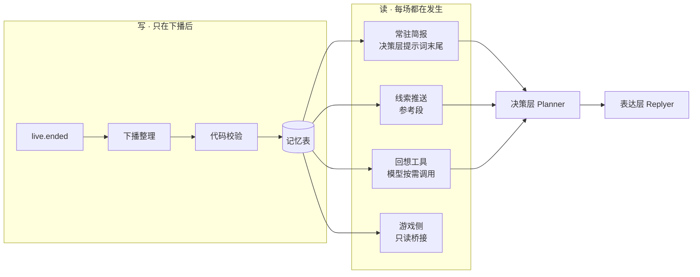
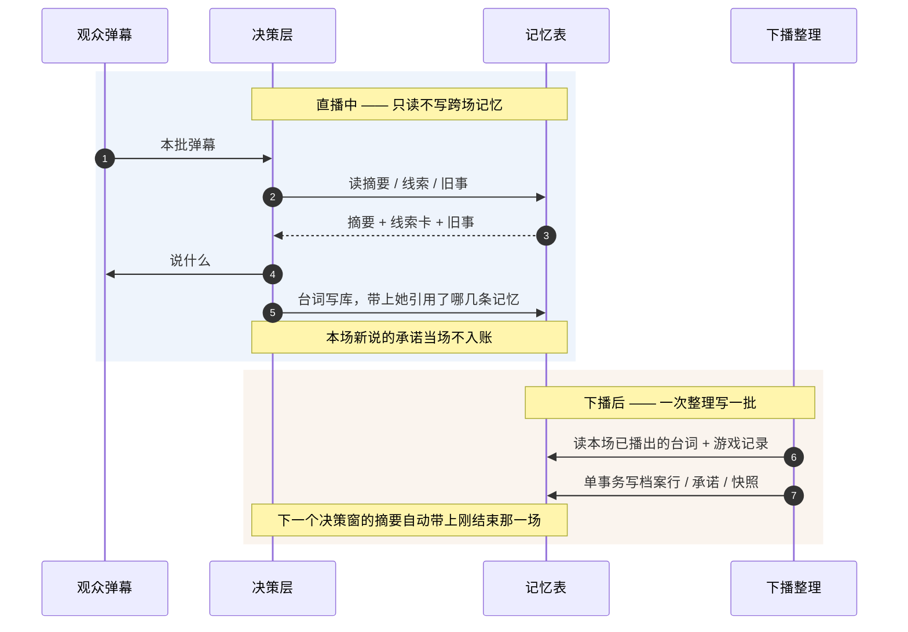
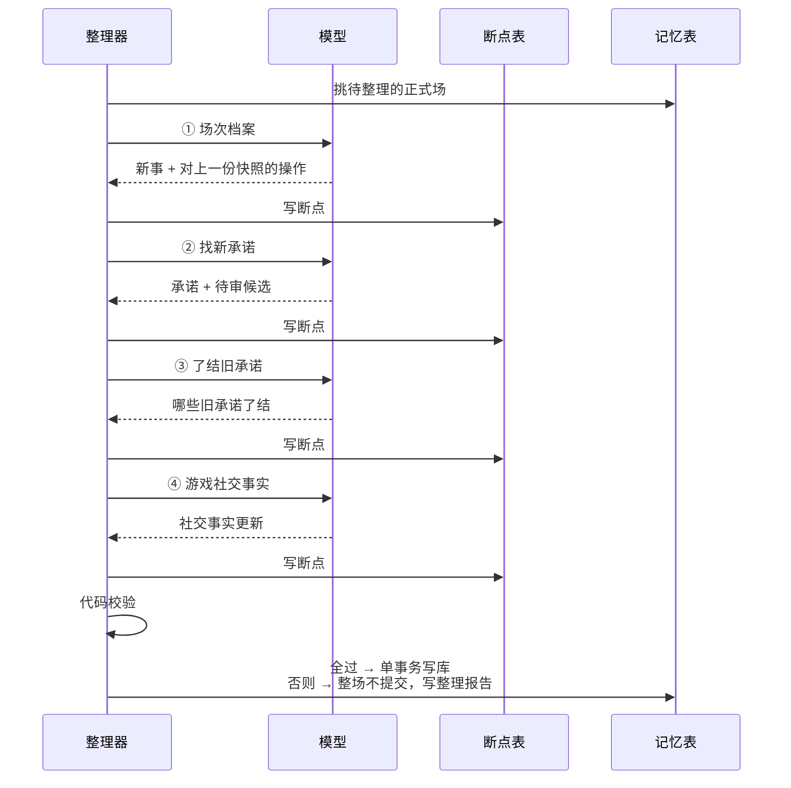
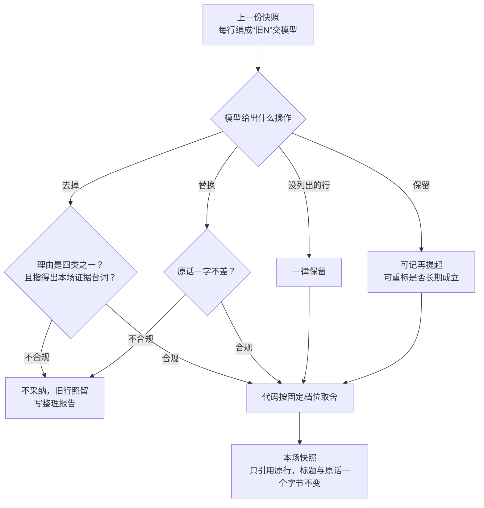
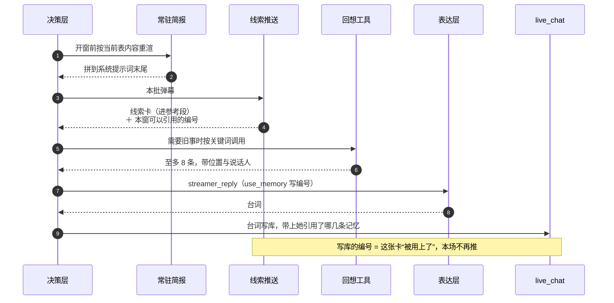
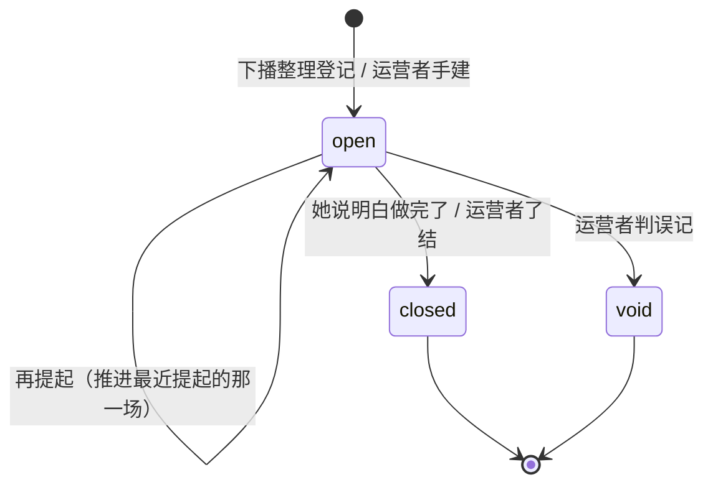
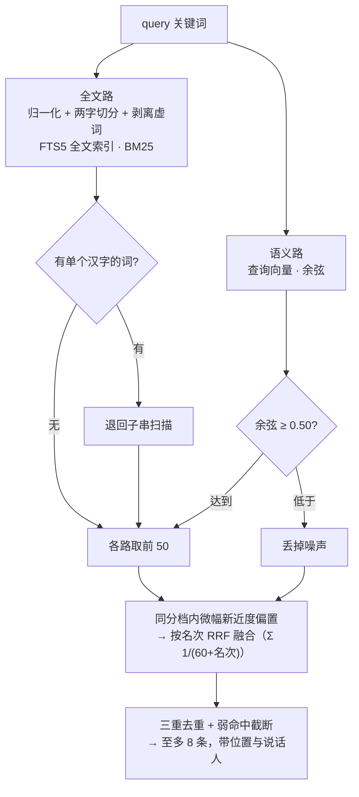
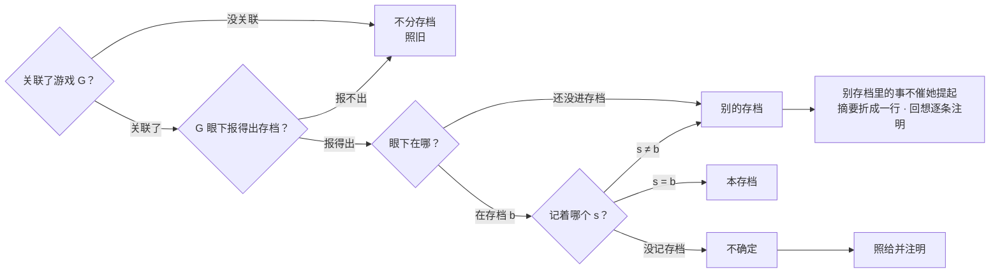

# 主播记忆（承诺表 + 场次档案）

> 主播跨场记忆的**当前规则**。这套系统记四类东西：**她当众答应过、还没兑现的事**（承诺表）、**前几场干了什么、哪些事还成立**（场次档案与滚动快照）、**游戏里单个玩家与她的一对一往来**（游戏玩家档案）、**多人存档里的群体环境与共享惯例**（游戏社交事实）。
>
> **怎么读这篇**：想了解整体，看[「整体结构」](#整体结构)；要改代码，看[「写入」](#写入下播整理)与[「读」](#读)两章的规则表；想知道"当初为什么这么定"，看文末[「相关决策」](#相关决策)——那里是决策记录，本文只陈述现在是什么。表结构与配置以代码为准（`src/modules/storage/schema.py`、`src/modules/config/`）。

## 记什么、不记什么

文中反复出现三个位置，先说清楚：

- **系统提示词**——决策层的指令与设定，包含人设与老梗栏。
- **参考段**——提示词里固定放在对话之后的一段元信息（环节描述、直播间快照、记忆线索、游戏那边此刻），不是她说的话。
- **对话历史**——她这一场说过的话与收到的弹幕。

**决策层**（Planner）想该说什么，**表达层**（Replyer）把决定变成台词；两个都是模型，记忆在这条链上被读进来。

| 记什么 | 存在哪张表 | 谁会读到它 |
|---|---|---|
| 她当众答应、还没兑现的事 | 承诺表 `commitments` | 常驻简报的【还惦记的事】一段、线索卡、回想工具 |
| 前几场干了什么、哪些事还成立 | 场次档案 `archive_lines` + 滚动快照 | 常驻简报的四段内容、线索卡、回想工具 |
| 游戏里单个玩家与她的一对一往来 | `game_players` 系列表 | 玩家卡、对玩家的承诺 |
| 多人存档里的群体环境与共享惯例 | `game_social_facts` | 参考段的【游戏社交事实】一段、游戏侧只读桥接、回想工具 |

运营者手写的老梗栏（人设字段 `inside_jokes`）是配置文本，不进这些表。

当场的工作记忆（对话时间线、前情提要）不在本文范围，见[主播上下文构成](streamer-context.md)。

当前成立七条规则：

1. **只从她播出的原话长出来**：档案行与承诺只取自本场已播出的台词，每条带逐字原话；没播出的不进。观众的话要人批准、且她当场接受过，才进跨场记忆。对游戏玩家的承诺可引她在游戏公屏打的那句。
2. **跨场记忆只在下播后写**：整理集中在 `live.ended` 之后。直播中发现旧档案或旧承诺记错，可当场加注或结掉承诺，但跨场快照的增删统一由下播整理核对证据。
3. **一种记忆一个出场入口**：对某位观众的承诺只在 ta 开口时出现；对某位游戏玩家的承诺只写在玩家卡上；对所有人许的承诺进【还惦记的事】。
4. **三个读出口、两档写法**：同一套渲染函数产出决策层写法与说话层写法，说话模型只拿到动作标题。
5. **身份判断是确定性代码**：观众按内部观众 ID 定位，外部 ID 只用于精确解析；昵称只在渲染与打码时经 `viewers` 使用。任何面向主播的通路都不出现精确天数、场次数与日期。
6. **只有正式场进承诺表**：彩排场（内部演练、不对外的直播）永不进候选，读取也按场次类型过滤。
7. **可纠错、可遗忘**：运营者能看了结、判误记、撤回、删除、手建；观众或游戏玩家发"忘了我"后由存储侧停止记录并在下播后删除。

## 整体结构

写只有一条线：下播整理把一场正式直播整理成承诺表与场次档案。

读有三条线，每场都在发生：

- **常驻简报**——决策层提示词末尾常驻的一段摘要，内容来自上面那些表，每个决策窗重渲一次。
- **线索推送**——每批新弹幕进来时算一遍"这一批她该想起的事"，做成小卡片放进参考段。
- **回想工具**——她想查旧事时自己按关键词调用的查询工具。



三条硬约束：

- **直播中不写跨场记忆。** 本场新说的承诺当场只活在对话历史里，下播整理后才入账。
- **渲染只依赖表内容、不含时刻。** 表没变时每个决策窗的输出逐字节相同，服务端前缀缓存照常命中；表一变（直播中改了旧事、运营者判误记、了结、删一行、上一场刚整理完），下一窗就变。
- **读写解耦。** 读这一侧任一环节出异常，只丢那一段，不阻断决策。

一场直播在时间上长什么样：



## 写入：下播整理

代码在 `src/agents/streamer/memory/settle.py`，跨表写库在 `SessionRepo.apply_settlement`。

### 触发与调度

- **触发**：`live.ended` 的道别轮跑完、队尾台词播完之后排进后台。TTS 卡住不挡住整理。进程启动时也补跑一次。
- **挑哪些场**：只挑已结束、`settled_at_ms` 为空、自动重试次数没用满的**正式场**，按开播时刻从早到晚逐场整理。彩排场永不在其中。
- **开播不阻塞等待**：新场次开播时先按当前表内容拼第一份常驻简报，再把待整理场次排进后台任务。后台整理写完档案后，下一个决策窗的摘要自然带上刚结束那一场；期间摘要退化为更早一场，不影响开播。
- **同一场只付一次模型调用**：下播后台、开播补整理、隐私清理前的等待共享同一个还没跑完的任务。写库这一侧用"整理完成时刻为空"抢占，两个进程同时跑只有一个写事务成功。
- **场次类型改动**：正式场改成彩排时，这一场写的档案行、快照、登记的承诺与整理进度一并清掉；删除场次同样。彩排改成正式后，下一次调度自然会整理它。

### 四次调用

各只做一种判断，都走 `settle` 档位（专门配给下播整理用的模型档位）。每跑完一步立即把输出写进 `settle_checkpoints` 表，重启或重试时从没跑完的那一步接着跑。

| 步骤 | 判断什么 | 何时不调 |
|---|---|---|
| ① 场次档案 | 挑至多 8 行值得下次开播提起的新事；同时对上一份快照逐行挑留 / 去掉 / 替换 | 本场没有任何播出台词时不调模型，直接记成已整理 |
| ② 找新承诺 | 她当众答应过、还没兑现的事 | — |
| ③ 了结旧承诺 | 她说没说明白做完了或不做了 | 只在本场之前有未了结承诺时才调 |
| ④ 游戏社交事实 | 更新社交事实与有据互动 | 只在接了社交事实存储对象、且本场玩过游戏时才调 |

一步一步走，每步都有落脚点：



每一步的模型调用都跑 `settle` 档位，一次只做一种判断。断点的作用是**不重复付模型调用**：重启或重试时从最后写完断点的那一步接着跑。

喂给模型的原料：

- 本场全部已播出台词（按时间编号，不抽样、不截断）。
- 回应弹幕的那句，附被回应的弹幕原文与发言人代号（本场内稳定的"观众1、观众2"）。
- 本场玩过的游戏与游戏关键事件（事件前标着当时的存档；一场里换过存档的游戏另起一行说明）。
- "她能做的事"一行（启用的游戏 Agent 名单加聊天、讲故事一类）。游戏 Agent 是替她在游戏里操作的角色，例如 Minecraft。
- 本场记住的地点。
- 本场开播前未了结的承诺、最近已了结与已判误记的承诺标题。
- 本场游戏玩家（代号"玩家1、玩家2"与名字）与她在游戏公屏打出去的字（编号"公屏#N"，前面附着玩家说的话）。

### 代码校验

校验全在代码，模型说的不算数。没通过的条目连同原话写进整理报告，运营者在 WebUI 里逐条判断。逐条对应的代码在 `memory/settle_proof.py`（"做成了"的核对）、`settle_cues.py`（触发词与地点）、`settle_players.py`（对谁）、`settle_candidates.py`（待审候选），通用校验器在 `memory/textmatch.py`（原话一字不差的核对）。

1. **原话必须一字不差**：引用的那句话必须是所引那一行台词的原样片段，不能改一个字、也不能超长；超出的整条丢弃，标题超长则截断。新写的档案行拒绝疑问句、反问句与猜测句作证据，并剥除误入标题的真实观众昵称。
2. **关联的游戏**：必须是本场玩过的，或是已启用的游戏 Agent，否则置空。关联了游戏的，按那句台词的时刻对上本场各游戏的存档时间段。
3. **承诺是对谁许的**：对某位观众答应的，那一行必须回应了真实观众的弹幕；对某位玩家答应的，按台词记下的回应对象，或公屏上点了名与紧接着回话，对上那位玩家。对不上不登记，进"没通过校验"的清单。公屏上打的字只登记对玩家的承诺。
4. **说"做成了"**：档案新事、替换旧行里的完成说法、了结关联了游戏的承诺，都必须引本场游戏记录撑着。代码核对引的那条存在、能作证、同一个游戏、不晚于她说那句（容两分钟）。没核实到的照写，但写成"她说……（游戏记录里没核实到）"，不算长期成立的事；了结不认。
5. **触发词与地点**：触发词必须在标题或原话里出现；地点必须照抄本场记住的地点，且说得通（那句台词里说到这个地名，或她说这句时就在这个地点跟前）。
6. **不重复、不改判**：与未了结的旧承诺是同一件事、或那句台词已经引用过某条承诺，都不新建，只推进"最近提起的那一场"。了结只改 `open` 的行，运营者已处理过的结论不被模型翻改。
7. **人改过的行模型动不了**：模型对它的去掉、替换一律不采纳，写进整理报告。

### 写库、失败与重试

- 四步全部就绪后**在一个事务里**写库：本场档案行、本场档案快照、新承诺、旧承诺了结与重申推进、社交事实更新、本场待审候选、本场整理完成时刻一起提交，同时清掉该场的 `settle_checkpoints`。重新整理前先清空该场旧断点，只替换这一场自己的档案行与快照。
- **失败判定**：任一次调用失败、输出读不懂、输入超出模型窗口、上一份档案快照读不出来，都算这一场失败。整场不提交，重试次数加一、原因写进整理报告。次数用满后不再自动补跑，等运营者在 WebUI 点"重新整理"（把次数清零，下一次调度就会再挑到它）。一场失败不挡后面的场。
- **整理报告另有一节"唠叨指标"**：本场引用旧事几次、同一条最多几次、没人问时主动提几次、半小时内绕回三次的条目、线索卡推了几张用上几张、只由她自己的话触发几张、同一位玩家被推几张。只有编号和数字。

## 档案快照

代码在 `src/agents/streamer/memory/rolling.py` 与 `settle.py`。

每份档案只写一场的事，碰上一场短的、乱的，前面几场的事就从摘要里全掉出去。所以每个整理过的正式场另留一份档案快照，接住前几场仍然成立的事。常驻简报只读一份快照。

- **快照只引用原行**：每行引用一条 `archive_lines`，另记位置、是否长期成立、最近一次写下或再提起它的那一场的开播时刻。原行被删（删单行、按句删台词、改彩排、删场次）时外键级联从所有快照撤掉；删观众改的是原行文本，快照读到的也是替换后的。留下的行标题、原话、证据、出自哪一场、关联哪个存档一个字节都不变。
- **上一份快照**：开播早于本场的最近一份同类型快照，不看时长。
- **模型只挑不改写**：上一份快照每行编号"旧N"，注明原话、在哪个存档、是否长期成立。没列出的行一律保留。

模型能做的三种操作：

| 操作 | 要求 |
|---|---|
| 保留 | 可以注明本场又提起它的那一行（记为再提起），可以重标是否长期成立 |
| 去掉 | 理由必须以了结、不成立、记错、被取代四类之一开头，并指出本场哪一行台词是证据（代码核对它确实是本场播出的台词）。"这场没提到""一次性的事"不算理由 |
| 替换 | 给本场一行台词里的原话片段，过与新事同一个"一字不差"的校验。被换掉的是长期成立的事，新行也算长期成立（模型明确写了不成立的除外） |

同一件事写了两行时可以注明与哪一行重复去掉其中一行；那一行本场被替换或带证据去掉了，这一行跟着它走；那一行自己也是按重复去掉的（互指、绕成一圈），这一条不采纳。

不合规的操作不采纳、旧行照留，连同理由写进整理报告——既没被合格地去掉、也没被替换的旧行一律留着。

一份快照是怎么从上一份变出来的：



**取舍由代码按固定档位做**，模型不凭感觉删：

| 档 | 内容 | 上限 |
|---|---|---|
| 0 | 人放回或新增的行（`pinned`） | 排最前、一行不挤，不占下面各档名额 |
| 1 | 代表性事件（`highlight`） | 每个游戏存档（及不关联游戏的直播间）各至多 6 条；单场新事强制至多保留前 2 条，且未核实到的完成说法禁标为代表性事件 |
| 2 | 每个存档的取名类长期成立的事 | 至多 12 条（压成 1～2 行名字表） |
| 3 | 每个存档的其余长期成立的事 | 补足至该存档【这个世界里】至多 12 行展示名额 |
| 4 | 游戏本场新进展 | 至多 6 行 |
| 5 | 前两场保留进展 | 至多 6 行 |
| 6 | 不关联游戏的直播间长期成立的事 | 至多 6 行 |
| 7 | 直播间普通事件 | 至多 6 行 |
| — | 跨多存档累计总安全上限 | 48 行 |

被挤出的本场新事照样写成本场档案行，回想工具查得到，只是不进快照；挤出的行写进整理报告。

**重新整理**：第 N 场的快照从它之前最近一份快照重新算，此前做过的去掉、替换随之作废；之后各场的快照不重放。要结果带到摘要里，按时间顺序把之后的场次依次重新整理。

**兜底**：输出里没有对旧行的操作（或整个输出为空）时上一份原样保留；操作不是列表、上一份读不出来，都算整理失败，下次再试，上一份快照原样留着。

**冷启动**（指升级后数据库里还没有任何快照的情况）：存储升到 v28 时库里还没有任何快照、而最近一个已结束的正式场已经按旧逻辑整理过，迁移把它放回待整理，启动补整理在现拼的基底上重新整理它。不需要运维步骤。

## 读

一个决策窗就是"一批新弹幕进来 → 她想一遍 → 决定说不说、说什么"。三个出口在同一个决策窗里这么协同：



### 出口一：常驻简报

代码在 `src/agents/streamer/memory/brief.py`、`zones.py`、`commitment_ttl.py`、`render.py` 与 `tools/memory_correct.py`。拼在决策层系统提示词末尾（人设与老梗栏之后）。

**每个决策窗按当前表内容重渲**：渲染只依赖表内容、不含时刻。表没变时每窗输出逐字节相同，系统提示词的前缀缓存照常命中；表变了下一窗就反映出来。

**四段内容各自算名额，互不挤占**（`zones.py`）。下面方括号里的是系统实际渲染出来的分段标题，后面跟着它装什么：

| 分段 | 装什么 | 上限 |
|---|---|---|
| 【这个世界里】 | 当前存档里长期成立的事。宠物、跟班、地点取名压成 1～2 行紧凑名字表；住处、关系、规矩等其余长期成立的事逐行展示且不附长原话 | 整段 ≤12 行 |
| 【最近几场】 | 当前存档里最近两三场发生的普通事件，分"上一场"与"再往前两场"（按最近被提起排序） | 上一场 ≤6 行；再往前两场合计 ≤6 行 |
| 【还惦记的事】 | 当前存档及不关联游戏的、还没兑现的承诺。抬头固定写着"【还惦记的事】（想做再做的事，不用赶）："，意思是这些是可选的、不是欠债 | ≤5 条 |
| 【直播间里的事】 | 不关联任何游戏存档的跨场设定、杂谈与互动。换任何游戏存档照样带着 | ≤6 行 |

**代表性事件分段按说话模式双态展开**：

- 常规边玩边说模式（`speaking_mode="gameplay"`）：严守存档隔离，仅在当前存档有已滑出近期窗口的历史代表事件时追加【忘不掉的名场面】（存档里早就过去了、但还值得留着的那些事），至多 4 行。
- 纯杂谈环节（`speaking_mode="zatsudan"`）：展开跨存档的【一起经历过的名场面】（跨存档的同一批代表事件），至多 6 行，行内显式标注所属游戏与存档。

两个分段统一纳入可合法引用的名单与"本场已提过"防复读护栏。

**承诺过期分两档门槛**（`commitment_ttl.py`，均为读时计算，不改库里的 `status='open'`，回想工具照查）：

| 档 | 门槛 | 结果 |
|---|---|---|
| 近期一次性时间词（今晚、明天、下次等） | 隔一个时长达标的正式场仍未被再提起 | 算作长期没再提 |
| 一般承诺 | 连续三个时长达标的正式场未再提起 | 算作长期没再提 |

一旦在后续场次被再次提起，"最近提起的那一场"往前推进，自动回到活跃区。长期没再提的承诺与超出名额的条数合并折成一句"另有 N 件搁了很久，可以用 memory_recall 查"。

承诺在库里的状态只有三种，"长期没再提"是读时算出来的、不是第四种状态：



`open` 到了过期门槛就算"长期没再提"，但**库里的 `status` 仍是 `open`**——它只是读时算出来的分档，回想工具照查得到。

**直播中改旧事**：决策环节调 `streamer_memory_correct`，附本场证据（游戏回执、玩家公屏、运营提醒或亲眼确认）标某条 `档#N` 或 `约#N` 为做完了、不成立或记错了。编号是引用记忆用的两类代号：`档#N` 指一条档案行，`约#N` 指一条承诺，同号不同义。

- 档案行本场后续每窗渲染附"（本场更正：……）"。
- 承诺当场改状态，运营者可在 WebUI 记忆页一键撤回。
- 运营递话里的纠错同步记入本场更正表（`memory_corrections`），摘要顶部保留最近 3 条本场运营提醒。

**"上一场"的定义**：整理失败、或既没有快照也没有档案行的场次不算；空场次不会被当成"上一场"；时长不到 `memory_brief_min_session_ms`（默认 5 分钟）的场次也不算，往前找——开错后马上重开的那一小段照样整理得出档案行，不跳过就会顶掉真正的上一场。最近已结束正式场尚未完成整理时，摘要注明快照来自更早一场。

**同一件事只列一遍**：

- 档案行与列出的承诺出自同一句台词（同一 `evidence_chat_id`）时只留承诺那一条。
- 本场台词已经引用过的承诺（`memory_refs` 里有它、且那句送达了）不再进后面的摘要。
- 引用过的档案行留在摘要里，末尾标"（本场已提过）"；决策层代码对非回人轮次的二次主动引用退回换话题（每窗至多退一次）。

本场新说的承诺不进常驻摘要：它就在决策层的对话历史里，下播整理后才入账。

时间词只用"上一场""之前"，相对本场开播固定，不出现日期、天数与场次数。

### 出口二：开播【上次收尾】与线索推送

代码在 `src/agents/streamer/memory/last_wrapup.py`、`cues.py`、`passive.py` 与 `render.py`。结果进参考段。

**【上次收尾】**（`last_wrapup.py`）：这个标题指的是"上一场下播收工时的实况"。它只在开播头两窗（或到本场第一件委派被接下为止——委派指主播交给游戏 Agent 去做的活）注入参考段，不改动系统提示词前缀缓存。用写库里的确定记录拼出上一场收工时的实况，不依赖下播整理的模型调用：

- 上一场最后在哪个存档（对比眼下所在存档）。
- 下播时还在做、待办或搁下的委派及状态。
- 下播前最后播出的几句台词。
- 上一场已整理完成时，再附上那一场新登记的承诺；还没整理完则明确注明"上一场的事还没整理，下面只有账面记录"。

**线索推送**：每批决策层调用前同步计算，每批至多 2 张卡。

| 优先级 | 线索 | 判定 | 推什么 |
|---|---|---|---|
| 1 | 对象开口 | 本批发言人名下有未了结承诺（按外部 ID 精确解析出观众编号，只读不建观众，有待删请求的不算）；或是本场还没回应过的老观众且名下有已批近况或共同造梗；或本窗在游戏公屏开口、冲她做动作的玩家以前有过往来 | 对 ta 的承诺卡（只给动作标题）；老观众卡（关系定位、曾用名、已批近况与共同造梗归属）；玩家卡。同时把这批弹幕的熟悉程度随调用单透传给表达层，好放轻松接话的语气 |
| 2 | 走到地点 | 角色从 48 格外走进某个记住的地点 24 格内（同一存档，每个地点每场一次） | 关联那个地点的档案行或还没长期没再提的游戏承诺 |
| 3 | 触发词 | 本批观众弹幕里出现档案行的触发词或老梗栏的梗（归一化，三个字以上再按拼音）；她最近 3 句台词说到触发词时，仅当该档案行不在常驻摘要且出自至少两场正式场以前才算 | 档案卡（标题加原话）、老梗卡 |
| 4 | 意思相近 | 配置了嵌入服务时（嵌入服务是把文字变成向量去比相似度的外部服务）：最新几条弹幕逐条、或游戏情境（存档、走到跟前的地点、手上的委派，变了才查）与档案行、还没长期没再提的对所有人许的承诺余弦 ≥ 0.65 且融合后排进前 3。不认她自己的台词，对某位观众的承诺不走这一路 | 档案卡、承诺卡 |
| 5 | 老观众在场 | 本批开口或首次进房的观众，本批没拿到承诺卡或老观众卡、她本场还没回应过、没有待删请求（进房的老观众需来过三场及以上正式场，每场每人一次；同平台待确认身份关联簇合并去重场次数、互动计数、大航海与曾用名） | 按熟悉程度分层（常来的老熟人 / 眼熟的老观众）附曾用名与近远档位词（只有"前几天刚来过""有阵子没来"两档），人数由代码常量限定，多的写"等 N 位" |
| 6 | 遗忘命令回执行 | 本批弹幕命中"忘了我"，或命中撤回短语且写库那一侧确认撤回已生效 | 用弹幕编号指人的回执行，不写名字、不复述 ta 说过的事 |

- 游戏承诺卡**不按"游戏开着"轮播**，只在对象开口、走到地点或意思相近命中时单推。
- **限频**：同一张卡每场至多推两次、两次至少隔十分钟（计数在内存里，进程重启后从零算）。
- **用上即停**（指这条记忆既然被说出来了，本场就不再重复推）：本场台词的 `memory_refs` 里已经有这张卡的编号（`约#N` 或 `档#N`）就是被用上了，本场不再推——每批查一次库，进程重启也不丢。
- 不推的情形：常驻摘要里已经列着的、已算作长期没再提的承诺、别的存档里的、发过"忘了我"的观众触发的、模拟消息、遗忘命令本身。只由她自己台词命中的（自触发）每条每场只推一次。
- 某位观众本人有卡时，不推他自己的老观众在场行；别人的卡不压他这一行。
- "回应过"每批查一次库，她回应 ta 之后这一行立即消失。
- **留痕**：每推一张卡记一行 `memory_cue_log`（哪一路命中、分数、用上的时刻，只记条目编号，不记观众身份或玩家名字）。语义向量路每次查询的前 3 名余弦分数无论是否达到推送门槛都记入——推出卡时附在 `detail.top3`，未推出任何卡时记为 `card_kind="vector_probe"` 探针记录，复盘页与唠叨统计排除探针行。

### 出口三：回想工具 `memory_recall`

代码在 `src/agents/streamer/memory/recall.py`。注册进 `ToolRegistry`，provider 名 `memory`。默认只对主播可见；主控态的游戏 Agent 也会并进可见名单（每次列工具时现算，不改常量规格）。

**参数**：

| 参数 | 取值 | 默认 |
|---|---|---|
| `query` | 关键词，多个用空格分开，个数不限 | 必填 |
| `scope` | `all` 查全部历史；`this_stream` 只查本场 | `all` |
| `order` | `relevant` 最相关的在前；`newest` 最近的在前；`oldest` 最早的在前 | `relevant` |

**查找范围**：

- 她已播出的台词（正式场全部历史；展示时按 140 字预算拼合同场前后 30 秒紧邻的主播台词）。
- 档案行。
- 对所有人许的承诺（未了结与已了结都给，标明状态，带了结原话；判误记的不给）。
- 游戏里程碑与阶段汇报。
- 现行游戏社交事实。
- 当前已认出存档的游戏工作笔记与未完待办（`game_work_docs`，别的存档严格隔离并把昵称换成代号）。
- 本场观众弹幕（不论 `scope` 都只查本场）。

不查往场观众弹幕。对某位观众、某位玩家的承诺只经线索推送出现，回想工具不返回。

**混合检索**（`memory/search.py`，文本处理在 `memory/textmatch.py`）：

- 关键词一路用 `fts_recall_query` 剥离高频疑问口水词后，在 FTS5 全文索引里按 BM25 取候选。查询词里有单个汉字时（"炸TNT"的"炸"、单独查的"猫"）按词查必漏，退回子串扫描兜底。
- 语义一路过滤低于 0.50 余弦底线的噪声后取前 50。
- 两路在同分档内施加封顶微幅新近度偏置后，按名次 RRF 融合（分数 = Σ 1/(60+名次)）。
- 语义一路没开或暂不可用时，结果注明"这次只按字面查"。

全文与向量索引是**派生表**（`memory_fts_*` 与 `memory_vectors_*`，跟着源表增删），由后台任务 `memory/index.py` 按"缺什么补什么"慢慢补上——全文是本地切词、毫秒级，向量要调嵌入服务。



**组装**前 8 条时执行三重去重与弱命中截断：

1. 裸台词与引用它的档案行或对所有人许的承诺同源合并，保留带标题、完成状态或存档注记的那一条。
2. 已被前排条目完整拼进正文的同场邻句不再重复占坑。
3. 跨场或同场近似原样复读（`Jaccard >= 0.85`）的台词单次至多保留 2 条。
4. 纯字面路径剔除零实词凑数尾行；整次查询仅剩字面弱擦边时至多返回 2 条，并提醒拿不准直说记不清。

**不按名字查人**：本场以外的结果里出现的已知观众昵称（当前名与曾用名，2 字以上）一律换成"某位观众"。关键词恰好是某位已知观众的昵称时丢掉这个词，并在抬头说明（"回想工具不按观众名字查，已忽略 N 个名字"）。本场结果不替换。

关联了游戏的档案行、承诺与游戏进展，逐条注明是在哪个存档；她过去说过的话，那场只在别的存档里玩过时注明。

结果按 `order` 排列，每条带位置（"本场 00:12""上一场""之前"）与说话人（"你""观众"）。查询失败返回"没查到（原因）"，不挡说话。

### 出口四：游戏侧只读桥接

`MinecraftAgent` 通过 `social_rules.py` 在认出具体存档及新开委派任务时，异步加载当前存档已核实公共规矩，至多 6 条。

- 只收 `sharing` / `setting` / `members` / `works` 四类；严格拦截未人工锁定的观众弹幕作证行与无引文行。
- 作为固定层任务上下文供角色遵守共享设施与领地规矩。换存档立即清退缓存与开局消息。
- 与主播包保持零导入依赖。

这条只给游戏 Agent，不进主播的常驻摘要与回想工具。

## 人工审核与待审候选

整理照旧自动生效，人在 WebUI 记忆页事后改；观众定下的事要人批准才进记忆。

**审核操作**：改标题、标或取消"长期成立"、把被挤出或去掉的行放回最新快照、取消放回、从这一场她播出的台词里截一段原话新增一行、删行、标已审。

- 改过标题或长期成立标记、人新增的行**锁住**，之后的整理不能去掉或替换（整理报告写"人改过的行只有人能让"），也改不了它是不是长期成立的事。只有"最近被提起"按本场台词证据照常更新。
- 放回与新增的行在快照取舍里排第 0 档，不挤、不占长期成立的事的名额。**一份快照至多 4 行**，满了界面提示、要先取消一条放回才能再放回或新增。取消放回的行还在快照里，之后按规则取舍。
- 锁住但没放回的行被 12 行上限挤出快照不算"去掉"：锁住只是模型不能改它、删它，要不要一直留在摘要里由放回决定。被挤出去的行还在档案里、回想查得到。
- 原话不能改。每次操作记一条改动记录（表 `memory_edits`），与档案同寿命。

**待审候选**（`viewer_candidates` 与玩家自述表），批准前对她完全不可见——摘要、回想、检索索引都不读候选表：

| 类型 | 怎么产生 | 上限 | 批准后 |
|---|---|---|---|
| 观众定下的事 | 写档案那次调用顺带列出：观众起的名字、定的设定或梗、说游戏世界的事，她在回复那条真实观众弹幕的那一行接受了、自己却没复述 | 一场至多 5 条 | 写成一行"观众来源"的档案行，锁住，放在最新快照最前面 |
| 她说欠着的事 | 找承诺那次调用顺带列出：她说"上次答应过""欠大家的"，账上（未了结、已了结）找不到对得上的 | 一行至多一条、一场至多 3 条 | 登记成一条未了结承诺 |
| 老观众的近况与喜好 | 老观众主动说起、她当场接住的持续性日常或喜好（`kind="viewer_self"`，标题以 `ta` 开头） | 一场至多 3 条 | 原地留在 `viewer_candidates`，不进全局档案与承诺；仅在该老观众场内开口时生成老观众线索卡 |
| 玩家自述 | 游戏玩家在公屏说的关于他自己的事、她当场接住了 | 一场至多 3 条 | 进另一张待审表 |

核对口径（代码判，不靠模型自觉）：

- **观众定下的事**：两段原话都要一字不差。模型另写观众定下的名字或梗词，必须在标题与那条弹幕原文里原样出现；观众只问了名字、名字是她自己起的不列。含个人信息模式的整条丢掉只计数。
- **她那行回应里点了那位观众的名**（弹幕上的名、现名、曾用名），常驻摘要、线索卡渲染时换成"那位观众"，库里的原话不改，回想照旧按跨场打码。人批过的标题不换，原话里和观众定下的那个词相同的那一段也不换。
- **候选的寿命**：待审的 14 天没人审自动删掉；驳回的留着，同一条以后不再列。候选挂在观众那条弹幕、她那句回应与观众行上，删观众、"忘了我"、按句删、删场次随外键一起删；挂在别人弹幕上、只是提到 ta 的候选不删，昵称换成"一位观众"。

## 游戏里的人

代码在 `src/modules/storage/game_player_ledger.py`（写库）、`memory/cues.py`（玩家卡）、`memory/settle_players.py`（承诺对象核对）。

- **认人与记录**：写库那一侧订阅公屏聊天与 `game.player.interacted`，只给带 UUID、核对过在线的发言人建档。记打招呼（一场一行）、送东西、切磋。公屏聊天落 `game_chat`（认不出是谁的一句只存占位、不存原话），私聊不写库。改彩排时撤掉本场互动。
- **见过他的存档**连同那台服务器验不验正版账号（`online_mode`：on / off / unknown）一起记，报了的按最新的写，没报的不抹掉已知的。记忆页"游戏里的人"列出这些存档，离线模式的标明"按名字认人，改名算新人，冒名认不出"。
- **玩家卡**（一张写着某位玩家是谁、跟她有过什么往来的小卡片）：本窗在公屏开口或冲她做动作、以前在正式场里和她有过往来的玩家，推一张卡（打招呼、送东西、切磋，现在与以前的名字，答应过他还没了结的事至多两条）。按 UUID 对上，同一位每场至多两次、隔十分钟，她本场回应过他就不再推。不进常驻摘要，只给决策层，不给游戏 Agent。
- **对玩家的承诺**：证据二选一，都必须是她自己说出去的——她回应这位玩家的台词（写库时记下了回应对象），或她在公屏打的那句（点了他现在或以前的名字，两个字的名字要整词出现；或在他上一句之后 3 句之内、60 秒之内、中间只有她的话）。对不上不登记。
- **对号与删除**：玩家与观众不自动对号，运营者在记忆页确认关联，关联永不告诉她，只用于连带删除。删玩家时他的互动、公屏聊天、对他的承诺一起删，他的名字（含以前的名字）在她的台词、档案、承诺、游戏事件、她打的公屏字里换成"一位玩家"，UUID 进不记录名单。删观众或观众"忘了我"连带删确认过关联的玩家。玩家在公屏打"忘了我"和观众同一套口令与宽限期。

## 游戏社交事实

代码在 `src/agents/streamer/tools/social_fact.py`、`memory/settle_social.py` 与 `repos/social_facts.py`。

多人联机存档里"谁和谁是什么关系、什么机器大家公用、眼下服务器里谁在牵头忙什么、她平时扮演什么分工"归 `game_social_facts` 表，按 `(game, save_id)` 分账。

- **封闭六类**：`setting` 环境形态、`members` 成员关系、`sharing` 共享惯例、`works` 进行中的事、`her_role` 她的角色、`open_questions` 待弄清。每类每存档至多 4 条现行、每次注入至多 12 条。
- **分工边界**：她自己亲历的事件归场次档案，她当众答应的待办归承诺表，单个玩家与她的一对一履历归玩家互动表。
- **证据门槛**：场内工具只允许游戏公屏已核实玩家原话经一字不差的校验直写现行；引用观众弹幕时要求她本场已送达回应，且只写入 `viewer_candidates` 待人工批准。下播整理没有原话作证的归纳行（未锁定的 `her_role` / `open_questions`）与未锁弹幕行不进每轮常驻【游戏社交事实】，仅留库供检索与审核。
- 单场跨多存档发言时，没有原话作证的归纳行归入整游戏级（`save_id=""`）。代号"玩家N"按整词边界正则还原真名。
- **陈旧降级**：未锁定的 `works` 隔过两个及以上时长达标的已完结正式场未再证实，读时降为"待确认的旧进展"排到末尾并附注说明；满 4 条上限时写入新 `works` 自动让位被取代。
- **删除**：删观众或删玩家时，先按证据外键整行删除拿本人话语作证的社交事实行，再把其余提及该名字的社交事实、游戏工作文档（`game_work_docs`）、场内更正与整理断点统一把名字换成代号。

## 游戏存档

同一款游戏的不同存档是互不相干的世界，关联了游戏的记忆只在说它的那个存档里成立。同一 `save_id` 在历史事件里出现过多个显示名称时，统一按 `save_id` 归并并展示最新非空存档名。

- **眼下在哪个存档**：主播每个决策窗开窗前从 `ToolRegistry.current_saves()` 拉一次（游戏工具面的只读方法，报不出存档的游戏不在结果里）。某个游戏从一个认出的存档换到另一个时，清掉这个游戏已了结的委派与补充要求；任务清单上还在做的留着。
- **写**：下播整理按台词时刻对上这一场各游戏的存档时间段，取台词之前最近开始的那一段。这个游戏这一场没有带存档的事件就不记。
- **读**：判定集中在 `src/agents/streamer/memory/saves.py`，一条记忆相对眼下存档分四种：

| 游戏眼下 | 记忆记着存档 | 记忆没记存档 |
|---|---|---|
| 报不出存档 | 照旧（不分存档） | 照旧 |
| 还没进存档 | 别的存档 | 不确定 |
| 在存档 b 里 | s 是 b：本存档；否则别的存档 | 不确定 |

"别的存档"的事不当成眼前的事推给她：线索卡不催她提起，摘要折成一行、回想逐条注明在哪个存档；"不确定"的照给并注明。升级前的旧数据存档为空，按不确定照给。

存档隔离这条规则，落到四种判定：



## 删除与遗忘

存储侧的删除与保留期见[存储 - 隐私与保留期](storage.md#隐私与保留期)；本节是记忆侧的入口。

- **删一条记忆**：记忆页可以给承诺了结、判误记、彻底删除、手建；档案可以删单行、改标题、标长期成立、放回、新增；整理状态里没通过校验的清单可以照原话手建；待审候选可以批准、驳回；"游戏里的人"可以删玩家、确认或取消玩家与观众的关联。
- **删单句台词**：复盘页的"本场台词"面板逐句可删（`DELETE /api/v1/review/speech/{chat_id}`）。一个事务里删这句台词、删引用它的档案行（档案行唯一证据就是这句台词）、清空引用它的承诺的原话（承诺行保留，记忆页显示"原句已删除"）。被诱导说出口的一句、说漏的观众私事走这里，不必连整场一起删。
- **"忘了我"**：观众发命中短语后，写库的入口在判场次之前就停止记录 ta（外部 ID 摘要进不记录名单、观众行记下删除请求、当前显示名进本场打码名单），删除推迟到发令之后第一次下播后的清理、最迟有上限；执行前本人发撤回短语即取消。判据与短语表在 `src/modules/storage/privacy.py` 与 `storage.toml` 的 `[privacy]` 段；决策层由线索推送收到同一判定函数的回执行，答应与否与代码一致。

  ```mermaid
  sequenceDiagram
      autonumber
      participant V as 观众
      participant L as 写库这一侧
      participant PL as 决策层
      participant C as 下播清理

      V->>L: 弹幕“忘了我”
      Note right of L: 判场次之前就停记 ta<br/>外部 ID 摘要进不记录名单<br/>观众行记下删除请求<br/>当前显示名进本场打码名单
      L-->>PL: 回执行（同一判定函数）
      Note over V: 发令前本人发撤回短语即取消
      Note over C: 删除推迟到发令之后第一次下播后的清理，最迟有上限
      C->>L: 清掉名单里的人
  ```

- **打码**（把某个人的真名换成"一位观众"这类称呼）：名单上的人发言后，她台词里 ta 的显示名在写库前就换成"一位观众"；回想工具的跨场结果同样打码。游戏情境发给嵌入服务前，已知的名字（身边看到的玩家、本场发过弹幕的观众、游戏公屏里说过话的人）先换成"玩家"。
- **下播收尾的顺序**：主播 Agent 接管下播清理（启动时关掉写库那一侧的 `cleanup_on_live_ended`，停止时还回去）。道别那一轮跑完后，后台按序：等道别句播完（上限 30 秒）→ 等本场下播整理结束（成功失败都继续，上限 5 分钟，超时记警告）→ 等最后几句台词与观众消息写库落完（上限 15 秒）→ 跑保留期清理与到期的"忘了我"删除 → **最后**清空本场打码名单。因此道别句里叫到的名字仍会被打码。每一步超时都不挡后续清理；清理失败记错误，由下次启动的启动期清理与 24 小时定时器兜底。道别期间已经开了新场次时仍跑清理，但不清打码名单。

  ```mermaid
  sequenceDiagram
      autonumber
      participant SA as StreamerAgent
      participant SP as 语音管线
      participant SE as 下播整理
      participant LG as 写库这一侧
      participant MS as 打码名单

      Note over SA: 道别那一轮跑完
      SA->>SP: 等道别句播完（上限 30 秒）
      SA->>SE: 等本场整理结束（上限 5 分钟）
      SE-->>SA: 成功或失败都继续
      SA->>LG: 等最后几句台词与观众消息写库（上限 15 秒）
      SA->>LG: 跑保留期清理与到期的“忘了我”删除
      SA->>MS: 最后清空本场打码名单
      Note over SA,MS: 每一步超时都不挡后续清理
  ```

- **保留期**：`storage.toml` 的 `[retention]` 两个天数默认为 0（不自动删除），由使用者按接入方式与合规判断配置；到期的"忘了我"删除与保留期清理在启动时与每次下播后跑。

## 降级

| 缺什么 | 表现 |
|---|---|
| 承诺或档案存储对象任一没接上 | 常驻摘要与线索推送整体关闭、回想工具不注册，决策照常（只是记不住事） |
| 存储对象没接上或模型不可用 | 下播整理关闭；失败的场次留在待整理里，次数用满后等运营者在 WebUI 手动重排 |
| `settle` 档位不可用 | 下播整理不写（原因进整理报告），直播主链路不受影响 |
| 嵌入服务没配或连不上 | 语义一路关掉，回想与被动想起退回关键词、触发词与地点，记 warning 带原因与退避时间；索引任务把没算上的留到下一轮 |
| 游戏玩家存储对象没装配 | 玩家卡不推、对玩家的承诺这一场认不出，其余照常 |
| 摘要、线索、回想任一读取异常 | 该段整段省略或返回"没查到"，不阻断决策 |

## 边界（不做什么）

- 不在说话路径上调模型挑选或重排序：检索与被动想起都是本地计算加异步嵌入，重排序模型只在离线评测里量。
- 观众弹幕不进持久索引，跨场记忆里的观众的话只有人批准过的那几条。
- 不在直播进行中写跨场记忆：本场新说的承诺要等下播整理才入账，本场靠对话历史记得。
- 不存观众的往事与画像：认人只做到"认出老观众、知道多久没来"。游戏玩家只记她亲身经历、画面里看得到的互动，玩家说他自己的事不自动记；玩家记忆只给主播，不给游戏 Agent。
- 不跨平台聚合：不同平台的观众始终是不同的人；同一平台内的账号 ID 与开放平台 ID 由观众表关联到同一人。

## 记忆相关的配置

| 键 | 在哪 | 作用 |
|---|---|---|
| `memory_passive_recall_enabled` | `agents.toml` `[agents.streamer]` | 被动想起总开关。关掉后线索只剩对象开口等承诺卡 |
| `memory_passive_recall_vector_enabled` | `agents.toml` `[agents.streamer]` | 被动想起的语义一路 |
| `memory_brief_min_session_ms` | `agents.toml` `[agents.streamer]` | 算"上一场"的最短场次时长，默认 5 分钟 |
| `inside_jokes` | `agents.toml` `[agents.streamer.persona]` | 老梗栏，一行一条，别名写在冒号前、用 `/` 分开。只进决策层系统提示词、整场不变，观众提起时才接。别写观众昵称（删除函数管不到配置文本） |
| `[embedding]` | `model.toml` | 引用一个 provider 条目；没填模型名或密钥留空即没开语义检索 |
| `[privacy]` | `storage.toml` | "忘了我"的短语表与执行参数 |
| `[retention]` | `storage.toml` | 保留期天数，默认 0（不自动删） |

旧的 `[agents.streamer.memory]` 段已不存在——记忆策略由代码与提示词决定，没有记忆策略开关。

## 相关决策

- [主播记忆改按账本记录](../decisions/065-memory-ledger-shadow-run.md)
- [记忆注入切到账本](../decisions/066-memory-injection-switch.md)
- [清掉旧记忆的存储面](../decisions/067-irreversible-memory-cleanup.md)
- [观众数据可自行删除与保留期](../decisions/068-memory-privacy-retention-and-forget.md)
- [游戏里的记忆按存档分开](../decisions/069-game-memory-per-save.md)
- [档案快照](../decisions/071-rolling-session-archive.md)
- [混合检索与被动想起](../decisions/072-memory-hybrid-search-and-passive-recall.md)
- [整理结果的人工审核](../decisions/073-settlement-human-review.md)
- [观众定下的事经人批准](../decisions/074-viewer-defined-memory-needs-approval.md)
- [游戏里的人按 UUID 认](../decisions/075-game-players-by-uuid.md)
- [常驻简报分区与场内更正](../decisions/077-memory-zones-opening-wrapup-ttl-and-in-stream-correction.md)
- [游戏社交事实边界治理](../decisions/078-game-social-facts-boundaries-and-governance.md)
- [检索抗干扰、双侧桥接与名场面分层](../decisions/079-memory-anti-noise-cross-agent-bridge-and-highlights.md)
- [常驻简报按表快照逐窗重渲](../decisions/082-brief-re-render-per-decision-window.md)
- [观众身份映射](../decisions/047-viewer-identity-mapping.md)
- [场次分正式与彩排](../decisions/050-session-kind-live-and-rehearsal.md)

## 相关文档

- [主播上下文构成](streamer-context.md) — 决策窗消息形态、参考段与系统提示词位置
- [存储](storage.md) — 表、迁移、删除函数与保留期
- [与 MaiBot 同步](../guides/maibot-sync.md) — 对外同步只剩直播近况与整场记录
- [提示词管理](../guides/prompt.md) — 提示词模板清单与渲染契约
