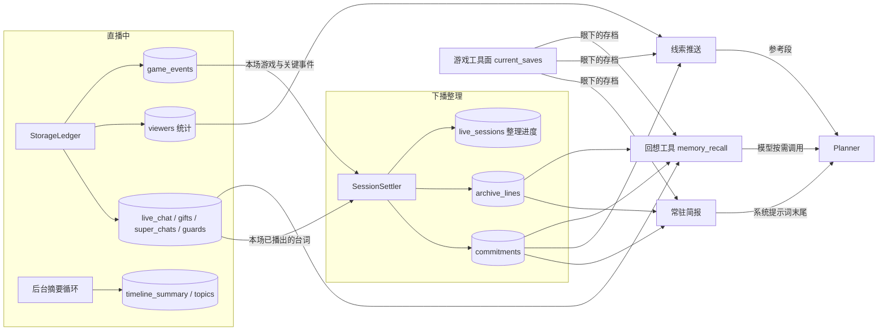

# 主播记忆（承诺账本 + 场次档案）

> 本文档是主播跨场次记忆的权威设计说明。
> 主播必须自己记住、现场又推不出来的东西只有两样：**她当众答应过、还没兑现的事**（承诺账本 `commitments`）与**前几场干了什么、哪些事还成立**（场次档案 `archive_lines`，每场整理时接住上一份仍然成立的事再加上本场的新事，滚动累积）。两者都由下播整理从她播出的原话里生成，条目自带原话，可核对、可纠错、可了结；另外还有运营者手写的老梗栏（人设字段 `inside_jokes`，配置文本，不在账本里）。
> 旧的场次回顾、观众画像、长期笔记文件与主播备忘录已退役：阶段 3b 起停写、也不再进任何提示词；v25 迁移删除两张旧表与场次表的备忘录列，并把库文件旁的旧笔记目录整目录移进 `backups/memory-pre-v25-<时刻>/`（不删除、可手工取回；不可逆，见 [清掉旧记忆的存储面](../decisions/067-irreversible-memory-cleanup.md)）。
> 决策依据见 [按账本记录](../decisions/065-memory-ledger-shadow-run.md)、[注入切到账本](../decisions/066-memory-injection-switch.md)、[不可逆清理](../decisions/067-irreversible-memory-cleanup.md) 与 [档案滚动累积](../decisions/071-rolling-session-archive.md)；当场的工作记忆（时间线与前情提要）见 [主播上下文构成](streamer-context.md)。

## 设计公理

1. **只从她播出的原话长出来**：承诺与档案只取自本场已播出的主播台词（`dropped_at_ms` 为空的行），每条带逐字原话；观众的话进不了任何跨场记忆，没播出的也不进。逐字引文只能证明"她说过"，证明不了"该记"，所以另由找承诺的提示词排除做不到、要花钱、线下见面、私下联系、改称呼、改身份与"以后都……"一类的话，提示词的红队样本评测在 `scripts/memory_eval/`。
2. **写入集中在收播后**：直播进行中不为记忆写任何跨场数据、也不新增模型调用；所有写入都在 `live.ended` 之后的整理里完成，每场固定几次调用、不随场长增加。
3. **一种记忆一个出场入口**：对某位观众的承诺只在 ta 开口时出现；挂游戏的承诺只在她**正在玩**那个游戏、且眼下就在答应它的那个存档里时出现（不是游戏工具被启用就推），其余承诺与最近一份档案常驻 Planner；没有按分数排序、没有模型挑选。
4. **三个读出口、两档写法**：常驻简报（系统提示词末尾）、线索推送（参考段）、回想工具 `memory_recall`（按需调用）。同一套渲染函数产出 Planner 档与说话档，说话模型只拿到动作标题。
5. **身份判断是确定性代码**：观众按内部观众 ID 定位，外部 ID 只用于精确解析；昵称只在渲染与遮名时经 `viewers` 使用。任何通路都不出现精确天数、场次数与日期。
6. **正式与彩排两条线**：只有正式场会被整理成账本；彩排场永不进候选，读取也按场次类型过滤。场次类型见 [场次分正式与彩排](../decisions/050-session-kind-live-and-rehearsal.md)。
7. **可纠错、可遗忘**：运营者能看了结、判误记、删除、手建承诺、删单行档案，能在复盘页按句删她的台词；观众发"忘了我"后由存储侧停止记录并在下播后删除，删除时按昵称使用期替换相关文本（接进后面几场的档案副本一并替换）。

## 数据流

## 写入：下播整理

代码在 `src/agents/streamer/memory/settle.py`，跨表落库在 `SessionRepo.apply_settlement`。

| 环节 | 规则 |
|---|---|
| 触发 | `live.ended` 道别那一轮跑完、队尾台词播完（等多久由代码常量限定，TTS 卡住不挡住整理）之后排进后台；进程启动时也补跑一次。存储升级到账本（v24）时，存量场次一律记成已整理，只留升级前最后一场够长的正式场待整理，启动补整理从它长出第一份档案与承诺（旧记忆同一次升级退役，不留这一场账本就是空的）。只挑已结束、尚未整理、自动重试次数还没用满的**正式场**，按开播时刻从早到晚逐场整理，彩排场永不在候选里 |
| 开播补整理 | 新场次开播时不再同步等整理：先按当前表快照拼第一份常驻简报，再把待整理场次排进后台任务（同一场与下播整理共享在途任务，只付一次模型调用）；后台整理写完档案后，下一个决策窗的简报自然带上刚结束那一场，期间简报退化为更早一场，不影响开播。这份后台任务失败按普通整理失败计次、写整理报告，下次启动、下次开播补整理或 WebUI"重新整理"再跑 |
| 取料 | 本场全部已播出台词（按时间编号，不抽样、不截断），回应弹幕的那句附上被回应的弹幕原文与发言人代号（本场内稳定的"观众1、观众2"）；本场玩过的游戏与游戏关键事件（事件前标着当时的存档，一场里换过存档的游戏另起一行说明）；"她能做的事"一行（启用的游戏 Agent 名单加聊天、讲故事一类）；本场开播前未了结的承诺与已判误记的承诺标题 |
| 三次调用 | 各只做一种判断，都走 summary 档位：①场次档案（接住上一份档案里仍然成立的事，再挑本场值得下次开播提起的事，标题加原话，游戏里的事标上游戏，长期有效的事标出来；见下文"档案怎么滚"）②找新承诺（行号、原话、标题、对谁、挂哪个游戏、与哪条旧承诺是同一件事）③了结旧承诺（只在本场之前有未了结承诺时才调） |
| 代码校验 | 逐字引文必须是所引那一行文本的子串且不超过上限（超出的整条丢弃，模型写的标题超长则截断）；挂的游戏（档案行与承诺同一口径）必须是本场出现过的、或是启用了的游戏 Agent（开错后马上重开的一两分钟里常常一条游戏事件都没记下），否则置空；挂了游戏的按那句台词的时刻对上本场的存档段记下存档（见下文"游戏存档"）；对某位观众答应的，那一行必须回应了真实观众的弹幕，对不上就不登记、进未登记清单；与未了结的旧承诺是同一件事、或那句台词的记忆引用里已经点到某条承诺，都不新建；与已判误记的承诺相近的进未登记清单；了结只改 `open` 的行，运营者已处理过的结论不被模型翻改；接住的旧档案行编号必须是上一份里有的，对不上的进未登记清单 |
| 写入 | 一场一个事务：档案行（本场新事与接住的旧行）、新承诺、旧承诺了结、本场整理完成时刻一起落库；重新整理只替换这一场自己的档案。校验没通过的条目连同原话写进整理报告，在 WebUI 里逐条列出，由运营者决定要不要手建 |
| 失败与重试 | 任一次调用失败、输出读不懂、输入超出模型窗口、上一份档案读不出来都算这一场失败：整场不提交，重试次数加一、原因写进整理报告；次数用满后不再自动补跑，等运营者在 WebUI 点"重新整理"（把次数清零，下一次调度就会再挑到它）。一场失败不挡后面的场 |
| 空场次 | 本场没有任何播出台词时不调模型，直接记成已整理 |
| 场次类型改动 | 正式场改成彩排时，这一场写的档案行（连同接进后面几场、出自这一场的副本）、登记的承诺与整理进度一并清掉（同一事务）；删除场次同样连副本一起删；彩排改成正式后，下一次调度自然会整理它 |
| 何时忘 | 对象观众被删除时，对 ta 的承诺随删除函数一并删掉；档案与承诺长期保留，运营者可删单行/单条 |

承诺只来自正式场与运营者手建，不来自彩排；整理报告的未登记清单同时是评估提示词质量的样本来源，也是 `scripts/memory_eval/` 的难负例来源。

## 档案怎么滚

每份档案只写一场的事时，碰上一场短的、乱的，前面几场的事就从简报里全掉出去；所以整理时把上一份档案交给模型，接住仍然成立的事。决策依据见 [档案滚动累积](../decisions/071-rolling-session-archive.md)，代码在 `src/agents/streamer/memory/rolling.py` 与 `settle.py`。

- **上一份档案**：开播早于本场的最近一份同类型场次档案，不看时长。它还是滚动之前写的旧档案时，往前再取几份旧档案一起给（份数由代码常量限定，遇到滚动档案为止），同一句台词只留最新那一行；交给模型的行数也有上限。
- **模型判断**：每行编号"旧N"，注明出自上一场还是更早、原话、在哪个存档、是否长期。仍然成立的列进 `keep`（这一场没提到的、别的存档里这一场没去的、拿不准的都留）；这一场有了新进展的不留旧行，按这一场的原话重写成新事；明确了结、不成立或被取代的不列。名字、关系、住处与家当、和观众一起定下的设定标"长期"，旧行也按同一标准重标。
- **取舍**：一份档案的行数上限与常驻简报的档案行上限是同一个代码常量（12）。先放长期的事，至多占一半（接住的在前、本场新写的在后），再放本场新事（至多 8 行），最后放接住的其余行；写入时本场新事在前。接住的行与本场新事出自同一句台词时只留新事。
- **接住的行**：原话、证据台词、游戏与存档照旧，另记出自哪一场（`from_session_id`）与是否长期（`lasting`）；滚动之前写的旧行出处为空，按它所在的场次算。
- **兜底**：模型输出里没有 `keep` 时上一份原样接住；`keep` 不是列表、上一份读不出来都算整理失败，下次再试，不写一份顶掉前几场的档案。
- **已知边界**：重新整理较早的一场不会连带重算后面几场，要后面的档案跟上就按时间顺序依次重新整理；运营者纠正一件事，删最新那一份里的那一行（更早几份里的副本不再被接过来）。

## 游戏存档

同一款游戏的不同存档是互不相干的世界，挂游戏的记忆只在说它的那个存档里成立。决策依据见 [游戏里的记忆按存档分开](../decisions/069-game-memory-per-save.md)。

- **眼下在哪个存档**：主播每个决策窗开窗前从 `ToolRegistry.current_saves()` 拉一次（游戏工具面的只读方法，报不出存档的游戏不在结果里）。某个游戏从一个认出的存档换到另一个时，清掉这个游戏已了结的委派与补充要求；任务账本上还在做的留着，由游戏 Agent 看眼前再决定接着做还是上报。
- **写**：下播整理按台词时刻对上这一场各游戏的存档段（由记下了存档的游戏事件按时间并成），取台词之前最近开始的那一段；这个游戏这一场没有带存档的事件就不记。
- **读**：判定集中在 `src/agents/streamer/memory/saves.py`，一条记忆相对眼下存档分不分存档、本存档、别的存档、不确定四种（眼下还没进存档时，记着存档的一律算别的存档）。游戏卡只推本存档的、不确定的照推并注明；常驻简报开头写眼下在哪个存档，档案里别的存档的事每个存档折成一行；回想工具逐条注明在哪个存档。升级前的旧数据存档为空，按不确定照给。

## 读出口一：常驻简报

代码在 `src/agents/streamer/memory/brief.py` 与 `render.py`，拼接在 Planner 系统提示词末尾（`planner.py`）。

- **内容**：最近一个"已整理、有档案行"的同类型场次的档案行（标题加她的原话；档案滚动累积，这一份里既有那一场新写的、也有从前几场接过来的），加所有不针对具体观众、不挂游戏的未了结承诺；承诺最老的在前，条数由代码常量限定，多出来的折成一行指向回想工具。档案行分两块列："上一场："下是那一场新写的，"之前几场还记着的事："下是接过来、仍然成立的；滚动之前的旧档案只有前一块。分存档的游戏：开头写眼下在哪个存档，别的存档里的档案行每块里各折成一行（见上文"游戏存档"）。
- **上一场**由此定义：整理失败或当场没写出档案行的场次不算，空场次不会被当成"上一场"；时长不到 `memory_brief_min_session_ms`（默认 5 分钟）的场次也不算，往前找——开错后马上重开的那一小段照样整理得出档案行，不跳过就会顶掉真正的上一场。被跳过的场次档案仍可用回想工具查到，它登记的承诺照常进承诺段，下一场整理照样从它接着滚；承诺卡的"上一场"时间词按同一口径。
- **每决策窗按表快照重渲**：渲染只依赖表快照，不含时刻；表没变时每个决策窗的输出逐字节相同，Planner 系统提示词的前缀缓存照常命中；表变了（运营者判误记、了结、删一行，或上一场整理刚写完）下一窗就反映出来——直播中的纠错"下一窗少一行"。
- **时间词只用"上一场""之前"**，相对本场开播固定，不出现日期、天数与场次数。
- 本场新说的承诺不进常驻：它就在 Planner 的对话历史里，下播整理后才入账。
- **同一件事只列一遍**：档案行与列出的承诺出自同一句台词（同一 `evidence_chat_id`）时只留承诺那一条；本场台词已经点名用过的承诺（`memory_refs` 里有它、且那句送达了）不再进后面的简报，与线索卡的"用上即停"同口径。否则她每个决策窗都看到同一件事，会一整场围着它转。

## 读出口二：线索推送

代码在 `src/agents/streamer/memory/cues.py` 与 `render.py`；每批 Planner 调用前同步计算（毫秒级，只读两张表的内存快照、本批事件与一次本场台词查询），结果进参考段。

| 优先级 | 线索 | 判定 | 推什么 |
|---|---|---|---|
| 1 | 对象开口 | 本批发言人按外部 ID 精确解析出观众编号（只读，不建观众；有待执行删除请求的不算），名下有未了结承诺 | 对 ta 的承诺卡，只给动作标题（原话可能夹着 ta 的私事） |
| 2 | 游戏卡 | 她此刻正在玩的游戏有挂这个游戏、不针对具体观众的未了结承诺，且不是别的存档里答应的 | 游戏承诺卡（标题加原话）。判据是"正在玩"，不是"游戏工具已启用"；已启用但没在玩的游戏不推；没记存档的照推，卡面让她先对一对眼前的世界 |
| 3 | 老观众在场 | 本批开口、本场之前来过的正式场数达到门槛、**这位观众本人**名下没有承诺卡、她本场还没回应过、没有待执行删除请求的观众，合成一行 | 名字加档位词（只有"前几天刚来过""有阵子没来"两档），人数由代码常量限定，多的写"等 N 位" |
| 4 | 遗忘命令回执行 | 本批弹幕命中"忘了我"，或命中撤回短语且记账侧确认撤回已生效 | 用弹幕编号指人的回执行，不写名字、不复述 ta 说过的事 |

- **限频与用上即停**：同一张卡每场的推送次数与两次之间的最小间隔由代码常量限定（推送计数在内存里，进程重启后从零算）；本场台词的 `memory_refs` 里已经有这张卡的编号就是被用上了，本场不再推——这一条每批查一次库，进程重启也不丢。
- **每批卡数与优先级**由代码常量限定；某位观众本人有卡时，不推他自己的老观众在场行，别人的卡不压他这一行。
- "回应过"每批查一次库，她回应 ta 之后这一行立即消失。

## 读出口三：回想工具 `memory_recall`

代码在 `src/agents/streamer/memory/recall.py`；注册进 ToolRegistry，可见名单只填主播。

- **参数**：`query`（关键词，空格分开，个数不限）、`scope`（`this_stream` 本场 / `all` 全部，默认 `all`）、`order`（`newest` 最新在前，默认 / `oldest` 最早在前）。
- **查找范围**：她已播出的台词（全部历史）、档案行、不针对具体观众的承诺（未了结与已了结都给，标明状态，带了结原话；判误记的不给）、本场观众弹幕。不查往场观众弹幕；对某位观众的承诺只经线索推送出现，回想工具不返回。
- **不按名字查人**：本场以外的结果里出现的已知观众昵称（当前名与曾用名）一律换成"某位观众"；关键词恰好是某位已知观众的昵称时丢掉这个词，并在抬头说明（"回想工具不按观众名字查，已忽略 N 个名字"）。本场结果不替换。
- 每个关键词一个包含判断，多个词取交集；结果按 `order` 取前若干条（条数由代码常量限定），每条带位置（"本场 00:12""上一场""之前"）与说话人（"你""观众"）；档案行在好几份滚动档案里重复出现，同一句原话只给一条，位置按最初说它的那一场标；查询失败返回"没查到（原因）"，不挡说话；每次调用的耗时写日志，供加回信号取数。

## 两档写法与点名

代码在 `src/agents/streamer/memory/render.py`，所有通路共用同一套渲染函数。两档差别只有三处：

| 成分 | Planner 档 | 说话档（Replyer） |
|---|---|---|
| 编号 | 承诺有（`约#7`），用于点名；档案行不带（`档#41` 只在 WebUI 给运营者看） | 没有 |
| 时间 | 跨场只用"上一场""之前" | 跨场只用"上次""之前" |
| 内容 | 不针对具体观众的承诺给标题加原话；对某位观众的承诺只给动作标题；档案给标题加原话 | 承诺只给动作标题；档案只给标题 |

- **点名**：Planner 在 `streamer_reply` 的 `use_memory` 里写承诺编号（一次一条）。编号必须出现在本窗常驻简报或本批卡片里，否则忽略并记日志；有效的编号渲染成说话档交给 Replyer，并随 `RoundOutcome` 带到 `dispatch`，以 `memory_refs` 落进这句台词的记忆引用列（同时也是"用上即停"与复盘核对的依据）。
- 对某位观众的承诺在 Planner 档也不给原话，因为原话可能夹着 ta 的私事；找承诺时只截答应的那半句是同一道防线的写入一侧。

## 合规：删除与遗忘

存储侧的删除与保留期见 [存储 - 隐私与保留期](storage.md#隐私与保留期)；本节的入口在主播记忆侧。

- **删一条记忆**：记忆页可以给承诺了结、判误记、彻底删除、手建；档案可以删单行；整理状态里的未登记清单可以照原话手建。
- **删单句台词**：复盘页的"本场台词"面板逐句可删（`DELETE /api/v1/review/speech/{chat_id}`）。一个事务里删这句台词、删引用它的档案行（档案行唯一证据就是这句台词）、清空引用它的承诺的原话（承诺行保留，记忆页显示"原句已删除"）。被诱导说出口的一句、说漏的观众私事走这里，不必连整场一起删。
- **"忘了我"**：观众发命中短语后，记账入口在判场次之前就停止记录 ta（外部 ID 摘要进不记录名单、观众行记下删除请求、当前显示名进本场遮名集合），删除推迟到发令之后第一次下播后的清理、最迟有上限；执行前本人发撤回短语即取消。判据与短语表在 `src/modules/storage/privacy.py` 与 `storage.toml` 的 `[privacy]` 段；Planner 侧由线索推送收到同一判定函数的回执行，答应与否与代码一致。
- **遮名**：名单上的人发言后，她台词里 ta 的显示名在落库前换成"一位观众"；回想工具跨场结果同样遮名。
- **下播收尾的顺序**：主播 Agent 接管下播清理（启动时关掉记账器的 `cleanup_on_live_ended`，停止时还回去）。道别那一轮跑完后，后台按序：等道别句播完（上限 30 秒）→ 等本场下播整理结束（成功失败都继续，上限 5 分钟，超时记警告）→ 等最后几句台词与观众消息写库落完（上限 15 秒）→ 跑保留期清理与到期的"忘了我"删除 → **最后**清空本场遮名集合。因此道别句里叫到的名字仍会被遮；每一步超时都不挡后续清理；清理失败记错误，由下次启动的启动期清理与 24 小时定时器兜底。道别期间已经开了新场次时仍跑清理，但不清遮名（新场次的遮名不能抹掉）。
- **保留期**：`storage.toml` 的 `[retention]` 两个天数默认为 0（不自动删除），由使用者按接入方式与合规判断配置；到期的"忘了我"删除与保留期清理在启动时与每次下播后跑。迁移前整库备份与迁移时移入 `backups/` 的旧记忆目录同样按 `raw_days` 清理（不再有保留期豁免）。

## 表、代码与配置

- **表**：`commitments`（承诺：动作标题、逐字原话、对谁、挂哪个游戏与存档、状态 `open`/`closed`/`void`、登记场次与时刻、了结原话）与 `archive_lines`（场次档案：场次、标题、逐字原话、证据台词、游戏与存档、出自哪一场、是否长期）。整理进度在 `live_sessions` 的整理三列（完成时刻、重试次数、整理报告）。表结构与索引以 `src/modules/storage/schema.py` 为唯一事实源。
- **代码**：写 `src/agents/streamer/memory/settle.py`（档案滚动的取舍在 `rolling.py`）；读 `brief.py` / `cues.py` / `recall.py` / `render.py`；存档判定 `saves.py`；仓储 `src/modules/storage/repos/commitments.py` 与 `repos/archive.py`；跨表写入 `repos/sessions.py` 的 `apply_settlement`；提示词 `src/agents/streamer/prompts/memory_{archive,commitment,commitment_close}_system.md`。
- **配置**：`[agents.streamer.persona].inside_jokes` 是老梗栏（运营者手写，一行一条），只进 Planner 系统提示词、整场不变，观众提起时才接，别写观众昵称（删除函数管不到配置文本）。旧的 `[agents.streamer.memory]` 段已由配置升级钩子删除，现在没有记忆策略开关（记忆策略由代码与提示词决定）。
- 评测脚本在 `scripts/memory_eval/`（找承诺：合成集、留出集、难负例、红队集；档案挂游戏：档案挂游戏样本集；各有 dry/live 入口），阈值与口径见该目录 README。

## 降级

- 账本两仓储（承诺、档案）任一未注入：常驻简报与线索推送整体关闭、回想工具不注册，决策照常（只是记不住事）。
- 账本两仓储任一未注入或模型不可用：下播整理关闭；整理失败的场次留在待整理里，次数用满后等运营者在 WebUI 手动重排。
- summary 档位不可用：下播整理不写（原因进整理报告），直播主链路不受影响。
- 简报、线索、回想任一读取异常：该段整段省略或返回"没查到"，不阻断决策。

## 边界（不做什么）

- 不做自由文本或语义检索（回想工具是关键词包含求交），不做 embedding，不做按分数排序的模型挑选。
- 不在直播进行中写跨场记忆：本场新说的承诺要等下播整理才入账，本场靠对话历史记得。
- 不存观众的往事与画像：认人只做到"认出老观众、知道多久没来"。
- 不跨平台聚合：不同平台的观众始终是不同的人；同一平台内的账号 ID 与开放平台 ID 由观众表关联到同一人（见 [观众身份映射](../decisions/047-viewer-identity-mapping.md)）。

## 相关文档

- [主播上下文构成](streamer-context.md) - 决策窗消息形态、参考段与系统提示词位置
- [存储](storage.md) - 表、迁移、删除函数与保留期
- [与 MaiBot 同步](../guides/maibot-sync.md) - 对外同步只剩直播近况与整场记录
- [提示词管理](../guides/prompt.md) - 提示词模板清单与渲染契约
