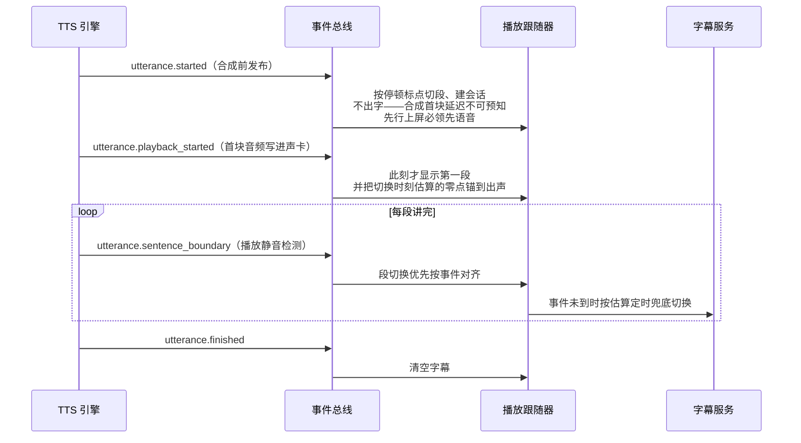

# 字幕

字幕是基础设施而非工具：配置启用即百分百工作，不由 Agent 决定用不用——与语音合成（TTS）同一装配通道（见 [语音合成](tts.md)）。它把她说出口的台词送到直播间画面与控制台展示位，核心机制是**字幕与声音同锚**：出声前字幕保持空窗，不领先语音。

实现入口在 `src/modules/subtitle/`。本文讲多后端怎么广播、字幕内容跟谁走、分段切换怎么与语音对齐。

想干什么读哪节：

- 想知道字幕组件是什么性质、怎么装配——[定位与装配](#定位与装配)
- 想加一个展示位（新后端）——[多后端广播](#多后端广播)
- 想知道字幕文本从哪来、为什么有时整句有时分段——[两种字幕源](#两种字幕源)
- 想改分段、出字、清空的时机——[播放跟随](#播放跟随)

## 定位与装配

- **装配入口** `build_subtitle_infrastructure`：按 `infra.toml` 的 `[subtitle]` 段构造字幕服务并注册后端（键全集以 `infra_schemas.py` 的字幕 Schema 为准）。装配是 **fail-soft**：配置缺失、格式不对、构造失败都返回零后端的服务，不阻断冷启动——字幕是装饰性路径，坏了不拖垮直播。
- **调用方**是编排层：发言编排与播放跟随器调用 `show` / `clear`，主播 Agent 与 TTS 域不知道具体后端的存在。

## 两种字幕源

字幕内容的来源在**装配期择流**，两种模式互斥（决策依据见文末 [ADR-025](../decisions/025-subtitle-single-source.md)）：

| 源 | 条件 | 行为 |
|---|---|---|
| 播放跟随器 | 配置了 TTS 引擎 | 订阅 `tts.utterance.*` 生命周期事件驱动字幕（见 [播放跟随](#播放跟随)） |
| 派发直出 | 无 TTS（发言照常生成、只不上声） | 编排层直接调 `show`，整句一次推送，引用随调用显式携带 |

## 多后端广播

字幕服务（`SubtitleService`）持有多个后端并行广播。后端契约是结构类型协议（`SubtitleBackend`）：只声明 `show`（一次性推送全量文本）与 `clear` 两个成员，不抽基类。

- **不做流式**：协议不接收逐块文本；打字机观感由前端模板动画承担，后端不负责逐字渲染。
- **并行广播**：`show` / `clear` 用并行派发同时送达全部后端——串行等待会让总延迟叠加为各后端之和。
- **故障隔离**：单后端抛异常被捕获记日志，不影响其他后端。多后端的语义是"任一后端坏了不挡其他后端"，与 TTS 单选引擎（一处失败按失败处理）语义相反。
- **可观测**：诊断清单暴露每个后端的类名与可用性——专治"后端静默降级"（如图形库不可用导致入队无人消费）的观测缺口。

两个内置后端：

| 后端 | 展示位 | 说明 |
|---|---|---|
| Tk 窗口后端 | 直播画面上的桌面字幕窗 | 长驻图形线程渲染；线程是后端的功能前提，由装配入口启动；图形库不可用时后端标记不可用 |
| 控制台后端 | 控制台弹幕小部件的字幕展示位（`/ws/subtitle` WebSocket） | 由组合根在控制台服务构造之后注册 |

新增展示位 = 实现 `show` / `clear` 两个方法的对象 + 装配处注册，框架零改动。

## 播放跟随

TTS 引擎在位时，字幕跟随语音的完整生命周期。一句话的分段会话按事件推进：

**分段**：整句台词按停顿标点切段（句末标点与逗号、分号；顿号与冒号不是停顿不切，引号内的标点不切），段尾标点不显示。切分点下沉到逗号级——只按句末切分对"一逗到底"的台词过粗，且播放路径的静音检测对逗号停顿同样报边界。

**段切换双路信号，事件优先、估算兜底**：

- **句边界事件**（`tts.utterance.sentence_boundary`）：播放路径静音检测出停顿间隙的时刻发布，与观众听到的停顿天然同步。停顿数与文本段数不保证一致——按标点分块合成的引擎停顿偏密，按顺序硬配会把文本段提前耗尽、字幕跑在语音前面。事件须过**估算下限闸门**：比估算切换时刻早到超过容差的碎停顿不推进段，晚到的真实长停顿照常采纳。
- **估算兜底定时**：防"静音检测不工作导致字幕卡在第一段"。合成时长可用时按出声窗口的字数占比内插；不可用（流式引擎）按每字语速外推，语速由已切换边界的实测时刻在线校准。定时到点但边界事件还没到，照估算节奏切。检测工作 = 真实同步，检测失效 = 估算节奏——任何情况下观众都能看到全部文本。

切换还受**最短段显示时长**约束：当前段上屏不足该时长不切，防逗号级细段闪切。

**边界兜底**：

- **出声信号缺席**（播放分接未挂、整句无声）：等待出声超时后把第一段兜底上屏——无声音也要给文本；兜底出字不锚估算时钟（没有出声事实就没有可信零点），字幕停在第一段。
- **合成失败**（`utterance.failed`）：该句照常显示全文，不分段。
- **迟到事件**：会话已结束的 utterance 事件按编号不匹配丢弃。

**引用弹幕**：本句在回复谁的哪条发言，随字幕显示为引用行。它不随语音生命周期事件走：跟随器额外订阅发言事件，按发声编号先记住该句的回复目标，显示每段字幕时反查带上（发言事件先于语音合成发布，"先记后查"的时序天然成立）。分段连播的派生编号（基编号加分段后缀）回退基编号查——几句共用同一次决策的回复目标。查不到不渲染引用行，宁缺毋假。

## 相关决策

- [ADR-025：字幕单一源——装配期择流](../decisions/025-subtitle-single-source.md)
