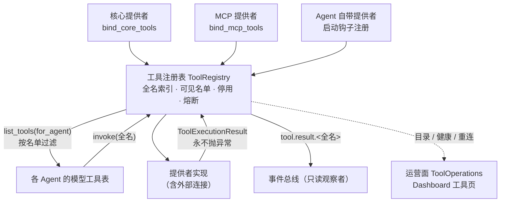

# 工具层

> 工具层是所有 Agent 可调用能力的统一契约面：把看屏幕、查旧事、切直播场景、让虚拟形象做动作、向游戏 Agent 委派这类**被调才干活**的能力做成同一种形状，注册进一张表，供模型按 function calling 调用。它解决三件事：让模型能调（契约翻译）、让每个 Agent 只看到自己该用的（可见名单）、让单个能力故障不扩散成全局停摆（调用永不抛异常 + 熔断摘除）。
>
> 系统里现在有哪些工具（工具清单）以代码为事实源（`ToolRegistry`），文档不抄录；写一个新工具的实操步骤见[组件开发指南的"添加工具"](../guides/component/README.md)。

## 三个概念

| 概念 | 代码 | 是什么 |
|---|---|---|
| 工具 | `ToolSpec`（`src/modules/tools/models.py`） | 一份能力声明：名字、说明、参数格式、可见名单 |
| 提供者 | `ToolProvider` / `BaseToolProvider`（`src/modules/tools/provider.py`） | 一组工具的来源，持有实现；注册时声明归属分类 |
| 工具注册表 | `ToolRegistry`（`src/modules/tools/registry.py`） | 全局唯一一张表：聚合所有提供者，按名分发调用 |

**全名派生**：工具的注册键与对外名字 = `<提供者名>_<工具声明名>`（如提供者 `minecraft` + 工具 `glance` → `minecraft_glance`）。全名由 `ToolSpec.full_name` 一处现算，代码里禁止手拼前缀或反向剥离。提供者名、归属分类（category，Dashboard 分组用）、tools.toml 配置段（开关地址）三者正交。

## 工具声明（ToolSpec）

| 字段 | 作用 |
|---|---|
| `name` | 声明名，不带前缀；对外全名 = `<provider>_<name>` 派生 |
| `provider` | 提供者短名；注册期强制与提供者对象同名（同值同源，不一致直接报错） |
| `description` | 模型看到的工具说明 |
| `parameters_schema` | JSON Schema 形态的参数描述，可空 |
| `kind` | `sync`（调用等结果）/ `async`（受理即返回 + 事件回传）；现行工具全部为 `sync` |
| `visible_to` | 可见名单；未声明落默认名单（仅主播） |
| `result_event` | 异步工具的结果事件名，默认 `tool.result.<全名>` |
| `result_section` | 结果在上下文计量中另记的分段（如技能正文记入技能段）；空串计入对话消息 |

调用请求是 `ToolInvocation`（`src/modules/tools/models.py`）：工具全名、参数、调用方标识、关联决策回合号等。另有一个 `attachment` 字段承载宿主代码构造的交接材料——它不经模型（模型不可见也不可伪造），形状由调用方与具体提供者约定；模型生成的参数走 `arguments`，两条通道不混。

## 管控三维度

任何"开/关/通"话题先分清说的是哪个维度（术语纪律全文见[组件开发指南](../guides/component/README.md)）：

| 维度 | 回答的问题 | 生效期 | 机制 |
|---|---|---|---|
| 存在性 | 系统里有没有它 | 装配期（重启生效） | 配置域开关；提供者是否装配 |
| 可见性 | 模型能不能看见它 | 运行时即时 | 可见名单、配置停用名单、熔断摘除 |
| 可用性 | 通道通不通 | 运行时即时 | 探活与重连；连接态刷新 |

模型工具面的完整口径：

```
<Agent> 工具列表 = 全部注册工具 − 配置停用 − 熔断中 − 可见名单不含该 Agent 的
```

## 装配：工具从哪来

三条路，都在启动期完成，互不感知：

- **核心提供者**：`bind_core_tools`（`src/modules/tools/bootstrap.py`）按配置域开关装配内置能力（虚拟形象动作、演播控制、联网搜索等）。成员表来自组件目录单一源表（`src/modules/component_catalog.py`），无目录扫描；单个成员装配失败只记日志，不阻断其他。
- **MCP 提供者**：`bind_mcp_tools` 把外部 MCP server 的工具映射进注册表（见下文 [MCP 集成](#mcp-集成)）。
- **Agent 自带**：各 Agent 在自己的启动钩子里注册自家提供者（如 `streamer_reply`、`minecraft_todo`）。加内容 = 加 Agent 包 + 配置，框架零改动。

TTS 与字幕**不是工具**：它们是基础设施，装配期构造实例直接注入主播 Agent，不经注册表（决策依据见 [ADR-007：TTS 作为配置驱动基础设施](../decisions/007-tts-infrastructure-pipeline.md)）。

## 总览



## 注册

- `register_provider(provider)` 注册一个提供者的全部工具。重复全名保留先注册者；提供者名与声明不符直接报错（注册期暴露，不进运行期）。
- 提供者自声明的归属分类（category）在登记期落账——0 个工具的提供者也照常登记，保证工具页可见（连接失败的 MCP server 就处于这个状态，见 [MCP 集成](#mcp-集成)）。
- `unregister_provider` 摘除提供者及其名下全部工具，连带清掉可见名单与熔断状态，不留悬挂条目。
- 生命周期批量启停：组合根在全部装配完成后调 `start_providers`，逐个调用维护外部连接的提供者的 `setup()`（建立连接、启动后台循环）；声明自管理生命周期的提供者（MCP）跳过，避免同一连接被建立两次。
- `register(spec, impl)` 直注册裸实现仅限测试兼容；生产代码一律走 `register_provider`。

## 查询与可见名单

`list_tools(for_agent=...)` 是全体消费方统一的取表入口，过滤维度：配置停用、熔断中、可见名单、提供者运行期装配态。

**可见名单是注册处的生产侧声明**：每个工具出生时声明它给谁看（Agent 注册名列表或 `["*"]` 全员）。决策依据见 [ADR-012：工具可见名单机制](../decisions/012-tool-visibility-list.md)——工具的生产者最清楚它给谁用，消费侧清单会要求每个 Agent 持有全局工具知识。

- 未声明的工具默认仅主播可见（fail-closed）：新工具不会意外泄漏给游戏 Agent，共享工具由注册处显式声明 `["*"]`。
- 名单可以逐次现算：少数工具（流程单控制、回忆工具）的名单随运行态变化，如游戏 Agent 主控期间也能看到流程单控制。
- 名单只约束可见性；`invoke()` 不校验调用方身份。模型拼错名字直调是已知的受众治理边界——防的是"看见不该看见的"，不是"调用没授权的"。
- 第二层过滤：提供者可按运行态声明自己此刻对某 Agent 有没有工具可给。例如没有可接收委派的 Agent 启用时，框架委派工具不进主播的工具表——纯杂谈场不挂这四件。

只读的发现面（能力/状态元数据，只许拉取不许推送，边界规则见[数据流](../conventions/data-flow.md)）：

| 接口 | 给什么 |
|---|---|
| `guides(for_agent)` | 各工具组的组合使用说明（如某游戏是委派型还是遥控型），拼进 Agent 系统提示词 |
| `current_saves(for_agent)` | 各游戏眼下所在的存档 |
| `current_situations(for_agent)` | 各游戏眼下的情境（离记住的地点多远） |

## 停用

配置停用与熔断是两套正交机制：停用来自配置（重启生效），熔断来自运行期失败计数（见下文 [熔断与探活](#熔断与探活)）。

- 停用的工具保留在注册表中：工具页全集可见，但对模型不可见，调用被拒绝并提示可在 WebUI 工具页重新启用。
- 停用名单里指向"尚未注册工具"的条目先进待生效集，工具日后注册时自动转正——连接型提供者降级登记（先占位、后补注册）不漏掉停用声明。

## 调用

`invoke()` 是唯一调用入口，契约是**永不抛异常**——上层拿到的永远是结构化结果，单个工具故障不会打断决策循环：

1. 未知工具 → 失败结果；报错按名字相似度附一个最接近的合法工具名，模型看一眼即能改对拼写。
2. 已停用 / 已熔断 → 失败结果短路返回（不触达健康计数，也不发结果事件）。
3. 执行 → 实现抛异常也兜成失败结果（携带异常类型与信息）。

每次调用完成（无论成败）广播 `tool.result.<全名>` 事件，携带入参回显与结果摘要，供 Dashboard 溯源；图片类大载荷不进事件正文，只记"带了几张图"。`invoke_many` 提供 gather 并发批量调用。

结果进对话前经过一次**对话安全视图**（`src/modules/tools/conversation.py`）：超长的纯 base64 字符串替换为"图像 N KB 已省略"占位符，完整载荷仍走事件通道供工具卡展示——对话通道与 UI 通道分离。视觉调用方另行经 `extract_image_data_urls` 取图，挂到下一次请求尾部看一次，历史里不存内联大载荷。

`src/modules/tools/llm_defs.py` 把 `ToolSpec` 转成 OpenAI 风格 function calling 定义：名字用全名，参数取 `parameters_schema`；另附两个**只用于上下文计量的标注**（区分 MCP 工具与系统工具两段、结果归属分段），规整请求时收下、不发给模型。

## 熔断与探活

工具层的韧性机制：单个能力坏了，从模型工具表里暂时消失、调用短路返回，而不是让决策循环跟着失败；外部连接恢复后自动回来。三种"不可用"的分工：

| 机制 | 来源 | 生效 | 解除 |
|---|---|---|---|
| 配置停用 | 人工配置（`[tools].disabled_tools`） | 注册表整体拒绝调用 | 人工在 WebUI 工具页重新启用 |
| 熔断 | 运行期连续失败计数 | 摘出模型工具表 + 调用短路 | 探活通过或手动复位 |
| 断连 | 外部连接断开 | 该提供者工具整体摘出（工具集刷新） | 重连后补注册 |

熔断器由注册表持有（`ToolCircuitBreaker`，代码在 `src/modules/tools/tool_health_monitor.py`），在 `invoke` 主路径上记账：

- 调用成功、或服务明确返回业务拒绝 → 连续失败计数清零。业务拒绝说明服务本身正常应答，参数填错不算服务故障，不让调用方传错参数把工具误摘。
- 执行故障（实现抛异常或未分类失败）→ 计数递增并记录最近错误。
- 连续失败达到阈值（可配置，阈值以代码与配置为准）→ 标记熔断，广播 `tool.health.<全名>` 事件（open）。

熔断期间：工具从 `list_tools` 默认结果里消失（模型看不见），`invoke` 短路返回"工具已熔断，探活恢复中"，不发结果事件、不触达健康计数。

探活服务（`ToolHealthMonitor`）按配置节拍扫描熔断中的工具，健康判定统一走 `registry.probe_tool` 一条路径：按"全名 → 提供者对象"的归属索引找到所属提供者，调它的 `health_check()`。探活契约：

- 维护外部连接（WebSocket / HTTP / 子进程等）的提供者**必须**重写：连接可用才返回真。架构测试强制这条约束（`tests/architecture/test_provider_health_contract.py`）。
- 无状态提供者沿用基类默认（返回真），语义是"无可检查之物，让流量决定"：熔断后驻留期满即恢复，再失败再熔断。
- 探活自身抛异常按不健康处理，不上抛。

恢复动作：探活通过 → 复位熔断器（计数清零、摘除标记清除）并广播 closed 事件。熔断后设有最小驻留时长（复用探活节拍），未到时长不尝试恢复，避免抖动。工具注销时其熔断状态随之清除。

## 手动重连与连接态刷新

Dashboard 工具页可对提供者触发手动重连，编排集中在 `ToolOperations.reconnect_provider`（决策依据见 [ADR-010：工具可用性手动操作](../decisions/010-tool-availability-reconnect.md)）：

1. `provider.reconnect()`（默认 = 先断开再连接；提供者覆写 `connect` 即自动获得重连支持，无需另打标）。
2. 成功后刷新该提供者的工具集（降级登记的 0 工具补注册、清单变化整体刷新）。
3. 对归属工具逐个探活，通过且仍在熔断的即复位。

失败报告携带机器可读的 `reason`（未注册 / 不支持 / 重连失败），HTTP 层按 reason 映射状态码，不做文案匹配；重连失败时附带提供者自记的最近连接错误摘要。刷新一步失败不推翻重连成果，原因进报告。

维护外部连接的提供者继承 `ConnectionToolProvider` 中间层，工具表跟着连接态走：

- 未连接时 `list_tools()` 返回空——装配期以 0 工具降级登记，提供者本体在册（工具页可见、可手动重连）。
- 连接建立或断开时，提供者在自身检测点调用 `mark_connected` / `mark_disconnected`，经装配端注入的回调触发 `registry.refresh_provider_tools`：按当前清单重新登记，新增的补注册、消失的摘除。
- 刷新不会把"熔断待核实"洗成健康：消失的工具清熔断状态，存续工具保留待探活复位——复位只属于探活路径。
- 各提供者自己的后台重连循环（如 MCP 的指数退避恢复）与手动重连属低频可接受并发，不强制串行。

## 运营面

`ToolOperations`（`src/modules/tools/operations.py`）是注册表的只读伴生对象，供 Dashboard 工具页消费：提供者目录（含 0 工具的降级登记项，保证可见可重连）、健康快照（只含熔断中或近期有失败的工具）、工具归属投影（可见名单的单归属 Agent）、手动重连编排。写路径仍归注册表，本类只读。

## 异步任务

有一类工具调用拿到的不是结果，而是一张**受理回执**（"接了，任务号是 X"）：游戏里的执行动作、跨 Agent 委派、后台生成的图纸都属这类。这套"受理—跟踪—通知"基建的代码在 `src/modules/tools/tasks.py`；委派原语的决策依据见 [ADR-013：异步任务基建与 Agent 委派原语](../decisions/013-async-task-infrastructure-and-delegation.md)与 [ADR-076：委派改为一件在做、其余待办](../decisions/076-delegation-one-in-hand-and-settle-on-switch.md)。

**受理约定**：回执型工具的成功结果携带结构化字段 `accepted=true` 与 `task_id`，调用回合不阻塞。任务的真实进展在执行侧（外部系统或执行 Agent），工具层只做三件事：登记账目、核实进展、把变化通知发起方。

状态词表：

| 状态 | 含义 |
|---|---|
| `accepted` | 已受理，执行侧尚未开工 |
| `running` | 执行中 |
| `waiting_for_decision` | 停在决策点等人定夺 |
| `queued` | 委派排队：执行者手上有在做的事，这件在待办里占账 |
| `succeeded` | 终态：执行侧主动交付，做完了 |
| `closed_by_initiator` | 终态：发起方认定做完，执行侧并未交付 |
| `failed` / `cancelled` / `timeout` | 终态：失败 / 撤销 / 超时 |
| `undelivered` | 终态：执行侧自己停了却没交付——停下不等于做完 |

`closed_by_initiator` 与 `succeeded` 分开记，事后核对"说做完了"的凭据时区分得出是谁认定的。

**单写者规则**——事实源在谁那边，谁写账：provider 型（真相在外部系统，如游戏 MCP）由跟踪循环唯一写入，执行 Agent 只被通知；agent 型（委派，真相在执行 Agent 的状态）由执行 Agent 唯一写入，跟踪循环不代写。

任务记录表（`TaskLedger`）是内存中的对账副本，事实源始终在执行侧。写入规则：

- 终态粘滞：已终态的任务忽略后续写入（条目已移除）。
- 同状态重复写入幂等：只有快照**内容**变化才算新进展。
- 受理与进行中之间的迁移静默记录、不发事件——不值得为"开始跑了"唤醒发起方；决策点与终态才是唤醒级变化。
- 执行侧可往快照补旁注（如执行 Agent 最近说的一句判断），旁注不算进展、不顺延停滞计时。
- provider 型任务终态后，结果保留在一个有界环形缓冲里，供只读观察者核对"最近几步到底成没成"。
- 发起方每回合决策前可读记录表旁注当参考；旁注里的原始推理含坐标与工具名，进参考段前由消费方脱敏。

跟踪循环（`TaskTracker`）对每个进行中的 provider 型任务双通道核实：执行侧通知触发一次核实（举旗级、可丢），周期兜底轮询保底。核实经提供者的**查询适配器**拉取快照写入记录表（真变化才发事件）。停滞告警：超过无进展时长（可配置）→ 经 `task.changed` 发一条告警（状态不变、`alert` 标记），不杀任务；排队等待出队的委派不算停滞。委派停着等定夺、连续多次告警仍无决断时，主播侧按配置自动撤单兜底。

两个可选适配器钩子挂在提供者上（默认不支持、不支持则退化为纯周期兜底）：

| 钩子 | 作用 |
|---|---|
| `query_task(task_id)` | 向事实源查任务快照，返回状态 + 快照 + 摘要 |
| `subscribe_task_notifications(callback)` | 订阅执行侧提示；订阅按提供者复用，名下任务清空自动退订 |

声明 server 特有映射（原始状态词 → 任务词表、通知资源地址）是绑定处的职责，通道层不含任何 server 语义。状态真变化（登记、决策点、终态、停滞告警）发 `task.changed`；订阅方按"发起方是自己"过滤后由 Agent 基类唤醒子类钩子——通知是提示，需要事实再查记录表与执行侧。跨 Agent 委派的委派/递话/结单原语（`framework_delegate` 等）挂在框架提供者上，记录表与跟踪循环为它共用。

## MCP 集成

MCP（Model Context Protocol，模型上下文协议）是连接外部工具服务的标准协议。本模块（`src/modules/mcp/`）是**通道层**：把 MCP server 暴露的工具映射成本项目的统一工具契约，不含任何具体 server 的语义知识。Agent 私有 MCP 的归属限定见 [ADR-009：Agent 私有 MCP 与工具归属限定](../decisions/009-agent-owned-mcp.md)。

两种用法：

- **全局外部 server**：`bind_mcp_tools` 按 `[tools.mcp]` 配置连接全部 server，工具以 server 名为提供者名全局注册，任何 Agent 经可见名单机制各取所需。
- **Agent 私有 MCP**：Agent 自建连接、自注册提供者，工具名单只给自己（如 Minecraft Agent 的游戏 server，工具只对 `minecraft` 可见）。见[组件开发指南的 MCP 二分表](../guides/component/README.md)。

命名与映射：

- `spec.name` 存 **server 原始名**；对外全名 = `<提供者名>_<原始名>`，提供者名默认 = server 名。调用时用原始名直呼 server，全程无名字解析。
- 映射（`mapper.py`）是纯函数、类型层直传：协议的工具声明 → `ToolSpec`，调用回执（文本块 / 图片块）→ 统一结果类型；单份完整 JSON 文本额外解析为结构化事实供程序消费。工具清单在**连接时预拉缓存**——协议的清单接口是异步的，提供者的清单接口是同步的，缓存是两者的衔接点。
- MCP 调用是请求-响应语义，映射出的工具一律 `sync`。

失败分两类，与熔断记账联动：

| 情形 | 分类 | 语义 |
|---|---|---|
| 请求超时，未拿到回执 | 执行故障 | 附"结果未知"标记：没拿到回执不能宣称远端未执行，通道不代替调用方重试 |
| server 返回业务错误 | 业务拒绝 | 透传给调用方自纠，不计入服务故障、不触发熔断 |
| 连接断开等拿不到任何回执 | 执行故障 | 按连接故障走降级与恢复 |

server 连不上是常态（如 server 晚于本进程启动），装配与运行期同一条路：

- 连接失败 → 0 工具**降级登记**：提供者本体占位在册（工具页可见、可手动重连），工具缓存清空、原因入日志。
- 后台按指数退避循环重试连接，拉到工具即止；断开且缓存已空时自动拉起。
- 恢复成功走与初次装配同一个出口：标记连接建立 → 工具集刷新补注册，无需重启。
- 生命周期自管理：MCP 提供者在装配期自行建连，退出注册表的批量启停，避免同一连接被建立两次。

MCP 提供者可声明任务适配器（绑定处在连接拉到清单后赋值，通道层只认全名不认语义）：任务查询工具 + 状态映射（把 server 的任务查询工具与原始状态词映射进任务词表，供跟踪循环核实）、通知资源地址（订阅 server 的举旗级通知，多订阅方共用一条资源订阅，最后一个退订才断开）、注意流读取工具 + 固定入参（按游标**增量**读一页事件；返回空表示"这一轮没读到"，不能读成"没有事件"——等待与失败必须区分）。优雅停机经 `close_mcp_providers` 关闭仍在连接的 MCP 提供者（取消恢复循环、关底层连接），幂等；单个关闭失败不影响其余。

## 什么不是工具

Agent 内部件的处置分三档（判据与细则见[组件开发指南的红线三分](../guides/component/tool.md#红线三分)）：

| 类别 | 处置 |
|---|---|
| 模型可调的内部工具 | 注册进表 + 可见名单隔离（如 `streamer_reply`、`minecraft_todo`） |
| 规划器 / 回复器类本体 | 留在 Agent 内部，不进表 |
| 代码直连的内部件 | 不是工具，没有声明、不注册（如主动发言判定、命令解析原语） |

## 相关配置与已知边界

配置键与字段以代码为事实源（`src/modules/config/tools_schemas.py`）。方向上分五处：各域装配开关（`[tools.<域>.<键>].enabled` 与虚拟形象平台名单）、全局停用名单（`[tools].disabled_tools`，重启生效）、探活节拍（`[tools.health]`）、任务基建节拍（`[tools.tasks]`）、MCP server 清单（`[tools.mcp]`）。

已知边界（有意取舍，勿当缺陷上报）：

- 编名直调不拦：`invoke` 不校验调用方身份（见"查询与可见名单"）。
- 名单静态、工具动态的例外：个别工具按运行态出现或消失（如流程单控制按流程单激活状态），靠提供者现算名单承接。
- 重启丢跟踪：任务记录表是内存态，重启后进行中任务的跟踪消失（执行侧仍在跑）。
- 进程内单例 `default_tool_registry()` 仅测试兼容；生产路径由组合根显式构造注册表并传递。

## 关联 ADR

- [ADR-005：v2.0.0 采用 Agent + 工具 + 存储 + 编排架构](../decisions/005-v2-agent-tool-architecture.md)
- [ADR-009：Agent 私有 MCP 与工具归属限定](../decisions/009-agent-owned-mcp.md)
- [ADR-010：工具可用性手动操作（手动重连）](../decisions/010-tool-availability-reconnect.md)
- [ADR-012：工具可见名单机制（注册处生产侧声明）](../decisions/012-tool-visibility-list.md)
- [ADR-013：异步任务基建与 Agent 委派原语](../decisions/013-async-task-infrastructure-and-delegation.md)
- [ADR-019：ToolRegistry Provider 常驻登记与工具集刷新](../decisions/019-tool-registry-provider-refresh.md)
