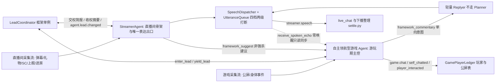

# ADR-081：游玩期动态主从移交与两级语音打断

- 状态：已采纳；扩展 [ADR-005](005-v2-agent-tool-architecture.md) 的主体驱动划分、[ADR-043](043-game-agent-interaction-shapes.md) 的游戏交互形态（新增"自主领航型"）、[ADR-076](076-delegation-one-in-hand-and-settle-on-switch.md) 的委派模式（游戏主控态下以非强杀建议替代委派强杀）、[ADR-080](080-speech-thinking-cadence-decouple.md) 的发声排队控制（四档优先级与两级打断）；保持 [ADR-018](018-game-agnostic-boundary.md) 游戏无关边界
- 日期：2026-11-19
- 实现提交：与本 ADR 同批交付，按路径检索：`git log -- docs/decisions/081-dynamic-lead-handover.md`

## 背景（Context）

在既有架构下，主播 Agent（`StreamerAgent`）始终是全场唯一的自我驱动主体，重度游戏 Agent（如 `MinecraftAgent`）属于命令驱动的委派型执行者（见 [ADR-005](005-v2-agent-tool-architecture.md) 与 [ADR-043](043-game-agent-interaction-shapes.md)）。哪怕在 [ADR-076](076-delegation-one-in-hand-and-settle-on-switch.md) 收紧了任务账本与换活结单契约之后，第 71 场实机复盘仍暴露出两类无法靠局部修补消除的结构性矛盾：

1. **双脑权责倒挂与成本倒挂**：
   - **成本倒挂**：游玩期间，并不掌握完整游戏场景的主播规划器（Planner）持续高频运行、反复根据压缩摘要发号施令；结果主播侧 Planner 单项模型支出达到 ¥4.17，反而超过承载全部游戏空间推理与施工执行的 `MinecraftAgent`（¥3.75）。
   - **后座盲区强杀清历史**：主播侧处于信息后座，看不到游戏现场正在进行的细粒度步骤（如挖到一半的矿道、刚布好的容器），稍有节奏波动便触发 `framework_delegate(when_busy="replace")` 强行收手换活，反复打断在途目标并清空执行上下文，迫使游戏侧重读现场重头再来。
   - **公屏瞎承诺而游戏侧无感继续原活**：主播侧经游戏直发公屏工具（`minecraft_chat_send`）在游戏聊天栏替角色答应其他玩家（例如"马上过来帮忙"），而游戏侧对此并不知情或仍锁在旧委派上继续制作熔炉，造成"嘴上承诺、身体不动"的言行割裂。
   - **游戏内文字与口播双脑分裂**：在写告示牌等同时牵涉语言表达与游戏操作的场景下，主播侧在直播间口播一套说辞，游戏侧在世界里按旧单或自行发挥写下另一套内容，同一角色出现两套相互冲突的意识。
2. **播音期间缺失紧急硬打断**：
   - [ADR-080](080-speech-thinking-cadence-decouple.md) 解耦了思考节拍与发言节拍并引入待播队列上限，但既有的队列打断机制只能取消"同一段杂谈里尚未播出的后续句子"。一方面无法按统一优先级清理跨来源的低优待播句；另一方面，当游戏内发生非自选意外阵亡或紧急急停等极急事件时，系统无法立即停播声卡里正在念着的常规解说或冷场暖场独白，导致角色已阵亡数秒后主播仍在慢悠悠念上一句普通闲聊。

问题的根源在于：**游玩期把游戏内决策权留在信息滞后的主播侧，而把拥有一手现场视野的游戏代理压制成被动工具**；同时，单一发声队列缺少覆盖"待播清队"与"极急停播"的分级打断机制。

## 决策（Decision）

核心一句：**保留 `StreamerAgent` 作为直播间唯一骨架与唯一出声出口，在游玩期把游戏内主导权动态移交给支持"自主领航型"的游戏 Agent；双方按两态清晰分工、以五束单向契约协作，并在唯一发言管线上建立四档优先级与两级语音打断。**

### 一、四条架构底线

1. **直播间唯一骨架永归 `StreamerAgent`**：直播场次生命周期（开播 / 下播）、流程单（Rundown，导演预写的直播环节清单）、观众身份与直播间长期记忆、下播整理（`settle.py`，直播结束后从台词与事件提炼记忆账本的后台流程），以及面向观众的唯一出声出口（TTS 播音、字幕与虚拟形象情绪/口型驱动），永久由 `StreamerAgent` 持有，游戏 Agent 绝不接管或旁路。
2. **严守游戏无关边界，扩展三种游戏交互形态**：框架层（`src/modules/`、`main.py`）与主播侧（`src/agents/streamer/`）继续严守 [ADR-018](018-game-agnostic-boundary.md)，不写死任何具体游戏名，不做按游戏名的特判分支。在 [ADR-043](043-game-agent-interaction-shapes.md) 的**遥控型**（游戏侧无 LLM、主播直调按键类工具）与**委派型**（主播派自然语言目标、游戏侧有界执行）之外，新增第三种形态——**自主领航型**：游戏 Agent 通过协议声明自身支持自主领航，在游玩期接管游戏内持续目标规划、执行与公屏社交，不再被动等待委派单。
3. **数据平面单向防环**：遵循[数据流规则](../architecture/data-flow.md)——输入采集单向流入各自归属方；游戏侧请求播音只经框架同步工具面单向提交给轻量表达层，不触发主播重型 Planner，杜绝"口播输出 → 再次决策 → 回流指令"的闭环；主播口播同步回游戏侧采用零唤醒只读写入，不反向拉起游戏 LLM。
4. **灰度与一键回退开关**：配置新增 `lead_mode = "dynamic" | "streamer_only"`。切为 `streamer_only` 时关闭动态移交，系统 100% 退回既有由主播常驻主控的委派模式（[ADR-076](076-delegation-one-in-hand-and-settle-on-switch.md) 原链路保持兼容）。

### 二、两态划分与全周期 12 时刻职责矩阵

运行时主控态严格分为两态，同一时刻只有一个主控方：

- **主播主控态（`mode = "streamer"`）**：系统默认态。覆盖待机调试、开场问候、纯杂谈（流程单 `talk` 环节）、遥控型/委派型游戏、下播收尾，以及自主领航型游戏断连、不健康或被运营者手动收权时的降级态。
- **游戏主控态（`mode = "game"`）**：仅当以下条件同时成立（或经运营者手动覆盖指定且目标健康可用）时进入：① `lead_mode = "dynamic"` 且覆盖模式未锁定主播；② 已处于开播场次；③ 流程单当前处于非 `talk` 的游玩环节；④ 存在在线且健康就绪的自主领航型游戏 Agent（`supports_autonomous_lead = True` 且 `can_take_lead() == True`）。此时游戏 Agent 主导游戏内一切行动与公屏交流，主播退居轻从侧，专注观众互动、唯一口播渲染、低频冷场暖场与流程单宏观把控。

全周期 12 个关键时刻的双方职责划分如下：

| # | 直播时刻 | 主控态 | 主播侧（`StreamerAgent`）职责 | 游戏侧（自主领航型游戏 Agent）职责 |
|---|---|---|---|---|
| 1 | 待机 / 开播前调试 | 主播主控 | 保持未开播态，不触发直播移交；允许常规人工调试 | 待命，不自行启动直播自主游玩循环 |
| 2 | 开播进入开场问候（`talk`） | 主播主控 | 开场问候、承接上次收尾、介绍本场流程单 | 保持收权待命，不发实况解说 |
| 3 | 纯杂谈环节（`talk`） | 主播主控 | 全权主导话题、弹幕互动与跨存档名场面回忆 | 保持收权待命，不介入直播间话题 |
| 4 | 切入游玩环节（`talk` → `play`，游戏就绪） | 交权 → 游戏主控 | 一次性生成游戏/存档级只读交接简报；隐藏/禁用委派强杀与直发公屏工具，切入轻从态；游戏段不触发主播流程单发言（开场白归游戏侧） | 接收交接简报进入主控，按当前存档工作文档启动自主领航；游戏段的开场白由游戏 Agent 经解说链承担（只此一句，主播侧不再产开场白） |
| 5 | 游玩常态推进 | 游戏主控 | 不跑高频游戏规划、不产过程解说与环节切换发言；只润色并播出游戏侧发来的实况解说，同步刚说过的话给游戏侧 | 自主维护待办与工作笔记、规划并执行游戏目标；按需调用 `framework_commentary` 提交解说意图；环节到点经 `rundown_control` 自主 `next`/`renew` 推进流程单 |
| 6 | 游戏公屏玩家聊天 / 玩家肢体互动 | 游戏主控 | 不把普通公屏送入主播 Planner、不代发游戏公屏、不替角色作游戏内承诺 | 直接由公屏与身体事件驱动，自主决定回应动作、直发游戏公屏，并视情况发实况解说 |
| 7 | 直播间观众弹幕 / 礼物 / 醒目留言（SC）/ 上舰 | 游戏主控（直播间由主播承接） | 独享直播间输入，以 P2 优先级及时口播回复观众；观众提出游戏点菜或提醒时，调用 `framework_suggest` 非强杀转达 | 不直接读直播间弹幕；收到主播转达的建议后自行评估排期、采纳或口播回应 |
| 8 | 游戏内突发极急事件（如非自选意外阵亡 / 紧急急停）或高光时刻 | 游戏主控 | 唯一发声管线执行分级打断（P3 可停播正在念的 P0 独白，绝不掐断 P2 观众回复），即时出声 | 身体/异常事件直接触发应急处置，并按紧急度提交高优解说或触发突发反应 |
| 9 | 游戏执行长目标挂起等待（赶路 / 烧炼 / 长施工等） | 游戏主控 | 连续沉默达 45–60 秒时产出低频 P0 冷场暖场句（可被高优解说或观众回复抢占），对游戏零干预 | 保持挂起态零 LLM 唤醒，等待游戏目标推进或事件唤醒，不自醒闲聊 |
| 10 | 游玩遥控型小游戏或传统委派型游戏 | 主播主控 | 沿用 [ADR-043](043-game-agent-interaction-shapes.md) 与 [ADR-076](076-delegation-one-in-hand-and-settle-on-switch.md) 既有工具面与委派账本 | （遥控型/委派型不声明自主领航，不参与移交） |
| 11 | 游戏断连 / 不健康降级，或运营者在 Dashboard 手动收回 | 收权 → 主播主控 | 立即恢复完整主控权，接过收尾摘要自然圆场、陪观众聊天或等重连；`auto` 模式下待游戏恢复健康再交回 | 经 `yield_lead` 安全收手并尽量回报当前进度摘要，停止发起解说 |
| 12 | 切回杂谈 / 收尾环节与下播整理 | 收权 → 主播主控 | 接过游戏收尾摘要完成总结与道别；下播后由 `settle.py` 照旧基于统一落库数据整理记忆 | 安全收手回报收尾摘要，持久化当前存档工作文档，退出主控态 |

**越界禁令（硬约束）**：
- 游戏主控态下，主播侧**禁止**向该游戏派发 `framework_delegate`（含 `replace` 强杀）、**禁止**调用 `framework_task_settle` 干预在途任务、**禁止**直发游戏公屏（如 `minecraft_chat_send`）替角色表态。
- 任何状态下，游戏侧**禁止**直接连接 TTS 或字幕出声、**禁止**直接订阅直播间观众弹幕、**禁止**编辑流程单内容或观众记忆账本；游戏主控态下环节推进（`next`/`renew`）经 `rundown_control` 授权执行，跳段（`goto`）与流程单内容编辑仍归主播侧；非主控态下**禁止**通过 `framework_commentary` 发解说意图。
- 2026-11-21 扩展：明确游戏段的开场白、过程解说与环节推进全部归当场主控（游戏 Agent），主播侧触发器按段类型门禁、`rundown_control` 可见名单跟随主控切换——补全本矩阵时刻 4/5 的职责缺口（场 73/74 实测主播侧在游戏主控期产开场白与过程解说的越位修正）；实现提交 `db9b7520f4bb6e9bb902bcd6ac5b85c52a68a494`、`e208af3e33e78fd1a892e95acea13e49b0385dd6`。

### 三、五束连线契约

1. **输入采集线**：
   - 直播间行为流（`room.message.*`：弹幕、礼物、醒目留言、上舰、进房、联动对象发言）始终只接 `StreamerAgent`，由主播侧完成聚合、防骚扰与观众关系维护，避免噪音与恶意弹幕直接污染游戏上下文。
   - 游戏内采集流（其他玩家公屏 `game.chat.*` 与角色身体事件 `game.body.*`）在游戏主控态直接驱动游戏 Agent，由其第一时间处置现场并回复公屏；主播侧在游戏主控态不再把常规公屏与普通身体事件喂进重型 Planner，只保留必要的只读观察与紧急反应联动。

2. **主控交接与协作线**：
   - **框架中枢 `LeadCoordinator` 单例**：装配于组合根，持有 `AgentManager` 与 `EventBus`，对具体游戏名零感知。通过 `BaseAgent` 新增协议成员（`supports_autonomous_lead`、`can_take_lead()`、`enter_lead(context)`、`yield_lead(reason)`、`receive_suggestion(...)`、`receive_spoken_echo(...)`）完成探测与切换；未覆写这些成员的既有 Agent 默认不支持自主领航，100% 向下兼容。
   - **状态变更事件 `agent.lead.changed`**：新增 `CoreEvents.AGENT_LEAD_CHANGED` 与 `AgentLeadChangedPayload`（含 `lead_agent`、`previous_lead`、`mode`、`reason`、`manual_override`、`handover_summary`、`live_session_id`、`timestamp_ms`），作为主控态切换的唯一观测事件。
   - **交权简报与收权摘要**：交权瞬间，主播侧通过绑定的构造回调一次性生成只读交接简报 `LeadHandoverContext`（当前流程单环节标题/目标/预期时长、当前存档名、该游戏/存档级精简记忆简报、运营备忘与最近几句已播台词）传给 `enter_lead`；收权时 `yield_lead` 返回简短收尾摘要（当前进度与未完事项），由主播接住话头。
   - **游戏 → 主播单向实况解说（`framework_commentary`）**：在框架工具提供者登记 `framework_commentary(summary, mood, urgency, about_player)`，仅对支持自主领航的游戏 Agent 可见，对 `streamer` 隐藏；调用时校验调用方确为当前主控者，经 `LeadCoordinator` 直通主播侧轻量 `Replyer` 按人设口语化润色并送入发言管线，**完全绕过重型 Planner**。
   - **主播 → 游戏非强杀建议（`framework_suggest`）**：登记 `framework_suggest(content, agent?)`，仅对 `streamer` 可见且用于游戏主控态。调用不创建委派账本、不调用 `release_delegation`、不强杀任何在跑目标，只将观众建议（可附来源原话）送达游戏侧 `receive_suggestion`，由游戏代理自主安排。
   - **游戏主控态工具隔离**：当某游戏处于主控态时，主播侧隐藏或执行期拒绝指向该游戏的 `framework_delegate`（含 `replace`）、`framework_task_settle` 及游戏直发公屏工具（如 `minecraft_chat_send`）；同时工具说明（`guide_for("streamer")`）自动由委派强杀守则切换为"游戏主控态观众建议守则"。
   - **主播 → 游戏零唤醒只读口播同步（`receive_spoken_echo`）**：主播每真正播出一句面向观众的话，`SpeechDispatcher` 经 `LeadCoordinator.publish_spoken_echo` 同步写入当前主控游戏侧的内存滚动缓冲，供游戏侧下次自然推理步顺带参考"主播刚才已经对观众说过什么"，绝不唤醒沉睡或挂起中的游戏模型。

3. **唯一表达与四档两级语音打断线**：
   - 全部面向直播间的口播统一汇入 `SpeechDispatcher` 与 `UtteranceQueue`（单一声源、单一字幕源、统一背压）。
   - **四档语音优先级**（比较基于 `<` / `<=`，向下兼容外部调用传入更大整数）：
     - `P0`（`SPEECH_PRIORITY_NORMAL = 0`）：常规实况解说、冷场暖场独白；
     - `P1`（`SPEECH_PRIORITY_HIGHLIGHT = 1`）：高光快嘴（游戏突发事件触发的即时短句）、高优实况解说（`urgency="high"`）、游戏公屏即时反应；
     - `P2`（`SPEECH_PRIORITY_AUDIENCE = 2`）：观众弹幕、礼物、醒目留言（SC）、上舰回复；
     - `P3`（`SPEECH_PRIORITY_EMERGENCY = 3`）：极急事件（非自选意外阵亡、紧急急停）。
   - **一级软打断（清低优待播，不掐在播短句）**：当 `priority > 0` 的发言入队前，`UtteranceQueue.interrupt_lower_priority(min_priority)` 移除队列中**尚未开始播放**且优先级 `< min_priority` 的条目——即 P2 观众互动清待播 P0/P1，P1 高光/高优解说清待播 P0。同属杂谈段落余句沿用 `tts.utterance.dropped(reason="segment_interrupted")` 并保留尾句回调；跨来源低优独立句发 `tts.utterance.dropped(reason="priority_preempted")`。
   - **二级硬打断（仅限 P3 停播正在念的 P0）**：仅当调用显式开启 `allow_hard_interrupt=True` 且 `priority >= P3` 时，触发 `UtteranceQueue.hard_interrupt_playing(min_priority, max_victim_priority=P0)`：先清低优待播，再仅当当前正在播放条目优先级 `<= P0` 时，定向取消单句播放子任务并立即停播声卡音频，发出 `tts.utterance.dropped(reason="hard_interrupted")`（不计渲染超时、不发 `failed`、不终止队列 worker 循环），随即播报紧随入队的 P3 紧急台词。**硬性边界：绝不硬打断正在播放的 P2 观众回复或 P1 高光发言。**
   - **低频冷场暖场兜底**：游戏主控态下若持续 45–60 秒既无解说也无观众互动，主播轻从侧才补发一条 `P0` 暖场独白，随时可被 P1/P2/P3 让位，不抢戏也不阻塞急讯。

4. **游戏自主执行线**：
   - 自主领航型游戏 Agent 接管主控后，以按存档分桶的待办清单与工作笔记（`todo` / `notebook`）驱动持续执行，自主拆解任务、读写告示牌、在游戏公屏与其他玩家交流，不再因完成单个子目标就停工等待外部发单。
   - 当游戏内长耗时目标挂起等待时，游戏 Agent 保持挂起零唤醒，不为了填补直播冷场而唤醒自身重上下文；冷场暖场由轻从侧主播按 45–60 秒低频兜底，且主播不对游戏执行做任何干预。

5. **存储记忆与下播整理线（及 Dashboard 控制面）**：
   - **台词落库单轨不变**：无论来源是主播观众回复、冷场暖场还是游戏 `framework_commentary` 经 Replyer 润色后的实况解说，全部通过 `SpeechDispatcher` 发射 `streamer.speech` 落入 `live_chat`（保持 [ADR-015](015-live-chat-single-source.md) 单一事实源）。
   - **玩家与公屏落库单轨不变**：其他玩家公屏发言、角色自发公屏与玩家互动继续通过 `game.chat.received`、`game.self.chatted`、`game.player.interacted` 经 `GamePlayerLedger` 落库（保持 [ADR-075](075-game-players-by-uuid.md) 与 [ADR-078](078-game-social-facts-boundaries-and-governance.md) 边界不变）。
   - **下播整理零断裂**：`settle.py` 继续统一消费 `live_chat`、游戏事件、玩家公屏与互动账本，生成场次档案、公开承诺与游戏社交事实，无需为两种主控态分拆两套整理逻辑。
   - **Dashboard 运行态控制面**：新增 `GET /api/v1/agents/lead` 与 `POST /api/v1/agents/lead`，向运营者实时呈现当前主控模式、主控 Agent、覆盖状态、候选与就绪列表及最近切换原因，并支持一键在 `auto`（自动跟随流程单与健康态）、`streamer`（强制收回主播主控）及具体候选游戏名之间手动切换。

## 替代方案（Alternatives）

### 方案一：游玩期（或全场）彻底取消 `StreamerAgent`，只留游戏 Agent 兼管直播间

**拒绝**。直播间承载的并非单一游戏会话，还包括开场、纯杂谈、无 LLM 的遥控型小游戏、流程单编排、观众身份映射、跨场承诺与下播整理。若把直播间高频弹幕、礼物、醒目留言直接灌进持有游戏大上下文的 Agent，不仅会让每次弹幕触发都背负巨额游戏上下文费用，还会把未经审核的观众弹幕直接暴露给游戏执行层，破坏防投毒边界（见 [ADR-074](074-viewer-defined-memory-needs-approval.md) 与 [ADR-079](079-memory-anti-noise-cross-agent-bridge-and-highlights.md)）。

### 方案二：让游戏 Agent 直连 TTS 引擎发声，绕过 `StreamerAgent`

**拒绝**。双入口同时输出音频会引发抢麦撞车与优先级失控，破坏单一字幕源（[ADR-025](025-subtitle-single-source.md)）和面捕表情/口型联动（[ADR-052](052-avatar-tracking-synthesizer.md)）；游戏侧模型上下文以空间推理、物品账本与工具调用为主，直接生成口播极易偏离主播人设与口语习惯；更关键的是，绕过 `SpeechDispatcher` 会断开 `streamer.speech` → `live_chat` 的统一记账通道，导致下播整理丢失整段游玩期口播。

### 方案三：维持主播常驻主控，继续通过叠加闸门与提示词守则修补

**拒绝**。场次 71 的实机数据已经证伪了这条渐进修补路径：即便在 [ADR-076](076-delegation-one-in-hand-and-settle-on-switch.md) 收紧账本与结单契约后，只要决策权仍握在缺少现场一手细节的后座规划器手里，就必然持续产生双重决策成本倒挂（主播 Planner ¥4.17 超过执行侧 ¥3.75）、滞后误杀 `replace` 以及主播直发公屏导致的言行割裂。继续往提示词和闸门层叠规则只会扩大维护面并诱发新的补偿行为。

### 方案四：游戏侧在长目标挂起期间自己定时唤醒闲聊暖场

**拒绝**。自主领航型游戏 Agent 承载完整的场景观察、工作笔记与行动轨迹，工作上下文常达约 70k token 量级；为了冷场说一句普通闲聊而周期性唤醒如此沉重的上下文，单句边际成本极高。此外，游戏侧既不持有直播间观众话题卡、流程单备注与跨场观众记忆，也不适合负责纯直播间寒暄。把 45–60 秒级低频冷场暖场交给轻从态主播侧（P0 优先级、零游戏干预），成本低一个数量级且语境天然贴合观众。

## 后果（Consequences）

### 收益

- **权责归一，终结双脑割裂**：游玩期由掌握一手游戏现场的游戏 Agent 统一负责规划、行动与公屏交流，由掌握直播间全局的 `StreamerAgent` 负责观众互动与唯一口播出口，从根源消除后座盲区强杀、公屏瞎承诺与告示牌双脑分裂。
- **成本结构显著改善**：游玩期常规游戏推进不再驱动主播重型 Planner，实况解说走 `framework_commentary` → 轻量 `Replyer` 直通，显著压低主播侧 token 支出，把算力集中到真正需要深度推理的游戏执行侧。
- **紧急反应实时可达**：四档优先级与两级语音打断使极急事件可在毫秒级停播正在播放的 P0 普通独白并立刻出声，同时确保正在回复观众的 P2 发言不被腰斩。
- **扩展性与兼容性兼得**：框架层零游戏名特判（[ADR-018](018-game-agnostic-boundary.md)），未来接入其他重度游戏只需实现 `BaseAgent` 自主领航协议；遥控型与传统委派型游戏零破坏，且可通过 `lead_mode = "streamer_only"` 一键回退。

### 配置与存储影响

- **零迁移成本**：新增的 `lead_mode` 等字段属于纯新增配置项（具备合法默认值），遵循项目两档变更规则——不升配置文件 `[meta].version`、不编写升级钩子，漂移写回自动补齐默认值；存量配置文件无需手工改造即可平滑升级。
- **存储 Schema 不变**：所有台词、游戏公屏与玩家互动沿用既有业务表与落库通道，不升存储 `SCHEMA_VERSION`，`settle.py` 无需重构。

### 新增复杂度与持续关注点

- 引入 `LeadCoordinator` 状态机与跨 Agent 交权/收权契约后，需要严格保证并发切换安全（流程单连续切段、游戏瞬断与 Dashboard 手动覆盖叠加时的幂等与锁序）。
- 游戏侧自主调用 `framework_commentary` 的频率需要受控，避免高频解说挤占观众留白或与主播刚说过的观众回复重复（需持续观察 `receive_spoken_echo` 的消重效果）。
- 非强杀 `framework_suggest` 将采纳权交给游戏侧，若游戏侧长期忽略观众点菜导致体感冷漠，需在后续提示词与建议排队策略中微调权重。

### 观测与验收指标

后续实机直播与复盘重点核对四项指标：

1. **游戏期主播 Planner 调用量与费用大幅下降**：对照场次 71 基线（Planner ¥4.17 超过游戏侧 ¥3.75），验证游玩期主播 Planner 仅因观众互动、流程单变更或低频暖场触发，调用次数与费用显著回落。
2. **公屏言行割裂与后座误强杀清零**：游玩主控期间主播侧调用 `framework_delegate(replace)` 与直发游戏公屏工具的次数归零，因双脑脱节导致的"公屏答应却继续原活"事故清零。
3. **两级语音打断命中与护栏准确性**：按 `tts.utterance.dropped` 的 `priority_preempted` 与 `hard_interrupted` 计数复核，确认 P3 紧急事件从发生到出声延迟大幅缩短，且 P2 观众回复被硬打断的次数严格为 `0`。
4. **降级恢复与手动切换可靠性**：实机与集成测试验证游戏断连自动收权降级、重连平滑交回、Dashboard 手动切换 `auto / streamer / <game>` 无卡死，以及 `lead_mode = "streamer_only"` 全路径回归无退化。
